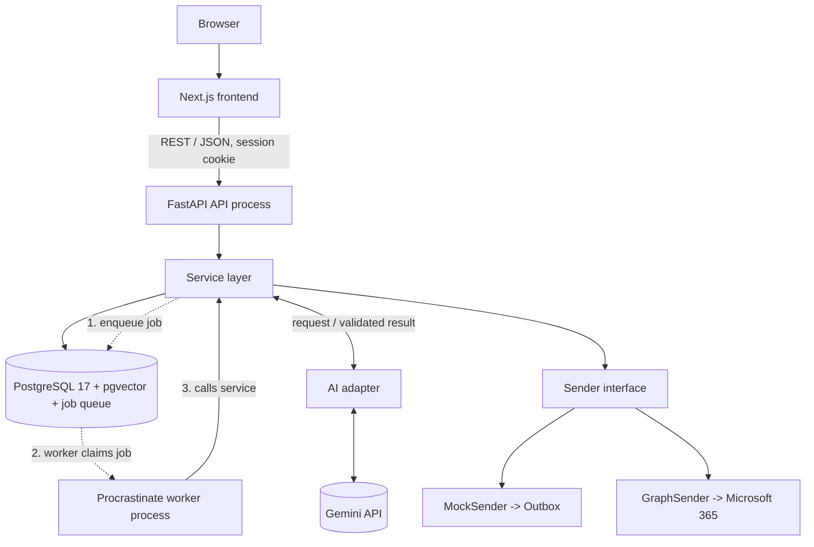
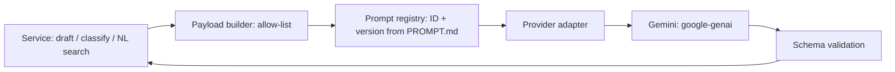

# ARCHITECTURE.md

How Alphaleo BD is built. **Status: planned design, no code exists yet.** Everything below is the target architecture from `docs/plan.md` and `docs/requirements/Q-A.md`; when code lands, change this file to describe what exists and mark the rest "planned". Why decisions were made, the roadmap, open items and test and deploy plans stay in `docs/plan.md`. Folder layout is in `FILE_STRUCTURE.md`.

## 1. Shape of the system

A modular-monolith FastAPI backend, a separate Next.js frontend, and a Procrastinate worker, all on one PostgreSQL 17 database (data, pgvector embeddings and the job queue; no Redis). It runs Mac-native for the MVP.

- **API process:** short requests only. Route handlers validate input (Pydantic v2), check permissions and call services.
- **Worker process:** imports, drafting, scheduler tick (about every minute), mailbox polling (every 3 min, one lock per mailbox), SLA reminders (hourly), embeddings, stuck-message recovery. Tasks are thin wrappers over services.
- **Queue:** there is no direct service-to-worker call. Enqueueing is a database write (service to the PostgreSQL job table); the worker polls the same database and then calls services.
- **Frontend:** screens and forms only; no business rules and no access decisions.

## 2. Modules and responsibilities

Built so far in `core`: the `User` model (`app/core/models.py`) and its migration `0002` (`users` table, `user_role` enum). `core` also has Argon2id password hashing and verification (`app/core/passwords.py`). `core` now also has the `sessions` table (`UserSession` model, migration `0003`); session create, lookup and revoke now exist in `app/core/services.py`; the `current_user` dependency (`app/core/dependencies.py`: cookie to signed-in user, 401 on any failure) exists. Login, logout and `/auth/me` now exist (`POST /auth/login`, `POST /auth/logout`, `GET /auth/me` in `app/core/api.py`; `login()`/`logout()` in `app/core/services.py`; cookie flags in `app/core/cookies.py`): a failed login gives one identical 401 for an unknown email, wrong password or disabled user, and is audited. Validation errors (422) go through one handler (`app/core/errors.py`) that returns only `type`, `loc` and `msg`, so a submitted password is never echoed. The `settings`, `clock_offsets` and `job_locks` tables (`Setting`, `ClockOffset`, `JobLock` models, migration `0005`) exist but nothing reads or writes them yet: the settings service, the link from `core.clock` to `clock_offsets` (and the rule that blocks changing the offset while real sending is active) and the lock acquire/release code are planned (decision record `docs/decisions/0002-2026-11-19-a2-core-tables-decisions.md`). CSRF protection, login throttling, permissions and user management are still planned. The `audit_log` table (`AuditLog` model, migration `0004`, with PostgreSQL triggers rejecting UPDATE, DELETE and TRUNCATE) and `audit.services.record()` exist; `login()` calls `record()` for every failed login (`auth.login_failed`).

Built so far in `leads`: the 16 lead tables only (`app/leads/models.py`, migration `0006`): `companies`, `people`, `person_emails`, `person_phones`, `social_profiles`, `contact_channels`, `quarantine_records`, `duplicate_candidates`, `merge_records`, `segments`, `lead_notes`, `lead_events`, `touches`, `lead_status_flags`, `industry_mappings` and `state_mappings`. Nothing reads or writes them yet: matching, merge, search, quarantine handling, flags and the `uses_salesforce` recompute are planned services. Notable shape: fixed-value columns are VARCHAR plus a named CHECK (not native enums); a person's email is unique per person but may repeat across possible-duplicate records (D-092); "Possible duplicate" is derived from open `duplicate_candidates` rows, not stored on `people`; there is no soft-delete column (erase-person deletes, D-099). `quarantine_records.raw_row_id` (nullable, unique, CASCADE) was added by `0007` with `raw_rows`; the foreign keys on `touches` / `lead_events` `campaign_id` and `outreach_message_id` arrive with the campaigns and outreach tables in `0010` and `0011`.

Built so far in `imports`: the six imports tables only (`app/imports/models.py`, migration `0007`): `source_profiles`, `import_files`, `column_mappings`, `raw_rows`, `import_reports` and `import_changes`. Nothing reads or writes them yet: upload, validation, mapping, the report and the erase-person deletion are planned services. Notable shape: `import_files.sha256` is indexed but not unique, so re-uploading identical content can warn and proceed (D-109), and only the hash is stored, never the file bytes; `source_profiles.layout` is free text with no seed rows because the three layouts are unresolved, and saved mapping defaults live in its JSONB `mapping_defaults` while `column_mappings` records the mapping actually used per file (D-049); `raw_rows` holds the original values as JSON with a PostgreSQL trigger that rejects any UPDATE of the original columns (only `person_id`, the link to the lead, may change; DELETE is allowed for erase-person, D-099), and carries an indexed lowercase `email_normalized` so erase-person can find rows never linked to a person, such as quarantined ones; `import_reports` has the seven D-050 totals as checked integer columns plus a JSONB `failure_reasons`; `import_changes` is the transient per-lead "what changed" summary and is removed with the person. No expiry or cleanup exists for `import_changes`: the retention period is still unresolved (`docs/plan.md` U18). Shared model helpers live in `app/core/model_helpers.py`.

Dependency direction (no upward imports): `core` ← `leads` / `content` ← `compliance` ← `ai` ← `campaigns` ← `outreach` ← `mail` ← `notifications`. `audit` is a leaf that anything may call.

| Module | Owns | Must not |
|---|---|---|
| `core` | Users, roles, central permissions, `now()` clock with test offset, settings store, session auth | contain business rules |
| `imports` | Upload, source profiles, column mapping, raw rows, validation, reports | decide eligibility |
| `leads` | People, companies, matching, merge, search, segments, notes, quarantine, status flags, contact history | send email |
| `compliance` | The single eligibility service, opt-outs, erasure, real-sending gate | create campaigns |
| `content` | Voice, size and industry profiles, email structures, knowledge base, config versions | call the AI |
| `ai` | Provider adapter, payload builders, retrieval, validators, draft, NL search and classify tasks | write to leads or outreach directly |
| `campaigns` | Campaign lifecycle, selection, sequences, review queue, approval | talk to Graph |
| `outreach` | The `outreach_messages` queue, scheduler, limits, retries | build email text |
| `mail` | `Sender` implementations, inbound mail, threading, bounce and unsubscribe detection | contain business policy |
| `notifications` | In-app and email alerts, SLA, dashboard queries | |
| `audit` | Append-only event log | import `core` models, services or passwords |

`imports` writes raw rows, then calls `leads` services to create or merge people and companies. `compliance.check_eligibility()` is the only eligibility logic and is used by `leads` (search), `campaigns` (creation), `ai` and `campaigns` (drafting) and `outreach` (sending).

## 3. Data flow, lead to handled reply

```mermaid
flowchart LR
  A[Import file] --> B[Raw rows + validation]
  B --> C[Quarantine or clean leads]
  C --> D[Match and merge]
  D --> E[Search and filter]
  E --> F[Create campaign]
  F --> G[AI drafts 3 emails]
  G --> H[9 validators]
  H --> I[Rep review and approve]
  I --> J[outreach_messages planned]
  J --> K[Scheduler claims, rechecks, sends]
  K --> L[Reply monitor]
  L --> M[Unsubscribe / bounce rules, then AI classify]
  M --> N[Notify rep and owner, SLA, audit]
```

- **Import:** every row is stored raw and never modified (except by erase-person). Valid rows become `Person` / `Company` records with latest-value-wins merging per field; invalid rows go to quarantine; uncertain matches are imported as "Possible duplicate" and kept out of campaigns until reviewed.
- **Drafting:** all three emails are drafted at campaign start. The app fills fixed sections; the AI supplies only the AI sections.
- **Sending:** approval creates three `OutreachMessage` rows. The scheduler claims due rows with `FOR UPDATE SKIP LOCKED`, rechecks eligibility, opt-out and limits inside the transaction, then sends through `Sender`. Technical failures retry at 30 min, 4 h and 20 h, then Failed. Limits and windows are in `docs/plan.md` section 11.
- **Replies:** each mailbox is polled by delta query. Unmatched mail is dropped without storing; the only exception is a new email with the subject "Unsubscribe" from an address the app emailed (D-080). Order: unsubscribe rule, bounce rule, AI classification; confidence below 0.7 becomes Unclear and stops the sequence (D-094).

## 4. API communication

- REST + JSON. FastAPI generates the OpenAPI schema; the frontend's typed client is generated from it, and CI fails if the client is out of date. The schema is exported to the committed `BD_BACKEND/openapi.json` by `python -m app.export_openapi` (`app/export_openapi.py`); a backend test fails while that file is stale, so it is regenerated in every PR that changes an endpoint.
- Auth: server-side sessions stored in PostgreSQL, delivered as an HttpOnly, Secure, SameSite=Lax cookie. Cookie auth uses an anti-CSRF header plus Origin checks; CORS is limited to the frontend origin. Login is throttled. Login method is password for the MVP (open item U17).
- Authorization: a central permission module, applied by route dependencies and re-checked on object ownership inside services. A role-by-endpoint test fails if a route has no declared permission.
- In production the frontend and API sit behind one reverse proxy on one domain so the cookie is first-party.

## 5. Database relationships (overview)

Full field lists are settled in M1; the three ER diagrams are in `docs/plan.md` section 6.1.

- **Leads side:** `Company` 1—n `Person`; `Person` 1—n `PersonEmail`, `PersonPhone`, `SocialProfile`, `Touch` (contact history, one row per touch on any channel), `LeadStatusFlag`, `LeadNote`, `LeadEvent`; `ImportFile` 1—n `RawRow`; `RawRow` 0..1 `QuarantineRecord`; `Person` n—n `DuplicateCandidate` pairs; `MergeRecord` points to a surviving person. Opt-outs are stored per email address.
- **Campaign side:** `User` 1—n `Campaign`; `Campaign` 1—n `CampaignLead` 0..1 `EmailSequence` 1—3 `EmailDraft` 1—n `ValidationResult`; an approved `EmailDraft` 0..1 `OutreachMessage` 1—n `SendAttempt`; `MailThread` 1—n `OutreachMessage` and `InboundMessage`; `InboundMessage` 0..1 `ReplyClassification`, `BounceRecord`; `Mailbox` 1—n `OutreachMessage`, with one `DeltaCursor`.
- **Content side:** `KnowledgeItem` 0..1 `KnowledgeEmbedding`; `IndustryProfile` n—n `KnowledgeItem`; `EmailStructure` 1—n `StructureSection`; voice, profiles and structures are versioned through `ConfigVersion`.
- **Cross-cutting:** `AuditLog` (append-only), `Setting`, `ClockOffset`, `JobLock`, `ErasureRecord`, `ComplianceGateStatus`.
- Lead data keeps the latest values only (D-008). All timestamps are UTC.

## 6. AI integration

- The rest of the app calls only the adapter, `generate_structured(task, input, schema)`. A provider is swappable by configuration; the model name is set per task in settings.
- Every call names a prompt ID and version from `PROMPT.md`. The provider, model, prompt ID, version, latency and token counts are logged; prompts containing lead data and credentials never are.
- Payloads are built from an allow-list: first name, job title, company name and company-level facts are sent; email addresses, phone numbers and LinkedIn URLs never are. Responses are schema-validated JSON; invalid JSON is a failure.
- Failures (timeout, 429, 5xx) use bounded retries with exponential backoff and jitter, a concurrency cap and a circuit breaker. A draft stays in a retryable state, never half-written. Imports, filter search, sending and reply monitoring continue during an AI outage.
- **Knowledge base and RAG:** items go Draft → Approved → Retired. Approving one queues an embedding job (stored in pgvector). Drafting filters approved items by the lead's size and industry profile, ranks by similarity when more than five remain, and passes at most five. Only approved and embedded items are retrievable.
- **Natural-language search:** the AI receives the typed sentence and the list of supported fields, and returns a filter set. The app drops unknown fields, shows the interpreted filters, and builds the query itself from the filter set. The AI never writes SQL.
- **Validation:** nine deterministic checks run on every draft (list in `docs/plan.md` module L). A failure is regenerated once, then the draft is marked Needs attention.

## 7. Sending and mail

- `Sender` interface: `send()`, `reply_in_thread()`. `MockSender` renders real HTML and text with footer and unsubscribe mailto, generates Message-ID and conversation ID, stores to the Outbox and transmits nothing. `GraphSender` (M7) uses Microsoft Graph application permissions (`Mail.Send`, `Mail.ReadWrite`) limited to a mail-enabled security group, sends from the rep's own mailbox and replies in the original thread.
- Real sending stays off until the admin passes the compliance gate (D-081); until then email goes only to the test-recipient list. A kill switch halts the queue within one scheduler tick.
- Time: all time-dependent code uses `core.clock.now()`, which an admin can offset for testing.
- A message is sent at most once: unique idempotency key, row claiming, send-time recheck, and recovery of messages stuck in "sending" (Graph crash window mitigation is a spike in M5).
