# Alphaleo BD: Implementation Plan

**Status:** DRAFT v0.4 for review. No code has been written; the build starts from scratch. Nothing here is final until you approve it.
**Date:** 12 November 2026
**Change in v0.2:** added end-to-end workflow (section 20), implementation approach (21), testing plan (22), deployment plan (23), post-deployment operations (24) and extra decisions (25).
**Changes in v0.3:** stack changed from Django + HTMX to FastAPI + Next.js (sections 4, 5, 13, 16, 19 and 21 to 24 updated); section 2 (repository inspection) removed, other section numbers unchanged; ER diagram redrawn as three corrected diagrams (6.1); Screens lines removed from modules C and D (section 14); `app.design` pin dependency removed from M1.
**Changes in v0.4:** `docs/requirements/Q-A.md` (decisions D-001 to D-113) adopted as the requirements source of truth. Decision numbers are cited in the text. Main changes: lead change history removed (D-008); channel-agnostic `Touch` history, status flags and Qualified / Handed Off added (D-034, D-065, D-022); erasure now also removes raw rows and keeps the plain opt-out address (D-099); unsubscribe-by-subject exception, Unclear and bounce rules added to reply handling (D-080, D-094, D-096); nine validation checks replaced with Q-CONTENT-09's list; permissions, import rules, size bands, structures, Graph restriction method and AI privacy updated; section 17 and 18 rewritten to show only what is still open.

---

## 0. How to read this draft

### 0.1 Labels

Every statement is one of these. Items marked `[ASSUMPTION]`, `[SUGGESTION]` or `[UNRESOLVED]` need your decision (collected in section 18).

| Label | Meaning |
|---|---|
| `[AGREED]` | Stated in your project brief or decided in `docs/requirements/Q-A.md` (decision numbers cited, e.g. D-008). |
| `[ASSUMPTION]` | My interpretation where the brief is silent or ambiguous. Please confirm or correct. |
| `[SUGGESTION]` | An implementation idea I recommend. You can overrule it. |
| `[UNRESOLVED]` | Depends on information I do not have. I have not invented it. |

### 0.2 What I could and could not see

Supplied: your project brief, and `docs/requirements/Q-A.md` (requirements Q&A, decisions D-001 to D-113, last updated 4 Nov 2026). `docs/requirements/Q-A.md` is the requirements source of truth; it consolidates the BD questionnaire answers (`docs/requirements/BD-Ans-2026-10-23-R1.docx`) and contains Q-CONTENT-07, 08 and 09. No code exists.

**Not supplied:**
- `app.design` (technology decisions, exact package pins, historical progress report through 4 Nov 2026)
- The BD sample file `Agentic Databse.xlsx` (7 sheets, 3 layouts) and a real Apollo CSV export

Consequences:
1. **Package versions** are only the ones named in the brief and your later change of stack (Python 3.12, FastAPI, Next.js, PostgreSQL 17, Procrastinate 3.x). Exact pins must come from `app.design`.
2. Business rules that Q-A does not settle are marked `[UNRESOLVED]` (section 17).

---

## 1. Product understanding

### 1.1 What it is
Alphaleo BD is an internal, standalone web application (own database, no Salesforce API integration) that runs a company's outbound business development from lead list to reply handling. Salesforce is only a searchable and filterable technology attribute on companies. `[AGREED]`

### 1.2 Users
- **Representative:** about five people initially. They own leads and campaigns, review and approve AI drafts, and handle real replies in Outlook.
- **Manager:** sees team campaigns, drafts and statistics. Reviews duplicates. Can remove opt-outs with a reason. Cannot edit others' drafts.
- **Admin:** manages system-wide configuration, content, mailboxes, limits, compliance, and real-sending activation.

### 1.3 Problem solved
Reps spend time on repetitive work: cleaning spreadsheets, finding eligible leads, writing personalized emails, spacing follow-ups, watching inboxes and keeping suppression lists correct. The app automates these while **humans stay in control** (every sequence is reviewed and approved before sending; no auto-send).

### 1.4 End-to-end workflow

```mermaid
flowchart LR
  A[Import files] --> B[Validate and quarantine]
  B --> C[Match and dedupe]
  C --> D[Assign to reps]
  D --> E[Search and filter]
  E --> F[Create campaign]
  F --> G[AI drafts 3 emails + RAG]
  G --> H[Rule validation]
  H --> I[Rep review and approve]
  I --> J[Scheduler and sender]
  J --> K[Reply monitor]
  K --> L[AI classification]
  L --> M[Notifications, follow-up, SLA]
  M --> N[Audit and reporting]
```

### 1.5 How AI and the knowledge base work (plain language)
1. Admins write knowledge items (solutions, case studies, offerings) as Draft. When one is Approved, a background job creates an embedding (Gemini model) stored in PostgreSQL via pgvector.
2. When drafting for a lead, the app picks the matching company-size and industry profiles, retrieves up to five approved, relevant knowledge items, and sends the AI a structured request.
3. The AI returns **structured JSON** for only the AI sections (opening, relevance, follow-up text). The app inserts them into a template that contains protected fixed sections (greeting, CTA, signature, footer).
4. Nine code-based checks validate the result. One automatic retry on failure, then "Needs Attention".
5. Natural-language search uses AI only to translate text into a whitelisted filter set, shown to the user before it runs.
6. AI also classifies replies, with a confidence score and a manual fallback.

### 1.6 Module interaction
- `imports` writes raw rows, then calls `leads` services to create or merge People and Companies.
- `compliance` owns the single eligibility service, used by `leads` (search), `campaigns` (creation), `ai`/`campaigns` (drafting) and `outreach` (sending).
- `content` supplies voice, profiles, structures and knowledge. `ai` consumes it.
- `outreach` owns the queue and scheduler and calls `mail` (MockSender or GraphSender).
- `mail` also supplies inbound messages to the reply pipeline, which calls `ai` for classification and `notifications` for alerts.
- `audit` receives events from everywhere. `core` holds shared utilities (clock, permissions, settings).

---------

## 3. Scope

### 3.1 In MVP (M1–M8) `[AGREED]`
All modules A–T in the brief, delivered in milestone order M1–M8 (section 16).

### 3.2 Explicitly out of the initial MVP `[AGREED]`
A/B testing, Apollo API sync, WhatsApp, LinkedIn, public unsubscribe pages, auto-send, AI reply suggestions, advanced analytics, Docker deployment.

> Note: there is no public web unsubscribe page in the MVP (D-079). Unsubscribe works by reply and by a mailto "Unsubscribe" button. The in-app "Opt-outs" page (a searchable staff list, D-067) is in scope. `[AGREED]`

### 3.3 Nothing silently removed
All functionality in the brief is mapped to a milestone in section 16. Anything I propose to defer is listed in section 18 for your decision.

---

## 4. User roles and permissions

All checks are enforced server-side in a central permission layer (`core.permissions`), never only by hiding buttons. `[AGREED]`

| Capability | Rep | Manager | Admin |
|---|---|---|---|
| Log in / out | ✔ | ✔ | ✔ |
| Import leads (existing source profile) | ✔ (D-104) | ✔ | ✔ |
| View own leads | ✔ | ✔ | ✔ |
| View all leads, with who contacted them and when | ✔ (D-001, D-026) | ✔ | ✔ |
| Assign / reassign leads (Unassigned pool) | ✖ | ✔ (D-075) | ✔ |
| Edit own campaigns / drafts | ✔ (owner only) | ✖ | ✖ |
| View others' campaigns and drafts | ✖ | ✔ (read-only) | ✔ (read-only) |
| Approve / reject drafts | owner only | ✖ | ✖ |
| Quarantine fix / release | ✔ | ✔ | ✔ |
| Quarantine discard | importer only | ✔ | ✔ |
| Set Qualified / Handed Off on any lead (logged) | ✔ (D-101) | ✔ | ✔ |
| Create / edit source profiles and industry / state mappings | ✖ | ✖ | ✔ (D-104) |
| Duplicate review (merge / not-a-duplicate) | ✖ | ✔ | ✔ |
| Remove opt-out (reason required) | ✖ | ✔ | ✔ |
| Erase person | ✖ | ✖ | ✔ (D-099) |
| Edit voice / profiles / KB / structures | read-only | read-only | ✔ |
| Sending limits, mailboxes, users, test clock | ✖ | ✖ | ✔ |
| Activate real sending | ✖ | ✖ | ✔ (compliance gate) |
| Private / shared segments | create own, may share with team (D-098) | same | all |
| CSV export (search results, campaign results) | ✔ (audited, within own visibility, D-087) | ✔ | ✔ |
| Download import quarantine / change-summary files | importer only (audited, D-111) | ✔ | ✔ |

All rows are `[AGREED]` from the brief or Q-A. Auto-send is deferred (D-019, D-091). A manager-granted per-rep auto-send permission is a later phase.

Design: individual accounts with the role stored on the user. Permission helpers such as `can_edit_campaign(user, campaign)`, used by FastAPI route dependencies, services and tests. Object-level checks on every service entry point, not just route handlers. The Next.js frontend may hide buttons for convenience but is never trusted for access control. `[SUGGESTION]`

---

## 5. Architecture

### 5.1 Principles `[AGREED]`
- Modular monolith backend (one FastAPI project, clear module boundaries) plus one Next.js frontend. The frontend contains no business rules.
- Business logic in service functions. Route handlers and background tasks are thin.
- API process = short requests. Worker process = long and scheduled work. Next.js serves the UI and calls the API.
- Transactions, row locking and crash recovery where state can be corrupted.
- PostgreSQL only: data, pgvector and the Procrastinate job queue. No Redis, no separate vector DB.
- Mac-native for MVP (Homebrew PostgreSQL + Python virtualenv + Node.js). Docker deferred.

### 5.2 Technology stack

| Layer | Choice | Source |
|---|---|---|
| Language | Python 3.12 (backend), TypeScript (frontend) | brief, updated |
| Backend API | FastAPI, Uvicorn, Pydantic v2 for request and response schemas | updated brief |
| Frontend | Next.js (App Router), React, TypeScript | updated brief |
| ORM and migrations | SQLAlchemy 2.x, Alembic | `[SUGGESTION]` |
| API contract | REST + JSON, OpenAPI schema generated by FastAPI, typed TypeScript client generated from it | `[SUGGESTION]` |
| DB | PostgreSQL 17, pgvector, psycopg 3 | brief |
| Jobs | Procrastinate 3.x (PG queue) | brief |
| AI | Google Gemini via `google-genai`, provider-independent adapter, structured JSON output, model configurable per task | brief |
| Mail | Microsoft Graph (app permissions `Mail.Send`, `Mail.ReadWrite`); MockSender locally | brief |
| Excel | openpyxl | brief |
| Tests / lint | Backend: pytest, httpx / FastAPI TestClient, ruff. Frontend: tsc, ESLint, Vitest, Playwright | pytest and ruff from brief; frontend tools `[SUGGESTION]` |
| Config | env vars, `.env` (backend and frontend each), `DATABASE_URL` | brief |
| Exact pins | **from `app.design`** | `[UNRESOLVED]` |
| Auth against Graph | Likely MSAL client-credentials. Library not named in brief | `[SUGGESTION]` |

### 5.3 System diagram

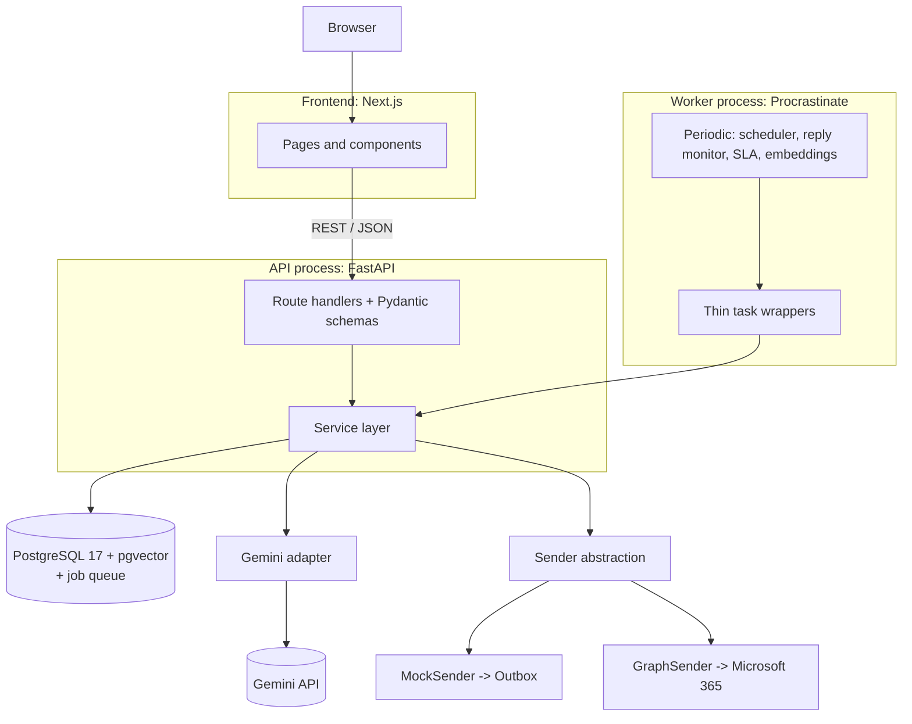

### 5.4 Proposed folder structure `[SUGGESTION]`

The maintained layout, and where new files go, is in `FILE_STRUCTURE.md`; the running description of the architecture is in `ARCHITECTURE.md`. The tree below is the original proposal, adapted to the real folder names `BD_BACKEND` and `BD_FRONTEND`.

```
BD ASSISTANT/                  # project root
├── Makefile                  # make check: ruff, pytest, tsc, eslint, frontend tests
├── BD_BACKEND/
│   ├── pyproject.toml        # deps + ruff + pytest config
│   ├── .env.example          # no real secrets; .env is git-ignored
│   ├── alembic.ini
│   ├── migrations/           # Alembic revisions
│   ├── app/
│   │   ├── main.py           # FastAPI app, router registration
│   │   ├── config.py         # settings from env (fail fast if missing)
│   │   ├── db.py             # engine, session, base model
│   │   ├── worker.py         # Procrastinate app and task registration
│   │   ├── core/             # users, roles, permissions, clock (test clock), settings store,
│   │   │                     #   pagination, CSV utils, session auth
│   │   ├── imports/          # files, source profiles, mapping, raw rows, validation, reports
│   │   ├── leads/            # Person, Company, emails, phones, matching, merge, search,
│   │   │                     #   segments, notes, quarantine, timeline
│   │   ├── compliance/       # eligibility service, opt-outs, erasure, compliance gate
│   │   ├── campaigns/        # campaigns, selection, sequences, review queue, per-lead status
│   │   ├── content/          # voice, profiles, structures, knowledge base, versions
│   │   ├── ai/               # provider adapter, tasks (draft, NL search, classify), prompts,
│   │   │                     #   payload builders, validators (9 checks), retrieval
│   │   ├── outreach/         # outreach_messages queue, scheduler, limits, retries, completion estimates
│   │   ├── mail/             # Sender interface, MockSender, GraphSender, outbox, reply monitor,
│   │   │                     #   threading, bounce / unsubscribe detection
│   │   ├── notifications/    # in-app + email notifications, SLA reminders, dashboard queries
│   │   └── audit/            # audit log, history
│   │                         # each module: models.py, schemas.py, services.py, api.py (router)
│   └── tests/                # mirrors app/, plus integration and e2e-style flows
└── BD_FRONTEND/
    ├── package.json
    ├── next.config.ts
    ├── .env.local.example    # API base URL only; no secrets
    ├── src/
    │   ├── app/              # routes (App Router): login, leads, campaigns, review, outbox, admin ...
    │   ├── components/       # shared UI (tables, filter chips, forms, email preview)
    │   └── lib/api/          # typed client generated from the FastAPI OpenAPI schema
    └── tests/                # component tests (Vitest) and Playwright journeys
```

### 5.5 Module responsibilities

| Module | Owns | Must not |
|---|---|---|
| `core` | Auth, roles, permissions, `now()` clock, shared API utilities | contain business rules |
| `imports` | Upload to raw rows to mapped rows, reports | decide eligibility |
| `leads` | People, companies, matching, merge, search, segments | send email |
| `compliance` | Eligibility, opt-outs, erasure, gate | create campaigns |
| `campaigns` | Campaign lifecycle, selection, review, approval | talk to Graph |
| `content` | Voice, profiles, KB, structures, versions | call the AI |
| `ai` | Provider calls, prompts, validators, retrieval | write to leads/outreach directly |
| `outreach` | Queue, scheduler, limits, retries | build email text |
| `mail` | Sender implementations, inbound mail, threading | contain business policy |
| `notifications` | Alerts, SLA, dashboards | |
| `audit` | Append-only event log | |
| `frontend` (Next.js) | All screens, forms, display of API data | contain business rules or make access decisions |

Dependency direction (to avoid cycles): `core` ← `leads`/`content` ← `compliance` ← `ai` ← `campaigns` ← `outreach` ← `mail` ← `notifications`. `audit` is a leaf that everything may call. `[SUGGESTION]`

---

## 6. Data model

### 6.1 Entity-relationship overview

The model is shown as three diagrams so each stays readable. `USER`, `PERSON` and `MAILBOX` appear in more than one diagram and are the same entities. Reading rule: `A ||--o{ B` means one A has zero or more B.

**6.1a Users, import, leads and compliance**

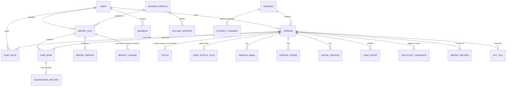

**6.1b Campaigns, sending and replies**

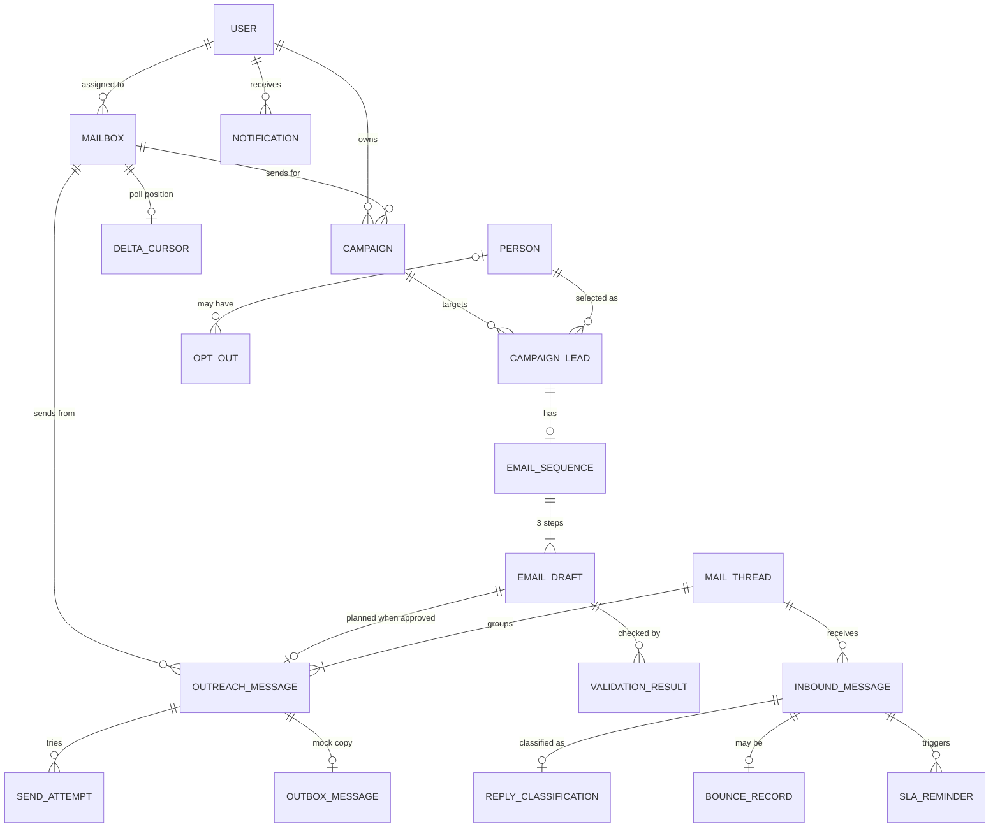

**6.1c Content and AI configuration**

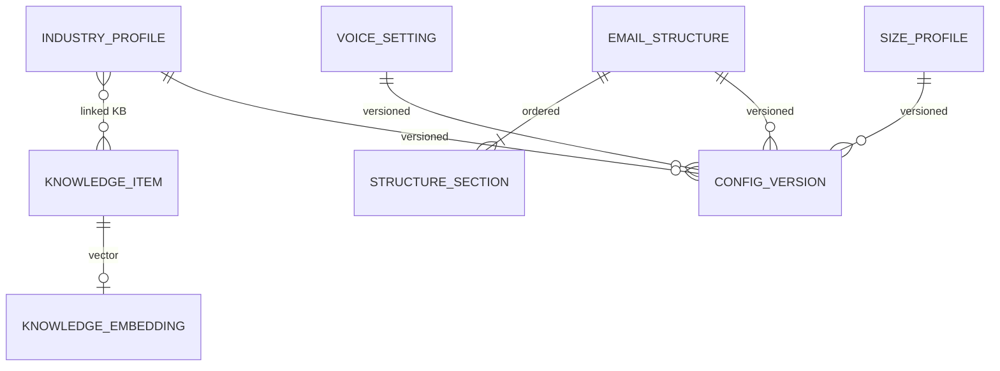

Not drawn because they have no direct relations or touch everything: `AuditLog`, `Setting`, `ClockOffset`, `JobLock`, `IndustryMapping`, `StateMapping`, `ErasureRecord` (kept after the person is gone), `ComplianceGateStatus` / `ComplianceChecklistItem`, `EligibilitySnapshot`. `QuarantineRecord`, `DuplicateCandidate` and `MergeRecord` are shown on the lead side only.

### 6.2 Entities by app (key fields only; full field list to be settled in M1)

**core:** `User` (role, active), `Setting` (key, typed value, version), `ClockOffset` (admin test clock), `JobLock`.

**imports:** `ImportFile` (sha256, filename, uploader, source_profile, default_country, worksheet, status, counts), `SourceProfile` (layout, mapping defaults) `[three layouts UNRESOLVED]`, `ColumnMapping`, `RawRow` (file, row number, **original values as JSON, never modified except by erase-person, D-099**), `ImportReport` (totals, reason-coded failures, and a transient per-import "what changed" summary, `ImportChange`, D-050).

**leads:** `Company` (apollo_account_id, domain, normalized_name, industry, NAICS, SIC, employees, revenue, funding stage/amount/date, technologies[], keywords[], HQ, founded_year, `uses_salesforce` derived from technologies, latest funding round type, total funding, name-derived flag; **latest values only, no change history, D-008**), `Person` (source_record_id, name, title, seniority, department, location, owner, lead_status, linkedin_url, company FK), `PersonEmail` (address, normalized, type work/personal/generic, verification, primary), `PersonPhone`, `SocialProfile`, `ContactChannel` (generic channels such as info@), `QuarantineRecord` (issues[], status, editable payload), `DuplicateCandidate` (pair, reason, status: open/merged/not-duplicate), `MergeRecord` (survivor, absorbed, snapshot for history), `Segment` (filters JSON, private/shared, owner), `LeadNote` (colleague activity notes), `LeadEvent` (timeline), `Touch` (channel, direction, rep, status, timestamps; email only in v1, designed for WhatsApp / LinkedIn later, D-034), `LeadStatusFlag` (existing customer, in conversation, partner, competitor, Qualified, Handed Off to Sales; with who and when; D-065, D-022), source engagement fields on `Person` (last contacted, sent / opened / bounced / replied / demoed, stage, lists as tags, intent signals stored but unused; D-063, D-073, D-074), `IndustryMapping` (standard NAICS-sector list, D-076), `StateMapping`.

**compliance:** `OptOut` (stored per email address, D-066; source: manual/imported/reply, created_by, removed_at, removal_reason, removed_by), `EligibilitySnapshot` (optional, for explaining past decisions) `[SUGGESTION]`, planned and not built in M1 A5 (no requirement needs it yet), `ComplianceGateStatus` / `ComplianceChecklistItem` (items defined by D-081), `ErasureRecord` (the erased person's address stays on the opt-out list, D-099).

**content:** `VoiceSetting`, `SizeProfile`, `IndustryProfile` (pain points, offerings, tone, avoid, example phrases, linked KB), `KnowledgeItem` (type, body, status draft/approved/retired, size/industry tags), `KnowledgeEmbedding` (vector, model name, dimension, content hash), `EmailStructure` + `StructureSection` (order, fixed vs AI, content, limits), `ConfigVersion` (snapshot, author, timestamp, restore support).

**campaigns:** `Campaign` (owner, mailbox, sequence config, target completion date, status), `CampaignLead` (eligibility result, exclusion reason), `EmailSequence` (status: generating / ready / needs_attention / approved / rejected), `EmailDraft` (step, ai_sections JSON, final render, validation status, edit history), `ValidationResult` (check id, status, message).

**outreach:** `OutreachMessage` (the persistent queue; status, scheduled_for, planned vs scheduled, defer_reason, attempts, next_retry_at, idempotency_key, mailbox, thread link, claimed_by/claimed_at), `SendAttempt` (error class, timestamps), `Mailbox` (address, owner, daily/hourly counters derived).

**mail:** `MailThread` (conversation id, internet message ids), `OutboxMessage` (mock: html, text, headers), `InboundMessage` (matched only), `DeltaCursor` (per mailbox delta token), `ReplyClassification` (category, confidence, model, handled flag, handled_by/at), `BounceRecord`.

**notifications:** `Notification` (user, type, link, read_at), `SlaReminder`.

**audit:** `AuditLog` (actor, action, object, before/after summary, ip, timestamp). Append-only.

### 6.3 Key modeling decisions
- **Two data layers** `[AGREED]`: `RawRow` is immutable; only erase-person (D-099) removes raw rows. Unified data lives in `Person`/`Company` and keeps the latest values only (D-008).
- **Email addresses** in their own table because people can have several and verification differs. `[AGREED]`
- **Soft state, not hard deletes** for leads, except the erase-person flow. `[SUGGESTION]`
- **Versioning** of voice, profiles and structures via `ConfigVersion` snapshots. `[AGREED]`
- **Vector column** sized to the configured Gemini embedding model. Store model name and dimension with each vector so a model change forces re-embedding. `[SUGGESTION]`

---

## 7. Main service functions (signatures indicative)

```
imports.services:   register_file(), detect_duplicate_file(), build_preview(), validate_rows(),
                    estimate_import(), process_import(), build_report()
leads.services:     match_person(), match_company(), merge_fields(), upsert_person(),
                    derive_company_name(), find_possible_duplicates(), merge_people(),
                    mark_not_duplicate(), assign_owner(), release_from_quarantine(),
                    account_engagement(), set_status_flag(), build_change_summary(),
                    apply_source_engagement()
leads.search:       apply_filters(), parse_nl_query() -> FilterSet, export_csv()
compliance:         check_eligibility(person, context) -> EligibilityResult(reasons[]),
                    eligible_queryset(), record_opt_out(), remove_opt_out(), erase_person(),
                    compliance_gate_status()
campaigns.services: create_campaign(), select_leads(), count_exclusions(), pause(), resume(),
                    estimate_completion(), approve_sequence(), undo_approval(), reject_sequence()
ai.services:        draft_sequence(), regenerate(), retrieve_knowledge(), run_validators(),
                    classify_reply()
content.services:   approve_item(), retire_item(), resolve_profiles(), snapshot_config(), restore_default()
outreach.services:  plan_messages(), claim_due_messages(), send_message(), defer(), schedule_retry(),
                    recover_stuck_messages(), enforce_limits()
mail.senders:       Sender.send(), Sender.reply_in_thread(), MockSender, GraphSender
mail.monitor:       poll_mailbox(), detect_unsubscribe(), detect_bounce(), match_thread(), store_inbound()
notifications:      notify(), sla_sweep(), dashboard_stats()
audit:              record()
core.clock:         now()   # the only permitted source of "current time"
```

---

## 8. Background job design

All tasks are thin wrappers that call services. Procrastinate with PostgreSQL queue. `[AGREED]`

| Job | Trigger | Notes |
|---|---|---|
| `process_import` | upload confirmed | Chunked, resumable, progress stored. Per-row errors never fail the file. |
| `generate_embedding` | KB item to Approved | Retries with backoff. Failed items stay non-retrievable. |
| `draft_sequence` | campaign created / regenerate | One job per lead. Rate-limit aware. One auto-retry on validation failure. |
| `scheduler_tick` | periodic (every minute `[SUGGESTION]`) | Claims due messages with `SELECT … FOR UPDATE SKIP LOCKED`. |
| `send_message` | from tick | Rechecks eligibility, opt-out and limits immediately before send. |
| `poll_mailboxes` | every 3 min `[AGREED]` | One lock per mailbox so polls never overlap. |
| `classify_reply` | inbound stored | Unsubscribe and bounce detection run first, before AI. |
| `sla_reminders` | hourly `[AGREED]` | Reminders until handled. |
| `recover_stuck` | periodic | Resets messages stuck in "sending" past a timeout (see 11.3). |
| `send_notification_email` | notification created | |

**Duplicate-job prevention:** Procrastinate queueing locks keyed on object ID, plus DB state checks inside services (idempotent by design). `[SUGGESTION]`

---

## 9. AI integration architecture

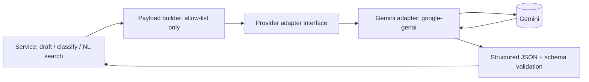

- **Adapter interface:** `generate_structured(task, input, schema) -> validated dict`. A different provider can be added later without touching services. `[AGREED]`
- **Model per task:** draft, NL-to-filters, classification, embeddings each have their own configured model name (settings, not code). `[AGREED]`
- **Structured output:** every response is JSON validated against a schema. Invalid JSON counts as a failure, not text to be used.
- **Privacy (hard rule):** payload builders use an **allow-list**. Emails, phone numbers and LinkedIn URLs are never included. `[AGREED]` First name, job title, company name and company-level facts are sent, because the validators check name and company matches (D-086, Q-DESIGN-07). Development uses a free-tier Gemini key on hand-selected test data only; a paid key is required before any real prospect data, and the provider's data-use terms are reviewed before go-live (D-062). `[AGREED]`
- **NL search:** AI receives only the typed sentence and the list of supported filter fields and allowed values, and returns a filter JSON. Unknown fields are dropped and reported. It cannot produce SQL; the app builds queries from the filter set only. The user sees and edits the interpreted filters before execution. `[AGREED]`
- **Reply classification** sends reply text, which may contain personal data (signatures, phone numbers). I suggest stripping quoted history and signature blocks and redacting emails and phone numbers before sending. `[SUGGESTION]` (Decision needed: Q-A confirms reply text goes to the AI but says nothing about redaction, and rule 3 forbids contact details.)
- **Failure handling:** timeouts, 429 and 5xx handled by bounded retries with exponential backoff and jitter, a concurrency cap, and a clear "AI unavailable" state. The draft stays in a retryable state, never half-written. A circuit breaker pauses AI calls during an outage. `[AGREED]` (rule 12), mechanism `[SUGGESTION]`.
- **Observability:** log task name, model, latency, token counts and error class. Never log prompts containing lead data or any credentials. `[AGREED]` (rule 14)

---

## 10. Knowledge base and RAG flow

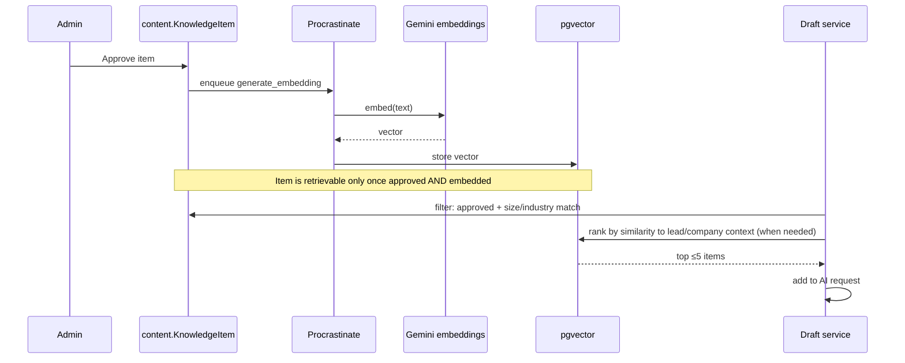

Rules:
1. Lifecycle: Draft → Approved → Retired. Only Approved items are retrievable. `[AGREED]`
2. Approval triggers an embedding job. `[AGREED]`
3. Retrieval: filter by matching profiles, then rank by similarity "when required", maximum five items. `[AGREED]` What "when required" means is `[UNRESOLVED]`. `[ASSUMPTION]` Rank by similarity only when more than five candidates remain.
4. Editing an approved item changes its content hash. `[SUGGESTION]` Return it to Draft or re-embed, so vectors never go stale. (Decision in 18.)
5. Retiring removes it from retrieval immediately.
6. pgvector index (HNSW or IVFFlat) is likely unnecessary at MVP volumes. Start with exact search and add an index when needed. `[SUGGESTION]`

---

## 11. Email sending architecture

### 11.1 Layers
`campaigns` approves the sequence, then `outreach.plan_messages` creates three `OutreachMessage` rows (Planned/Scheduled), then the scheduler claims due rows, then `send_message` rechecks, builds the final email and calls `mail.Sender`.

### 11.2 Scheduling rules (defaults from brief) `[AGREED]`
- Max 3 emails per person per 30 days
- Min 2 business days between emails to the same person
- 90-day cooling-off before a new campaign to the same person
- Max 2 people per company per day
- Max 30 per mailbox per day; max 8 per mailbox per rolling hour (defaults; the admin raises them gradually, D-083)
- Mon–Fri, 09:00–17:00 in the prospect's time zone, falling back to the rep's time zone when location is unknown; no holiday calendar (D-014, D-083)
- Step 1 on day 0; step 2 on business day 3; step 3 on business day 7, counted from the first email (D-082)
- When a cap is reached, due follow-ups go before new first emails, then oldest first (D-082). The 90-day cooling-off applies to entering a new campaign, not to follow-ups
- All three emails of a sequence are drafted at campaign start and reviewed together (D-090). Pausing requires an explicit resume (D-015)
- Retries after technical failures at 30 min, 4 h, 20 h, then Failed (notify rep)

Limits are global admin settings with no per-campaign override in the MVP. Saving conflicting settings (for example a sequence longer than the contact limit) shows a warning and asks for confirmation. Opt-outs are always enforced, whatever the settings (D-083). `[AGREED]`

**Settled by Q-A:** time-zone fallback is the rep's; there is no holiday calendar; follow-ups count toward the 3-per-30-days limit and the 90-day cooling-off applies only to entering a new campaign (D-082, D-083). Time zone is derived from the lead's city, state and country, with a default country set per import (D-078). "Business day 3" counts from step 1's actual send date `[ASSUMPTION]`.

**Volume target `[UNRESOLVED]`:** BD wants about 800–1,000 emails per day per mailbox and a full campaign, follow-ups included, within one week (D-029). With the default sequence the last follow-up goes out about 9 calendar days after step 1, so the one-week target cannot be met, and the completion estimate must say so. The 800–1,000 per day figure needs validation against Microsoft 365 tenant policy and cold-email deliverability practice before it becomes a requirement. Defaults stay at 30 per day and 8 per hour.

### 11.3 Safety mechanisms
- `outreach_messages` is the only outgoing queue. `[AGREED]`
- **Claiming:** row lock with `SKIP LOCKED`, set status `sending`, record `claimed_at`.
- **Idempotency key** per message, unique-constrained. Mock outbox and Graph both keyed on it.
- **Send-time recheck** by calling the same `check_eligibility()` plus limit enforcement inside the transaction. Failing means the message is **deferred with a reason**, or cancelled if permanently ineligible (e.g. opt-out, reply received).
- **Crash window:** a worker may die after Graph accepts a message but before the DB commit. To avoid a duplicate, I suggest creating the message as a Graph draft first and saving its ID, then sending, and having `recover_stuck` check Sent Items for that ID before retrying. `[SUGGESTION]` Needs a spike in M7.
- **Pause/resume:** pausing flips pending rows to a held state. Resume re-plans from "now", respecting spacing.
- **Completion estimate:** simulated forward pass of the scheduler against limits and the target completion date, with a warning if the target is unreachable.

### 11.4 Senders
- `Sender` interface: `send()`, `reply_in_thread()`.
- `MockSender` (first): builds real final HTML and plain text, with footer and unsubscribe `mailto`, generates Message-ID and conversation ID, keeps follow-up threading, stores in Outbox, shows the email as recipients see it. **Transmits nothing.** `[AGREED]`
- `GraphSender` (M7): app permissions `Mail.Send`, `Mail.ReadWrite`, restricted to an approved mail-enabled security group (Exchange Online RBAC for Applications, with application access policies as the fallback; configured on the Microsoft side, D-057), sends from the rep's own mailbox, replies in the original thread. `[AGREED]` Microsoft 365 code stays inside `mail/`.
- **Test clock:** an admin-only offset applied by `core.clock.now()`. All time-dependent code uses it. `[AGREED]` I suggest disabling it when real sending is active. `[SUGGESTION]`
- **Selecting sender:** a setting, with real sending guarded by the compliance gate (M8).

---

## 12. Reply monitoring architecture

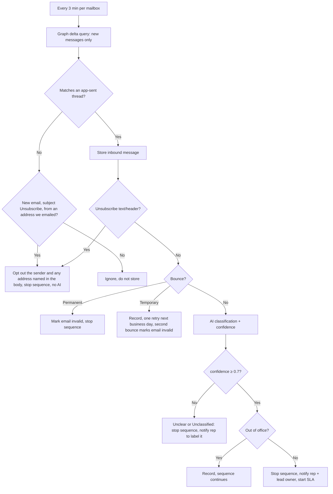

- Categories: Interested, Not now, Not interested, Out of office, Wrong person, Unsubscribe. Plus Unclear for low confidence. `[AGREED]`
- Threshold default 0.7, admin-adjustable. If the AI is unavailable the reply is saved as "Unclassified" with the same safe handling. `[AGREED]` (D-094)
- Alerts go to the sending rep and, if different, the lead owner, in-app and by email. Managers see replies in their overview without individual alerts. `[AGREED]` (D-095)
- Matching uses conversation ID, `In-Reply-To`/`References` headers, and a custom message header. Unmatched mail is dropped without storing body. `[AGREED]` (rule 13) The only exception is the fixed unsubscribe rule (D-080): a new email with the subject "Unsubscribe" from an address the app has emailed.
- SLA: same-business-day follow-up, hourly reminders until handled. `[AGREED]` Exact rule for replies arriving late in the day or at weekends `[UNRESOLVED]`.
- Reply-based opt-out: the fixed rule above, keyword rules before AI, and a confident "Unsubscribe" category. Every email footer says "Reply with 'unsubscribe' to opt out" and carries an "Unsubscribe" button that opens a pre-filled email to the sending rep's mailbox (D-079). `[AGREED]`
- Real customer replies are answered in Outlook, not in the app. The app shows the reply with its thread and a link to open it in Outlook, and the rep marks it handled (D-105). `[AGREED]` The "Simulate reply" screen injects a fake inbound message through the same pipeline, available only when MockSender is active. `[ASSUMPTION]`
- Delta cursors are stored per mailbox. Token expiry or reset triggers a safe full resync limited to the app's threads.

---

## 13. Authentication and authorization design

- Individual accounts, login and logout. `[AGREED]` Implementation: passwords hashed with argon2, server-side sessions stored in PostgreSQL, delivered to the browser as an HttpOnly, Secure, SameSite=Lax cookie. `[SUGGESTION]` (JWTs are not needed for a single first-party frontend.)
- Login method (password only? Microsoft 365 SSO?) `[UNRESOLVED]`. `[ASSUMPTION]` Password login for MVP, with a note that SSO could be added later.
- Roles: Representative, Manager, Admin. `[AGREED]`
- Central permission module. FastAPI route dependencies (for example `Depends(require_permission(...))`) call it. Services re-check object ownership so a background job or a different route cannot bypass rules. Next.js route guards are only a UX convenience; the API enforces access.
- Tests: a role-by-endpoint matrix test that fails if a new API route is added without a declared permission. `[SUGGESTION]`
- Session security: secure cookies, CSRF protection for cookie auth (anti-CSRF token header sent by the Next.js client, plus Origin checks), CORS limited to the frontend origin, lockout or throttling on login. `[SUGGESTION]`
- Secrets only in environment/`.env` (git-ignored). Graph and Gemini credentials never stored in the DB in plain text. Mailbox configuration in the DB stores identifiers only. `[AGREED]`

---

## 14. Feature breakdown by module

Format per module: **Screens** / **Backend** / **DB** / **Rules** / **Jobs** / **AI** / **Integrations** / **Tests**.

### A. Authentication and user management (M1)
- **Screens:** login, logout, user list and edit (admin), "my profile".
- **Backend:** auth, role checks, assignment helpers.
- **DB:** `User`, role, `Mailbox` link.
- **Rules:** server-side enforcement everywhere. Owner-only draft editing.
- **Jobs / AI / Integrations:** none.
- **Tests:** role × endpoint matrix; owner-only edit; manager read-only.

### B. Lead import (M2)
- **Screens:** upload, worksheet picker, source profile, default country, column mapping, missing-header fix, preview, estimate, progress, report, CSV download.
- **Backend:** SHA-256 duplicate-file check (warn with the earlier date and user; cancel or import anyway, D-109), CSV/XLSX (openpyxl) up to 50,000 rows or 20 MB, one sheet per import (D-110), Apollo layout, three predefined layouts (needs the sample xlsx) `[UNRESOLVED]`, row validation, chunked processing. Source-owner names map to app users; unmatched leads go to the Unassigned pool (D-075). Source engagement history is applied per D-073 (do-not-contact becomes opt-out, bounced marks email invalid, replied excludes from new campaigns, recent contact starts cooling-off).
- **DB:** `ImportFile`, `SourceProfile`, `ColumnMapping`, `RawRow`, `ImportReport`.
- **Rules:** raw rows are immutable. Bad rows never reject the whole file.
- **Jobs:** `process_import`.
- **Tests:** duplicate file, missing headers, mixed valid and invalid rows, large file, raw-data preservation.

### C. Validation and quarantine (M2)
- **Rules:** only two mandatory fields: a valid work email and a first name (D-069). Rows whose only email is personal or free-mail, generic role addresses (info@, sales@) and badly formatted emails go to quarantine, where BD can add a work email, release or discard (D-072, D-107). Never reject a whole file (D-068). Missing industry becomes "Unknown", not quarantined (D-070). Missing company name is derived from the work-email domain and marked derived (D-071). Apollo-unverified emails stay eligible with a warning (D-042). Secondary, tertiary and personal emails are stored but never used for outreach. `[AGREED]` The lists of personal domains and generic prefixes are still `[UNRESOLVED]`. `[SUGGESTION]` Make them admin-editable settings.
- **Resolved:** a valid person with only an unusable email is quarantined (Q-IMPORT-17, Q-IMPORT-20).
- **Tests:** each quarantine reason, release revalidates, discard audited.

### D. Matching and deduplication (M2)
- **Rules:** person match order: source record ID → normalized email → LinkedIn URL → name + company domain. Company: Apollo Account ID → domain → normalized name. Latest-source-wins merge at field level. Latest values only, no change history (D-008); each import shows a one-time "what changed" summary (D-050). Uncertain matches are imported as separate "Possible duplicate" records, excluded from campaigns until a manager or admin merges them or marks them "not a duplicate" (D-092). A merge pre-selects the most recent value per field (editable), keeps all email addresses, and combines campaign history and timelines (D-108). `[AGREED]`
- **Assumptions:** "latest" means latest import time, and blank incoming values do not erase existing data. `[ASSUMPTION]` Name + domain matches only produce a *possible* duplicate, not an automatic merge. `[ASSUMPTION]` Confidence scoring `[UNRESOLVED]`.
- **Tests:** each match path, merge precedence, merge keeps all emails and combined timelines, "not a duplicate" is remembered.

### E. Lead and company management (M1 model, M3 screens)
- **Screens:** lead detail (timeline, emails, notes, history), company detail.
- **DB:** people, companies, emails, phones, social profiles, channels.
- **Rules:** multiple emails per person; generic contact-channel records separate from person emails.
- **Status:** "Qualified" and "Handed Off to Sales", settable by any BD user and logged; status flags existing customer, in conversation, partner, competitor (D-022, D-065, D-101). Contact history (who contacted the lead, when, status) is visible to every rep, and a note shows when a colleague is already engaging the same company (D-026, D-027). `[AGREED]` Any further lead status values remain `[UNRESOLVED]`.
- **Tests:** model constraints, multi-email handling.

### F. Lead search (M3)
- **Screens:** filter panel (multi-select checkboxes), active-filter chips, results with pagination, select one / select all matching, segments (private/shared), notes, CSV export, "add to campaign", NL search with interpreted-filter confirmation.
- **Backend:** single `FilterSet` definition used by form, saved segments, and AI output. Query built only from that definition.
- **AI:** NL to filters (see section 9).
- **Rules:** the default view shows every lead except opted-out ones, with badges for cooling-off, replied, possible duplicate and unverified email; "Eligible only" is a filter that is off by default and "Show opted-out" reveals them (D-106, D-067). Filters include industry, company size, location, job title, tech stack, revenue, funding stage and Salesforce usage (D-025, D-063). Unsupported fields rejected. "Select all matching" stores the *filter*, with the lead set resolved at campaign time, so counts are not stale. `[SUGGESTION]`
- **Tests:** each filter, combined filters, NL parser rejects invented fields, select-all semantics, export permissions and audit.

### G. Eligibility and compliance (M3)
- **Rules:** checks for opt-out, invalid email, previous reply, cooling-off, contact limits, possible-duplicate status, Qualified / Handed Off status. There is no separate customer or competitor suppression list; BD filters on status flags, and opt-outs are the only enforced suppression (D-065, D-066). One service used in search, campaign creation, drafting and sending. `[AGREED]`
- **Technical risk:** search needs a bulk (SQL) version of the rules, while sending needs a per-lead version. Two implementations can drift. `[SUGGESTION]` Define each rule once as a pair (queryset expression + record check), with a parity test that compares both across generated data.
- **Features:** manual, imported and reply opt-outs; manager/admin removal with reason (audited); any BD user can add an opt-out; Opt-outs page (searchable: date, reason, source), "Opted out" badge, lead-detail banner and campaign-builder exclusion counts (D-067); footer and mailto Unsubscribe button (D-079); erase-person.
- **Real-sending gate (D-081):** the admin can switch on real sending only when Microsoft 365 sending is connected, a working unsubscribe has been tested, the footer wording is saved and the postal address is saved. Until then email goes only to an admin-maintained test-recipient list. Activation is audited.
- **Erasure (D-099):** removes the person's details from leads, the original imported rows, and stored emails and replies, but keeps the email address on the opt-out list so it is never contacted again, including through future imports. Each erasure is audited. `[AGREED]` Retention periods for other data remain `[UNRESOLVED]`.
- **Tests:** every reason code, no-bypass tests at each call site, send-time recheck, removal needs reason.

### H. Campaign management (M4 creation, M5 operation)
- **Screens:** create wizard (leads, exclusion counts, mailbox (set by the admin per campaign, default the rep's own, D-002 / D-013), sequence, target date, estimate), list, detail, pause/resume, per-lead status, sending history, results CSV.
- **Rules:** owner-only edit/approve/reject. Managers view only.
- **Tests:** ownership, exclusion counts match eligibility, pause/resume, estimate.

### I. AI email generation (M4)
- **Backend:** structure composer. Ordered sections, fixed vs AI. Fixed text is substituted by the app and is never sent for AI rewriting. Default structures (D-084, Q-CONTENT-07): first email 80–120 words (subject by AI, 60 characters or fewer; greeting "Hi {first name}," fixed; opening 1–2 sentences, relevance 2–3 sentences, optional proof point from approved KB only; fixed call to action, signature with rep name, title, Alphaleo and phone, and footer). Follow-up 1: 70 words or fewer, same thread, new angle, softer fixed call to action. Follow-up 2: 50 words or fewer, same thread, short close plus the fixed line "If this isn't a priority, just let me know and I won't follow up." The admin edits structures and can restore defaults. The first email's 80–120 target is under review (Q-CONTENT-14, open): outside the range is a warning, not a block.
- **AI inputs:** lead facts (without contact details), company facts, voice, size and industry profiles, ≤5 knowledge items, word limits, offerings. Output: JSON with AI sections only.
- **Tests:** fixed sections never alter, schema validation, retry logic, provider outage behaviour (with a fake provider).

### J. Knowledge base and RAG (M4)
- **Screens:** KB list/editor, lifecycle actions, embedding status.
- **Jobs:** `generate_embedding`.
- **Tests:** only approved retrieved; retired excluded; max 5; embedding failure handling.

### K. Voice and segment profiles (M4 / M5 admin screens)
- **Screens:** voice editor, size profiles, industry profiles, version history, restore defaults.
- **Rules:** admin edit; every BD user can view voice, segment guidance, structures and knowledge items read-only (D-113); profiles merged at draft time. Size profiles by employee count: SMB 1–200, mid-market 201–1,000, enterprise above 1,000. Industry profiles: Manufacturing, Real Estate, Hospitality, Healthcare, IT/Services, plus a General fallback (D-085). Until leadership confirms, the differentiator defaults to the candidate list in D-038 and the tone to "clear, practical, peer-to-peer". Merge precedence when voice, size and industry conflict `[UNRESOLVED]`.
- **Tests:** versioning, restore defaults, merge, permissions.

### L. Email validation (M4)
Nine deterministic checks (Q-CONTENT-09, D-086). `[AGREED]`

| # | Check | Notes |
|---|---|---|
| 1 | Required sections present; fixed parts unchanged | Every required section is non-empty |
| 2 | Length limits met | Subject 60 characters or fewer; word limits per email in the structure |
| 3 | No leftover placeholders | e.g. `{...}`, `[Company]` |
| 4 | First name and company match the lead | No other lead's or company's name appears |
| 5 | Numbers, percentages, client names and "case study" claims | Only if they come from lead data or the supplied approved KB items |
| 6 | Only the four agreed offerings mentioned; no banned phrase | Banned list is admin-editable (e.g. "guarantee", "100%", spam-trigger words) |
| 7 | No links or attachments in AI-written parts | |
| 8 | No ALL-CAPS words (acronyms allowed); at most one exclamation mark | |
| 9 | Opt-out and eligibility re-checked | |

- Statuses: Pass / Warning / Fail. Passes go to the review queue; warnings go there with the warning shown; failures are regenerated once, then land in the queue as "Needs attention" (D-086). Exactly which checks are Warning and which are Fail is `[UNRESOLVED]`; the only rule stated is that a first email outside its word range is a warning.
- On Fail: auto-retry once, then Needs Attention. Rep edits are revalidated before approval. `[AGREED]`
- **Tests:** at least one passing and one failing fixture per check; retry flow; revalidation after edit.

### M. Review queue (M4)
- **Screens:** sequence view, email preview, edit AI sections (fixed ones read-only), regenerate, approve, reject, undo approval, validation results, writing guidance for the lead, bulk-approve clean sequences.
- **Rules:** bulk approve only for sequences with zero warnings/failures. Undo while no message from the sequence has been sent. `[ASSUMPTION]` Managers/admins view-only.
- **Tests:** fixed-section protection server-side (tampered POST rejected), bulk approval gating, undo window, permissions.

### N. Sending queue and scheduler (M5)
See section 11. **Tests:** every limit with boundary cases, time zone and DST, follow-up priority, defer reasons, retry schedule, crash recovery, two workers never double-send, pause/resume.

### O. Mock sender and Outbox (M5)
- **Screens:** Outbox list and "as recipient sees it" view, test-clock control (admin).
- **Tests:** HTML and text both rendered, footer and unsubscribe present, threading headers, nothing leaves the machine (network guard in tests).

### P. Microsoft Graph integration (M7)
- **Integrations:** Graph auth (client credentials), send, reply in thread, delta reads, mailbox restriction.
- **External prerequisite:** Azure app registration, admin consent, and the mail-enabled security group `[UNRESOLVED: who sets this up, and tenant details]`.
- **Tests:** contract tests against recorded Graph responses; a sandbox-tenant smoke test; interface parity with MockSender.

### Q. Reply monitoring and classification (M6; Graph wiring in M7)
See section 12. In M6 the pipeline runs on simulated replies and the MockSender's outbox. **Tests:** each category, threshold, OOO continues sequence, other replies stop it, unsubscribe detected before AI, bounce types, unmatched mail ignored and not stored.

### R. Notifications and dashboard (M5 basic dashboard, M6 notifications)
- **Screens:** notification bell and list, rep dashboard, manager/admin dashboard.
- **Rules:** types: failed send, new reply, draft needs attention, SLA reminder. Notifications go to the sending rep and the lead owner (in-app and email); managers see replies in their overview without individual alerts (D-095). Simple activity page: reps see their own figures and managers see team totals (emails sent, replies by category, drafts awaiting review, failed sends, missed same-day follow-ups, D-102).
- **Tests:** counts, read state, deep links, dashboard queries respect role.

### S. Audit and history (built from M1, extended each milestone)
- **Audited actions:** approval, export, merge, opt-out removal, deletion/erasure, settings changes, real-sending activation. `[AGREED]` I suggest also: role changes, login failures, import deletion. `[SUGGESTION]`
- **Tests:** each listed action writes an audit row; audit is append-only.

### T. Admin settings (M5, some earlier)
Screens for the items in the brief: users, roles, mailboxes, source profiles, industry mappings, state mappings, KB, structures, voice, segment profiles, sending limits, test recipients, compliance, opt-outs, audit log, simulate reply, erasure. Test recipients: an admin-maintained allow-list that is the only destination until real sending is switched on (D-081). Saving conflicting limits shows a warning and asks for confirmation (D-083).

---

## 15. Module dependencies

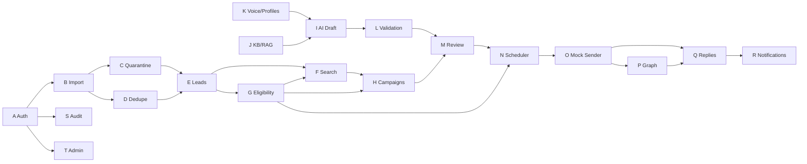

Cross-cutting from M1: audit, permissions, test-clock `now()`, settings store.

---

## 16. Implementation roadmap

General rules for every milestone: ruff, tsc and ESLint clean, pytest and frontend tests green, Alembic migrations reviewed, OpenAPI schema and generated frontend client in sync, audit events wired for new sensitive actions, no secrets in code, docs updated.

### M1: Project setup and data model
- **Tasks:** backend skeleton (FastAPI app, settings, SQLAlchemy + Alembic), frontend skeleton (Next.js, TypeScript, API client generated from the OpenAPI schema), `.env` handling for both, PostgreSQL 17 + pgvector extension setup on Mac, Procrastinate setup with a no-op worker, `User` with roles, session login and permission dependencies, `core.clock`, audit module (basic), full initial data model for all modules (models + migrations; admin screens follow in M5), base layout and login page in Next.js, test scaffolding and factories (pytest; Vitest and Playwright set up), CI-style `make check`.
- **Files:** `BD_BACKEND/app/{main,config,db,worker}.py`, `BD_BACKEND/app/core/*`, `BD_BACKEND/app/audit/*`, models in all modules, `BD_BACKEND/tests/`, `BD_FRONTEND/` skeleton.
- **Output:** running app, login, empty shells, database schema reviewed with you.
- **Acceptance:** fresh clone to running app via documented steps; migrations apply cleanly on empty DB; permission matrix test passes; worker starts and runs a sample job; pgvector extension verified.
- **Tests:** model constraints, role permission matrix, clock offset, audit append-only.
- **Demo:** log in as each role; show permission differences; run sample job; show schema diagram.

### M2: Import, mapping, validation, quarantine, deduplication
- **Tasks:** upload + SHA-256, worksheet and profile selection, mapping UI with saved mappings, preview, estimates, background import with progress, raw-row layer, normalization (emails, domains, names, countries, states, industries), validation rules, quarantine UI (fix/release/discard/download), person and company matching, merge with per-import change summary, duplicate-review screen, import report CSV, three source layouts `[needs spec]`.
- **Files:** `BD_BACKEND/app/imports/*`, `BD_BACKEND/app/leads/{services,matching,merge}.py`, frontend pages for quarantine and duplicate review.
- **Depends on:** M1.
- **Output:** a real Apollo/Excel/CSV file loads into clean People and Companies, with problems quarantined.
- **Acceptance:** re-uploading the same file is flagged; a file with 10% bad rows still imports the 90%; every raw row is retrievable unchanged; second import with changed data merges per latest-wins and produces a what-changed summary (no permanent history); possible duplicates reach the manager screen.
- **Tests:** each match path; merge precedence; quarantine reasons; large-file import; idempotent re-run after worker crash.
- **Demo:** import sample files, show preview, quarantine, release a fixed record, merge a duplicate, view the import change summary.

### M3: Lead search, lead details, eligibility, opt-outs, exports
- **Tasks:** `FilterSet`, structured search UI, pagination and selection, select-all-matching, saved segments, notes, lead and company detail pages with timeline, **eligibility service + parity-tested bulk queryset**, opt-outs (manual, imported, removal with reason), opt-out page, erase-person, CSV export with audit, NL search with Gemini adapter (first AI integration), assignment and Unassigned pool, status flags (Qualified, Handed Off, customer, partner, competitor), contact-history and same-account notes, Opt-outs page.
- **Files:** `BD_BACKEND/app/leads/search.py`, `BD_BACKEND/app/compliance/*`, `BD_BACKEND/app/ai/{adapter,nl_search}.py`.
- **Depends on:** M2. NL search needs the adapter, so a minimal adapter ships here.
- **Output:** reps can find and export eligible leads.
- **Acceptance:** NL query shows editable filters before running; invented fields never reach the query; opted-out leads never show as eligible; removal of opt-out requires a reason and is audited.
- **Tests:** eligibility reasons; search/eligibility parity; NL adversarial inputs (prompt-injection style text in the query); exports permissions.
- **Demo:** run structured search and the CFO/pharma/Karnataka NL query, adjust filters, save segment, export.

### M4: Knowledge base, embeddings, AI integration, email generation, validation, review
- **Tasks:** KB CRUD + lifecycle, embedding job, pgvector storage and retrieval, voice/profile/structure admin and versioning, structure composer, payload builder (privacy allow-list), draft task with structured output, nine validators, auto-retry then Needs Attention, review queue (edit AI sections, regenerate, approve, reject, undo, bulk approve), campaign creation wizard through approved sequences.
- **Files:** `BD_BACKEND/app/content/*`, `BD_BACKEND/app/ai/{drafting,retrieval,validators,payloads}.py`, `BD_BACKEND/app/campaigns/*`.
- **Depends on:** M3 (eligibility, selection), M1.
- **Output:** a rep creates a campaign and gets reviewable, validated three-step sequences.
- **Acceptance:** only approved, embedded items retrieved (≤5); fixed sections cannot change even with a crafted request; failed validation retries once then lands in Needs Attention; edits are revalidated; bulk approval excludes anything with warnings; outage of AI leaves drafts retryable.
- **Tests:** per-validator fixtures; retrieval filters; fake-provider tests for timeouts, 429, bad JSON; payload test asserting no email/phone/LinkedIn.
- **Demo:** approve a KB item, watch the embedding job, create a campaign, review one clean and one flagged sequence, edit and approve.

### M5: Sending queue, mock sender, Outbox, scheduler, settings, dashboard
- **Tasks:** plan messages on approval, scheduler with all limits and time zones, follow-up priority, defer reasons, retries, stuck-message recovery, pause/resume, completion estimate, MockSender + Outbox viewer, final HTML/text rendering with footer and unsubscribe mailto, threading identifiers, test clock UI, admin settings screens (limits, mailboxes, mappings, test recipients), campaign progress/history/results CSV, basic dashboards.
- **Files:** `BD_BACKEND/app/outreach/*`, `BD_BACKEND/app/mail/{senders,mock,outbox}.py`, `BD_BACKEND/app/notifications/dashboard.py`.
- **Depends on:** M4.
- **Output:** end-to-end sending into the Outbox with correct spacing.
- **Acceptance:** limits enforced at boundaries; follow-up lands in the same thread; opting out between steps cancels remaining steps; killing the worker mid-send creates no duplicate; test clock advances follow-ups.
- **Tests:** property-style tests on limits, DST/time zone cases, concurrency test with two workers, crash-recovery test, "no network" guard.
- **Demo:** approve a campaign, advance the clock day by day, see follow-ups in Outbox, pause/resume, opt out a lead mid-sequence.

### M6: Reply handling, classification, notifications, SLA
- **Tasks:** inbound pipeline on a `MailSource` interface (mock source now), unsubscribe and bounce detection, thread matching, AI classification with 0.7 threshold, Unclear queue, OOO continues sequence and others stop it, reply list/detail/thread, handled flag, simulate-reply screen, notifications (in-app + email), SLA hourly reminders, extended dashboards.
- **Files:** `BD_BACKEND/app/mail/{monitor,detection}.py`, `BD_BACKEND/app/ai/classify.py`, `BD_BACKEND/app/notifications/*`.
- **Depends on:** M5.
- **Output:** simulated replies flow through to notifications and sequence changes.
- **Acceptance:** unsubscribe replies create opt-outs without AI; low confidence → Unclear; OOO does not stop; unrelated mail ignored and not stored; reminders hourly until handled.
- **Tests:** fixture reply corpus per category; threshold edges; bounce permanent vs temporary; classification payload redaction test.
- **Demo:** simulate each category, watch notifications and sequence effects, see SLA reminder.

### M7: Microsoft Graph integration
- **Tasks:** Graph auth, `GraphSender`, in-thread replies, delta polling with per-mailbox cursors, mailbox group restriction handling, error mapping to retry policy, crash-window mitigation (section 11.3), config via env, sandbox testing with test mailboxes only.
- **Depends on:** M5, M6; Microsoft tenant setup `[external]`.
- **Output:** the same flows run against real test mailboxes (or recorded Graph fixtures if no tenant yet). The MVP is complete when Microsoft 365 sending and reply checking work end to end with test recipients (D-103); real sending to prospects follows once the go-live items are settled.
- **Acceptance:** all MockSender-path tests pass against the `Sender` interface contract; delta fetches only new mail; a mailbox outside the approved group is refused.
- **Tests:** recorded-response contract tests; failure injection (401, 429, 5xx); cursor-reset test.
- **Demo:** send from a test mailbox, reply from a test account, see classification.

### M8: Compliance gate and controlled real sending
- **Tasks:** compliance gate model and admin checklist (items per D-081: Microsoft 365 sending connected, tested unsubscribe, footer wording saved, postal address saved), real-sending activation flow (audited, admin-only), test-recipient-only mode for first live sends, kill switch, final end-to-end review of "no bypass" paths, production runbook (backups, secrets, monitoring), deployment notes (Docker still deferred).
- **Depends on:** M7.
- **Output:** real sending can be turned on only after the gate passes.
- **Acceptance:** activation refused until all gate items pass; every send path re-checks opt-out; kill switch halts the queue within one scheduler tick; activation recorded in audit.
- **Tests:** gate matrix, bypass-attempt tests, test-recipient restrictions.
- **Demo:** try to activate (blocked), complete gate, activate in test-recipient mode, send, flip the kill switch.

### Roadmap adjustment I would suggest `[SUGGESTION]`
Pull a **minimal Gemini adapter and fake provider** forward to M3 (already included above), and spike the **Graph crash-window problem** and tenant access during M5, so M7 has no surprises. Order M1–M8 otherwise unchanged.

---

## 17. Gaps and unresolved requirements

`docs/requirements/Q-A.md` settled many of the v0.3 items. This table shows what is still open and what was closed. I have not invented answers.

| # | Item | Status | Impact |
|---|---|---|---|
| U1 | Exact package pins and any further tech decisions | Open: `app.design` not supplied; pin versions at M1. Frontend pins approved in B1 (2026-11-18): Node 22 (engines 22 to 24), npm, next 16.4.6, react and react-dom 19.3.1, typescript 6.0.3, eslint 10.15.0, eslint-config-next 16.4.6, @types/node 22.20.5, @types/react and @types/react-dom 19.3.0. B2 (2026-11-19): OpenAPI client generator `@hey-api/openapi-ts` 0.99.0 (exact pin; needs Node 22.18 or newer, so frontend `engines` is `>=22.18 <25`). Backend pins still open. | M1 |
| U2 | Three predefined BD source layouts (columns, quirks) | Open: needs `Agentic Databse.xlsx` (7 sheets, 3 layouts; profiled in Q-A, about 16% personal emails, company name missing in about 62% of the largest sheet) | M2 |
| U3 | Personal-email domain list; generic address prefixes | Open: seed lists needed (rules settled, D-069 / D-072) | M2 |
| U4 | Lead status values | Closed: Qualified / Handed Off plus status flags (D-022, D-065); journey states stay derived | M1/M3 |
| U5 | "Other applicable restrictions" in eligibility | Closed: replied, Qualified / Handed Off, possible duplicate, cooling-off; no separate customer suppression list (D-065) | M3 |
| U6 | Industry and state mapping seed data | Open: NAICS-sector standard list is settled (D-076); seed tables needed | M2 |
| U7 | Company-size bands | Closed: SMB 1–200, mid-market 201–1,000, enterprise above 1,000 (D-085) | M3/M4 |
| U8 | Validation thresholds and Warn vs Fail | Mostly closed: Q-CONTENT-07 / 09 give limits and the check list. Open: which checks are Warning vs Fail beyond the word-range warning; Q-CONTENT-14 first-email length | M4 |
| U9 | Default voice, profiles, structures, banned phrases | Partly closed: structures and segment profiles defined (D-084, D-085). Open: tone examples (Q-CONTENT-06), final differentiator, priority industry order, approved case studies (Q-CONTENT-04); banned-phrase list seed | M4 |
| U10 | Footer wording, postal address, signature rules | Open: Q-COMP-05 and Q-COMP-06. Mailto Unsubscribe mechanism settled (D-079) | M5/M8 |
| U11 | Time-zone derivation, holidays, business days | Closed: prospect zone with rep fallback, no holidays, counted from step 1 (D-014, D-082, D-083) | M5 |
| U12 | Compliance gate contents | Closed: D-081. Sign-off owner still to be named | M8 |
| U13 | SLA edge cases (after hours, weekends) | Open: only "same business day" is defined (D-032) | M6 |
| U14 | Opt-out page vs public unsubscribe page | Closed: no public web page in the MVP; Opt-outs page for staff (D-079, D-067) | M3 |
| U15 | Notification email delivery channel (which mailbox) | Open | M6 |
| U16 | Microsoft 365 tenant, app registration, security group, test mailboxes | Partly closed: you are the M365 admin; registration happens at M7 (D-057). Group and test mailboxes still to be named | M7 |
| U17 | Login method (password vs SSO) | Open: password assumed | M1 |
| U18 | Data retention periods and legal basis | Open: agree before go-live (D-100). Erasure behaviour settled (D-099) | M3/M8 |
| U19 | What is sent to Gemini; reply redaction | Mostly closed: first name, company and reply text are sent; paid key before real data (D-062). Open: redaction of reply text | M4/M6 |
| U20 | Apollo terms of service on exporting data (Q-COMP-03), Apollo cost baseline (Q-REPORT-02), 800–1,000 per day per mailbox validation (D-029) | Parked or flagged in Q-A | Pre-go-live |
| U21 | Can a manager or admin author and approve their own campaigns and drafts? Section 4 says only reps edit and approve (so `EDIT_DRAFT` and `APPROVE_DRAFT` are rep-only in `core/permissions.py`, M1 A6); Q-ROLES-03 only says a manager cannot edit another rep's drafts | Open: confirm with the BD team before M4 if managers should also run outreach (a one-line change to the capability table) | M4 |

---# Alphaleo BD: Implementation Plan

**Status:** DRAFT v0.4 for review. No code has been written; the build starts from scratch. Nothing here is final until you approve it.
**Date:** 12 November 2026
**Change in v0.2:** added end-to-end workflow (section 20), implementation approach (21), testing plan (22), deployment plan (23), post-deployment operations (24) and extra decisions (25).
**Changes in v0.3:** stack changed from Django + HTMX to FastAPI + Next.js (sections 4, 5, 13, 16, 19 and 21 to 24 updated); section 2 (repository inspection) removed, other section numbers unchanged; ER diagram redrawn as three corrected diagrams (6.1); Screens lines removed from modules C and D (section 14); `app.design` pin dependency removed from M1.
**Changes in v0.4:** `docs/requirements/Q-A.md` (decisions D-001 to D-113) adopted as the requirements source of truth. Decision numbers are cited in the text. Main changes: lead change history removed (D-008); channel-agnostic `Touch` history, status flags and Qualified / Handed Off added (D-034, D-065, D-022); erasure now also removes raw rows and keeps the plain opt-out address (D-099); unsubscribe-by-subject exception, Unclear and bounce rules added to reply handling (D-080, D-094, D-096); nine validation checks replaced with Q-CONTENT-09's list; permissions, import rules, size bands, structures, Graph restriction method and AI privacy updated; section 17 and 18 rewritten to show only what is still open.

---

## 0. How to read this draft

### 0.1 Labels

Every statement is one of these. Items marked `[ASSUMPTION]`, `[SUGGESTION]` or `[UNRESOLVED]` need your decision (collected in section 18).

| Label | Meaning |
|---|---|
| `[AGREED]` | Stated in your project brief or decided in `docs/requirements/Q-A.md` (decision numbers cited, e.g. D-008). |
| `[ASSUMPTION]` | My interpretation where the brief is silent or ambiguous. Please confirm or correct. |
| `[SUGGESTION]` | An implementation idea I recommend. You can overrule it. |
| `[UNRESOLVED]` | Depends on information I do not have. I have not invented it. |

### 0.2 What I could and could not see

Supplied: your project brief, and `docs/requirements/Q-A.md` (requirements Q&A, decisions D-001 to D-113, last updated 4 Nov 2026). `docs/requirements/Q-A.md` is the requirements source of truth; it consolidates the BD questionnaire answers (`docs/requirements/BD-Ans-2026-10-23-R1.docx`) and contains Q-CONTENT-07, 08 and 09. No code exists.

**Not supplied:**
- `app.design` (technology decisions, exact package pins, historical progress report through 4 Nov 2026)
- The BD sample file `Agentic Databse.xlsx` (7 sheets, 3 layouts) and a real Apollo CSV export

Consequences:
1. **Package versions** are only the ones named in the brief and your later change of stack (Python 3.12, FastAPI, Next.js, PostgreSQL 17, Procrastinate 3.x). Exact pins must come from `app.design`.
2. Business rules that Q-A does not settle are marked `[UNRESOLVED]` (section 17).

---

## 1. Product understanding

### 1.1 What it is
Alphaleo BD is an internal, standalone web application (own database, no Salesforce API integration) that runs a company's outbound business development from lead list to reply handling. Salesforce is only a searchable and filterable technology attribute on companies. `[AGREED]`

### 1.2 Users
- **Representative:** about five people initially. They own leads and campaigns, review and approve AI drafts, and handle real replies in Outlook.
- **Manager:** sees team campaigns, drafts and statistics. Reviews duplicates. Can remove opt-outs with a reason. Cannot edit others' drafts.
- **Admin:** manages system-wide configuration, content, mailboxes, limits, compliance, and real-sending activation.

### 1.3 Problem solved
Reps spend time on repetitive work: cleaning spreadsheets, finding eligible leads, writing personalized emails, spacing follow-ups, watching inboxes and keeping suppression lists correct. The app automates these while **humans stay in control** (every sequence is reviewed and approved before sending; no auto-send).

### 1.4 End-to-end workflow


### 1.5 How AI and the knowledge base work (plain language)
1. Admins write knowledge items (solutions, case studies, offerings) as Draft. When one is Approved, a background job creates an embedding (Gemini model) stored in PostgreSQL via pgvector.
2. When drafting for a lead, the app picks the matching company-size and industry profiles, retrieves up to five approved, relevant knowledge items, and sends the AI a structured request.
3. The AI returns **structured JSON** for only the AI sections (opening, relevance, follow-up text). The app inserts them into a template that contains protected fixed sections (greeting, CTA, signature, footer).
4. Nine code-based checks validate the result. One automatic retry on failure, then "Needs Attention".
5. Natural-language search uses AI only to translate text into a whitelisted filter set, shown to the user before it runs.
6. AI also classifies replies, with a confidence score and a manual fallback.

### 1.6 Module interaction
- `imports` writes raw rows, then calls `leads` services to create or merge People and Companies.
- `compliance` owns the single eligibility service, used by `leads` (search), `campaigns` (creation), `ai`/`campaigns` (drafting) and `outreach` (sending).
- `content` supplies voice, profiles, structures and knowledge. `ai` consumes it.
- `outreach` owns the queue and scheduler and calls `mail` (MockSender or GraphSender).
- `mail` also supplies inbound messages to the reply pipeline, which calls `ai` for classification and `notifications` for alerts.
- `audit` receives events from everywhere. `core` holds shared utilities (clock, permissions, settings).

---------

## 3. Scope

### 3.1 In MVP (M1–M8) `[AGREED]`
All modules A–T in the brief, delivered in milestone order M1–M8 (section 16).

### 3.2 Explicitly out of the initial MVP `[AGREED]`
A/B testing, Apollo API sync, WhatsApp, LinkedIn, public unsubscribe pages, auto-send, AI reply suggestions, advanced analytics, Docker deployment.

> Note: there is no public web unsubscribe page in the MVP (D-079). Unsubscribe works by reply and by a mailto "Unsubscribe" button. The in-app "Opt-outs" page (a searchable staff list, D-067) is in scope. `[AGREED]`

### 3.3 Nothing silently removed
All functionality in the brief is mapped to a milestone in section 16. Anything I propose to defer is listed in section 18 for your decision.

---

## 4. User roles and permissions

All checks are enforced server-side in a central permission layer (`core.permissions`), never only by hiding buttons. `[AGREED]`

| Capability | Rep | Manager | Admin |
|---|---|---|---|
| Log in / out | ✔ | ✔ | ✔ |
| Import leads (existing source profile) | ✔ (D-104) | ✔ | ✔ |
| View own leads | ✔ | ✔ | ✔ |
| View all leads, with who contacted them and when | ✔ (D-001, D-026) | ✔ | ✔ |
| Assign / reassign leads (Unassigned pool) | ✖ | ✔ (D-075) | ✔ |
| Edit own campaigns / drafts | ✔ (owner only) | ✖ | ✖ |
| View others' campaigns and drafts | ✖ | ✔ (read-only) | ✔ (read-only) |
| Approve / reject drafts | owner only | ✖ | ✖ |
| Quarantine fix / release | ✔ | ✔ | ✔ |
| Quarantine discard | importer only | ✔ | ✔ |
| Set Qualified / Handed Off on any lead (logged) | ✔ (D-101) | ✔ | ✔ |
| Create / edit source profiles and industry / state mappings | ✖ | ✖ | ✔ (D-104) |
| Duplicate review (merge / not-a-duplicate) | ✖ | ✔ | ✔ |
| Remove opt-out (reason required) | ✖ | ✔ | ✔ |
| Erase person | ✖ | ✖ | ✔ (D-099) |
| Edit voice / profiles / KB / structures | read-only | read-only | ✔ |
| Sending limits, mailboxes, users, test clock | ✖ | ✖ | ✔ |
| Activate real sending | ✖ | ✖ | ✔ (compliance gate) |
| Private / shared segments | create own, may share with team (D-098) | same | all |
| CSV export (search results, campaign results) | ✔ (audited, within own visibility, D-087) | ✔ | ✔ |
| Download import quarantine / change-summary files | importer only (audited, D-111) | ✔ | ✔ |

All rows are `[AGREED]` from the brief or Q-A. Auto-send is deferred (D-019, D-091). A manager-granted per-rep auto-send permission is a later phase.

Design: individual accounts with the role stored on the user. Permission helpers such as `can_edit_campaign(user, campaign)`, used by FastAPI route dependencies, services and tests. Object-level checks on every service entry point, not just route handlers. The Next.js frontend may hide buttons for convenience but is never trusted for access control. `[SUGGESTION]`

---

## 5. Architecture

### 5.1 Principles `[AGREED]`
- Modular monolith backend (one FastAPI project, clear module boundaries) plus one Next.js frontend. The frontend contains no business rules.
- Business logic in service functions. Route handlers and background tasks are thin.
- API process = short requests. Worker process = long and scheduled work. Next.js serves the UI and calls the API.
- Transactions, row locking and crash recovery where state can be corrupted.
- PostgreSQL only: data, pgvector and the Procrastinate job queue. No Redis, no separate vector DB.
- Mac-native for MVP (Homebrew PostgreSQL + Python virtualenv + Node.js). Docker deferred.

### 5.2 Technology stack

| Layer | Choice | Source |
|---|---|---|
| Language | Python 3.12 (backend), TypeScript (frontend) | brief, updated |
| Backend API | FastAPI, Uvicorn, Pydantic v2 for request and response schemas | updated brief |
| Frontend | Next.js (App Router), React, TypeScript | updated brief |
| ORM and migrations | SQLAlchemy 2.x, Alembic | `[SUGGESTION]` |
| API contract | REST + JSON, OpenAPI schema generated by FastAPI, typed TypeScript client generated from it | `[SUGGESTION]` |
| DB | PostgreSQL 17, pgvector, psycopg 3 | brief |
| Jobs | Procrastinate 3.x (PG queue) | brief |
| AI | Google Gemini via `google-genai`, provider-independent adapter, structured JSON output, model configurable per task | brief |
| Mail | Microsoft Graph (app permissions `Mail.Send`, `Mail.ReadWrite`); MockSender locally | brief |
| Excel | openpyxl | brief |
| Tests / lint | Backend: pytest, httpx / FastAPI TestClient, ruff. Frontend: tsc, ESLint, Vitest, Playwright | pytest and ruff from brief; frontend tools `[SUGGESTION]` |
| Config | env vars, `.env` (backend and frontend each), `DATABASE_URL` | brief |
| Exact pins | **from `app.design`** | `[UNRESOLVED]` |
| Auth against Graph | Likely MSAL client-credentials. Library not named in brief | `[SUGGESTION]` |

### 5.3 System diagram


### 5.4 Proposed folder structure `[SUGGESTION]`

The maintained layout, and where new files go, is in `FILE_STRUCTURE.md`; the running description of the architecture is in `ARCHITECTURE.md`. The tree below is the original proposal, adapted to the real folder names `BD_BACKEND` and `BD_FRONTEND`.

```
BD ASSISTANT/                  # project root
├── Makefile                  # make check: ruff, pytest, tsc, eslint, frontend tests
├── BD_BACKEND/
│   ├── pyproject.toml        # deps + ruff + pytest config
│   ├── .env.example          # no real secrets; .env is git-ignored
│   ├── alembic.ini
│   ├── migrations/           # Alembic revisions
│   ├── app/
│   │   ├── main.py           # FastAPI app, router registration
│   │   ├── config.py         # settings from env (fail fast if missing)
│   │   ├── db.py             # engine, session, base model
│   │   ├── worker.py         # Procrastinate app and task registration
│   │   ├── core/             # users, roles, permissions, clock (test clock), settings store,
│   │   │                     #   pagination, CSV utils, session auth
│   │   ├── imports/          # files, source profiles, mapping, raw rows, validation, reports
│   │   ├── leads/            # Person, Company, emails, phones, matching, merge, search,
│   │   │                     #   segments, notes, quarantine, timeline
│   │   ├── compliance/       # eligibility service, opt-outs, erasure, compliance gate
│   │   ├── campaigns/        # campaigns, selection, sequences, review queue, per-lead status
│   │   ├── content/          # voice, profiles, structures, knowledge base, versions
│   │   ├── ai/               # provider adapter, tasks (draft, NL search, classify), prompts,
│   │   │                     #   payload builders, validators (9 checks), retrieval
│   │   ├── outreach/         # outreach_messages queue, scheduler, limits, retries, completion estimates
│   │   ├── mail/             # Sender interface, MockSender, GraphSender, outbox, reply monitor,
│   │   │                     #   threading, bounce / unsubscribe detection
│   │   ├── notifications/    # in-app + email notifications, SLA reminders, dashboard queries
│   │   └── audit/            # audit log, history
│   │                         # each module: models.py, schemas.py, services.py, api.py (router)
│   └── tests/                # mirrors app/, plus integration and e2e-style flows
└── BD_FRONTEND/
    ├── package.json
    ├── next.config.ts
    ├── .env.local.example    # API base URL only; no secrets
    ├── src/
    │   ├── app/              # routes (App Router): login, leads, campaigns, review, outbox, admin ...
    │   ├── components/       # shared UI (tables, filter chips, forms, email preview)
    │   └── lib/api/          # typed client generated from the FastAPI OpenAPI schema
    └── tests/                # component tests (Vitest) and Playwright journeys
```

### 5.5 Module responsibilities

| Module | Owns | Must not |
|---|---|---|
| `core` | Auth, roles, permissions, `now()` clock, shared API utilities | contain business rules |
| `imports` | Upload to raw rows to mapped rows, reports | decide eligibility |
| `leads` | People, companies, matching, merge, search, segments | send email |
| `compliance` | Eligibility, opt-outs, erasure, gate | create campaigns |
| `campaigns` | Campaign lifecycle, selection, review, approval | talk to Graph |
| `content` | Voice, profiles, KB, structures, versions | call the AI |
| `ai` | Provider calls, prompts, validators, retrieval | write to leads/outreach directly |
| `outreach` | Queue, scheduler, limits, retries | build email text |
| `mail` | Sender implementations, inbound mail, threading | contain business policy |
| `notifications` | Alerts, SLA, dashboards | |
| `audit` | Append-only event log | |
| `frontend` (Next.js) | All screens, forms, display of API data | contain business rules or make access decisions |

Dependency direction (to avoid cycles): `core` ← `leads`/`content` ← `compliance` ← `ai` ← `campaigns` ← `outreach` ← `mail` ← `notifications`. `audit` is a leaf that everything may call. `[SUGGESTION]`

---

## 6. Data model

### 6.1 Entity-relationship overview

The model is shown as three diagrams so each stays readable. `USER`, `PERSON` and `MAILBOX` appear in more than one diagram and are the same entities. Reading rule: `A ||--o{ B` means one A has zero or more B.

**6.1a Users, import, leads and compliance**


**6.1b Campaigns, sending and replies**


**6.1c Content and AI configuration**


Not drawn because they have no direct relations or touch everything: `AuditLog`, `Setting`, `ClockOffset`, `JobLock`, `IndustryMapping`, `StateMapping`, `ErasureRecord` (kept after the person is gone), `ComplianceGateStatus` / `ComplianceChecklistItem`, `EligibilitySnapshot`. `QuarantineRecord`, `DuplicateCandidate` and `MergeRecord` are shown on the lead side only.

### 6.2 Entities by app (key fields only; full field list to be settled in M1)

**core:** `User` (role, active), `Setting` (key, typed value, version), `ClockOffset` (admin test clock), `JobLock`.

**imports:** `ImportFile` (sha256, filename, uploader, source_profile, default_country, worksheet, status, counts), `SourceProfile` (layout, mapping defaults) `[three layouts UNRESOLVED]`, `ColumnMapping`, `RawRow` (file, row number, **original values as JSON, never modified except by erase-person, D-099**), `ImportReport` (totals, reason-coded failures, and a transient per-import "what changed" summary, `ImportChange`, D-050).

**leads:** `Company` (apollo_account_id, domain, normalized_name, industry, NAICS, SIC, employees, revenue, funding stage/amount/date, technologies[], keywords[], HQ, founded_year, `uses_salesforce` derived from technologies, latest funding round type, total funding, name-derived flag; **latest values only, no change history, D-008**), `Person` (source_record_id, name, title, seniority, department, location, owner, lead_status, linkedin_url, company FK), `PersonEmail` (address, normalized, type work/personal/generic, verification, primary), `PersonPhone`, `SocialProfile`, `ContactChannel` (generic channels such as info@), `QuarantineRecord` (issues[], status, editable payload), `DuplicateCandidate` (pair, reason, status: open/merged/not-duplicate), `MergeRecord` (survivor, absorbed, snapshot for history), `Segment` (filters JSON, private/shared, owner), `LeadNote` (colleague activity notes), `LeadEvent` (timeline), `Touch` (channel, direction, rep, status, timestamps; email only in v1, designed for WhatsApp / LinkedIn later, D-034), `LeadStatusFlag` (existing customer, in conversation, partner, competitor, Qualified, Handed Off to Sales; with who and when; D-065, D-022), source engagement fields on `Person` (last contacted, sent / opened / bounced / replied / demoed, stage, lists as tags, intent signals stored but unused; D-063, D-073, D-074), `IndustryMapping` (standard NAICS-sector list, D-076), `StateMapping`.

**compliance:** `OptOut` (stored per email address, D-066; source: manual/imported/reply, created_by, removed_at, removal_reason, removed_by), `EligibilitySnapshot` (optional, for explaining past decisions) `[SUGGESTION]`, planned and not built in M1 A5 (no requirement needs it yet), `ComplianceGateStatus` / `ComplianceChecklistItem` (items defined by D-081), `ErasureRecord` (the erased person's address stays on the opt-out list, D-099).

**content:** `VoiceSetting`, `SizeProfile`, `IndustryProfile` (pain points, offerings, tone, avoid, example phrases, linked KB), `KnowledgeItem` (type, body, status draft/approved/retired, size/industry tags), `KnowledgeEmbedding` (vector, model name, dimension, content hash), `EmailStructure` + `StructureSection` (order, fixed vs AI, content, limits), `ConfigVersion` (snapshot, author, timestamp, restore support).

**campaigns:** `Campaign` (owner, mailbox, sequence config, target completion date, status), `CampaignLead` (eligibility result, exclusion reason), `EmailSequence` (status: generating / ready / needs_attention / approved / rejected), `EmailDraft` (step, ai_sections JSON, final render, validation status, edit history), `ValidationResult` (check id, status, message).

**outreach:** `OutreachMessage` (the persistent queue; status, scheduled_for, planned vs scheduled, defer_reason, attempts, next_retry_at, idempotency_key, mailbox, thread link, claimed_by/claimed_at), `SendAttempt` (error class, timestamps), `Mailbox` (address, owner, daily/hourly counters derived).

**mail:** `MailThread` (conversation id, internet message ids), `OutboxMessage` (mock: html, text, headers), `InboundMessage` (matched only), `DeltaCursor` (per mailbox delta token), `ReplyClassification` (category, confidence, model, handled flag, handled_by/at), `BounceRecord`.

**notifications:** `Notification` (user, type, link, read_at), `SlaReminder`.

**audit:** `AuditLog` (actor, action, object, before/after summary, ip, timestamp). Append-only.

### 6.3 Key modeling decisions
- **Two data layers** `[AGREED]`: `RawRow` is immutable; only erase-person (D-099) removes raw rows. Unified data lives in `Person`/`Company` and keeps the latest values only (D-008).
- **Email addresses** in their own table because people can have several and verification differs. `[AGREED]`
- **Soft state, not hard deletes** for leads, except the erase-person flow. `[SUGGESTION]`
- **Versioning** of voice, profiles and structures via `ConfigVersion` snapshots. `[AGREED]`
- **Vector column** sized to the configured Gemini embedding model. Store model name and dimension with each vector so a model change forces re-embedding. `[SUGGESTION]`

---

## 7. Main service functions (signatures indicative)

```
imports.services:   register_file(), detect_duplicate_file(), build_preview(), validate_rows(),
                    estimate_import(), process_import(), build_report()
leads.services:     match_person(), match_company(), merge_fields(), upsert_person(),
                    derive_company_name(), find_possible_duplicates(), merge_people(),
                    mark_not_duplicate(), assign_owner(), release_from_quarantine(),
                    account_engagement(), set_status_flag(), build_change_summary(),
                    apply_source_engagement()
leads.search:       apply_filters(), parse_nl_query() -> FilterSet, export_csv()
compliance:         check_eligibility(person, context) -> EligibilityResult(reasons[]),
                    eligible_queryset(), record_opt_out(), remove_opt_out(), erase_person(),
                    compliance_gate_status()
campaigns.services: create_campaign(), select_leads(), count_exclusions(), pause(), resume(),
                    estimate_completion(), approve_sequence(), undo_approval(), reject_sequence()
ai.services:        draft_sequence(), regenerate(), retrieve_knowledge(), run_validators(),
                    classify_reply()
content.services:   approve_item(), retire_item(), resolve_profiles(), snapshot_config(), restore_default()
outreach.services:  plan_messages(), claim_due_messages(), send_message(), defer(), schedule_retry(),
                    recover_stuck_messages(), enforce_limits()
mail.senders:       Sender.send(), Sender.reply_in_thread(), MockSender, GraphSender
mail.monitor:       poll_mailbox(), detect_unsubscribe(), detect_bounce(), match_thread(), store_inbound()
notifications:      notify(), sla_sweep(), dashboard_stats()
audit:              record()
core.clock:         now()   # the only permitted source of "current time"
```

---

## 8. Background job design

All tasks are thin wrappers that call services. Procrastinate with PostgreSQL queue. `[AGREED]`

| Job | Trigger | Notes |
|---|---|---|
| `process_import` | upload confirmed | Chunked, resumable, progress stored. Per-row errors never fail the file. |
| `generate_embedding` | KB item to Approved | Retries with backoff. Failed items stay non-retrievable. |
| `draft_sequence` | campaign created / regenerate | One job per lead. Rate-limit aware. One auto-retry on validation failure. |
| `scheduler_tick` | periodic (every minute `[SUGGESTION]`) | Claims due messages with `SELECT … FOR UPDATE SKIP LOCKED`. |
| `send_message` | from tick | Rechecks eligibility, opt-out and limits immediately before send. |
| `poll_mailboxes` | every 3 min `[AGREED]` | One lock per mailbox so polls never overlap. |
| `classify_reply` | inbound stored | Unsubscribe and bounce detection run first, before AI. |
| `sla_reminders` | hourly `[AGREED]` | Reminders until handled. |
| `recover_stuck` | periodic | Resets messages stuck in "sending" past a timeout (see 11.3). |
| `send_notification_email` | notification created | |

**Duplicate-job prevention:** Procrastinate queueing locks keyed on object ID, plus DB state checks inside services (idempotent by design). `[SUGGESTION]`

---

## 9. AI integration architecture


- **Adapter interface:** `generate_structured(task, input, schema) -> validated dict`. A different provider can be added later without touching services. `[AGREED]`
- **Model per task:** draft, NL-to-filters, classification, embeddings each have their own configured model name (settings, not code). `[AGREED]`
- **Structured output:** every response is JSON validated against a schema. Invalid JSON counts as a failure, not text to be used.
- **Privacy (hard rule):** payload builders use an **allow-list**. Emails, phone numbers and LinkedIn URLs are never included. `[AGREED]` First name, job title, company name and company-level facts are sent, because the validators check name and company matches (D-086, Q-DESIGN-07). Development uses a free-tier Gemini key on hand-selected test data only; a paid key is required before any real prospect data, and the provider's data-use terms are reviewed before go-live (D-062). `[AGREED]`
- **NL search:** AI receives only the typed sentence and the list of supported filter fields and allowed values, and returns a filter JSON. Unknown fields are dropped and reported. It cannot produce SQL; the app builds queries from the filter set only. The user sees and edits the interpreted filters before execution. `[AGREED]`
- **Reply classification** sends reply text, which may contain personal data (signatures, phone numbers). I suggest stripping quoted history and signature blocks and redacting emails and phone numbers before sending. `[SUGGESTION]` (Decision needed: Q-A confirms reply text goes to the AI but says nothing about redaction, and rule 3 forbids contact details.)
- **Failure handling:** timeouts, 429 and 5xx handled by bounded retries with exponential backoff and jitter, a concurrency cap, and a clear "AI unavailable" state. The draft stays in a retryable state, never half-written. A circuit breaker pauses AI calls during an outage. `[AGREED]` (rule 12), mechanism `[SUGGESTION]`.
- **Observability:** log task name, model, latency, token counts and error class. Never log prompts containing lead data or any credentials. `[AGREED]` (rule 14)

---

## 10. Knowledge base and RAG flow


Rules:
1. Lifecycle: Draft → Approved → Retired. Only Approved items are retrievable. `[AGREED]`
2. Approval triggers an embedding job. `[AGREED]`
3. Retrieval: filter by matching profiles, then rank by similarity "when required", maximum five items. `[AGREED]` What "when required" means is `[UNRESOLVED]`. `[ASSUMPTION]` Rank by similarity only when more than five candidates remain.
4. Editing an approved item changes its content hash. `[SUGGESTION]` Return it to Draft or re-embed, so vectors never go stale. (Decision in 18.)
5. Retiring removes it from retrieval immediately.
6. pgvector index (HNSW or IVFFlat) is likely unnecessary at MVP volumes. Start with exact search and add an index when needed. `[SUGGESTION]`

---

## 11. Email sending architecture

### 11.1 Layers
`campaigns` approves the sequence, then `outreach.plan_messages` creates three `OutreachMessage` rows (Planned/Scheduled), then the scheduler claims due rows, then `send_message` rechecks, builds the final email and calls `mail.Sender`.

### 11.2 Scheduling rules (defaults from brief) `[AGREED]`
- Max 3 emails per person per 30 days
- Min 2 business days between emails to the same person
- 90-day cooling-off before a new campaign to the same person
- Max 2 people per company per day
- Max 30 per mailbox per day; max 8 per mailbox per rolling hour (defaults; the admin raises them gradually, D-083)
- Mon–Fri, 09:00–17:00 in the prospect's time zone, falling back to the rep's time zone when location is unknown; no holiday calendar (D-014, D-083)
- Step 1 on day 0; step 2 on business day 3; step 3 on business day 7, counted from the first email (D-082)
- When a cap is reached, due follow-ups go before new first emails, then oldest first (D-082). The 90-day cooling-off applies to entering a new campaign, not to follow-ups
- All three emails of a sequence are drafted at campaign start and reviewed together (D-090). Pausing requires an explicit resume (D-015)
- Retries after technical failures at 30 min, 4 h, 20 h, then Failed (notify rep)

Limits are global admin settings with no per-campaign override in the MVP. Saving conflicting settings (for example a sequence longer than the contact limit) shows a warning and asks for confirmation. Opt-outs are always enforced, whatever the settings (D-083). `[AGREED]`

**Settled by Q-A:** time-zone fallback is the rep's; there is no holiday calendar; follow-ups count toward the 3-per-30-days limit and the 90-day cooling-off applies only to entering a new campaign (D-082, D-083). Time zone is derived from the lead's city, state and country, with a default country set per import (D-078). "Business day 3" counts from step 1's actual send date `[ASSUMPTION]`.

**Volume target `[UNRESOLVED]`:** BD wants about 800–1,000 emails per day per mailbox and a full campaign, follow-ups included, within one week (D-029). With the default sequence the last follow-up goes out about 9 calendar days after step 1, so the one-week target cannot be met, and the completion estimate must say so. The 800–1,000 per day figure needs validation against Microsoft 365 tenant policy and cold-email deliverability practice before it becomes a requirement. Defaults stay at 30 per day and 8 per hour.

### 11.3 Safety mechanisms
- `outreach_messages` is the only outgoing queue. `[AGREED]`
- **Claiming:** row lock with `SKIP LOCKED`, set status `sending`, record `claimed_at`.
- **Idempotency key** per message, unique-constrained. Mock outbox and Graph both keyed on it.
- **Send-time recheck** by calling the same `check_eligibility()` plus limit enforcement inside the transaction. Failing means the message is **deferred with a reason**, or cancelled if permanently ineligible (e.g. opt-out, reply received).
- **Crash window:** a worker may die after Graph accepts a message but before the DB commit. To avoid a duplicate, I suggest creating the message as a Graph draft first and saving its ID, then sending, and having `recover_stuck` check Sent Items for that ID before retrying. `[SUGGESTION]` Needs a spike in M7.
- **Pause/resume:** pausing flips pending rows to a held state. Resume re-plans from "now", respecting spacing.
- **Completion estimate:** simulated forward pass of the scheduler against limits and the target completion date, with a warning if the target is unreachable.

### 11.4 Senders
- `Sender` interface: `send()`, `reply_in_thread()`.
- `MockSender` (first): builds real final HTML and plain text, with footer and unsubscribe `mailto`, generates Message-ID and conversation ID, keeps follow-up threading, stores in Outbox, shows the email as recipients see it. **Transmits nothing.** `[AGREED]`
- `GraphSender` (M7): app permissions `Mail.Send`, `Mail.ReadWrite`, restricted to an approved mail-enabled security group (Exchange Online RBAC for Applications, with application access policies as the fallback; configured on the Microsoft side, D-057), sends from the rep's own mailbox, replies in the original thread. `[AGREED]` Microsoft 365 code stays inside `mail/`.
- **Test clock:** an admin-only offset applied by `core.clock.now()`. All time-dependent code uses it. `[AGREED]` I suggest disabling it when real sending is active. `[SUGGESTION]`
- **Selecting sender:** a setting, with real sending guarded by the compliance gate (M8).

---

## 12. Reply monitoring architecture


- Categories: Interested, Not now, Not interested, Out of office, Wrong person, Unsubscribe. Plus Unclear for low confidence. `[AGREED]`
- Threshold default 0.7, admin-adjustable. If the AI is unavailable the reply is saved as "Unclassified" with the same safe handling. `[AGREED]` (D-094)
- Alerts go to the sending rep and, if different, the lead owner, in-app and by email. Managers see replies in their overview without individual alerts. `[AGREED]` (D-095)
- Matching uses conversation ID, `In-Reply-To`/`References` headers, and a custom message header. Unmatched mail is dropped without storing body. `[AGREED]` (rule 13) The only exception is the fixed unsubscribe rule (D-080): a new email with the subject "Unsubscribe" from an address the app has emailed.
- SLA: same-business-day follow-up, hourly reminders until handled. `[AGREED]` Exact rule for replies arriving late in the day or at weekends `[UNRESOLVED]`.
- Reply-based opt-out: the fixed rule above, keyword rules before AI, and a confident "Unsubscribe" category. Every email footer says "Reply with 'unsubscribe' to opt out" and carries an "Unsubscribe" button that opens a pre-filled email to the sending rep's mailbox (D-079). `[AGREED]`
- Real customer replies are answered in Outlook, not in the app. The app shows the reply with its thread and a link to open it in Outlook, and the rep marks it handled (D-105). `[AGREED]` The "Simulate reply" screen injects a fake inbound message through the same pipeline, available only when MockSender is active. `[ASSUMPTION]`
- Delta cursors are stored per mailbox. Token expiry or reset triggers a safe full resync limited to the app's threads.

---

## 13. Authentication and authorization design

- Individual accounts, login and logout. `[AGREED]` Implementation: passwords hashed with argon2, server-side sessions stored in PostgreSQL, delivered to the browser as an HttpOnly, Secure, SameSite=Lax cookie. `[SUGGESTION]` (JWTs are not needed for a single first-party frontend.)
- Login method (password only? Microsoft 365 SSO?) `[UNRESOLVED]`. `[ASSUMPTION]` Password login for MVP, with a note that SSO could be added later.
- Roles: Representative, Manager, Admin. `[AGREED]`
- Central permission module. FastAPI route dependencies (for example `Depends(require_permission(...))`) call it. Services re-check object ownership so a background job or a different route cannot bypass rules. Next.js route guards are only a UX convenience; the API enforces access.
- Tests: a role-by-endpoint matrix test that fails if a new API route is added without a declared permission. `[SUGGESTION]`
- Session security: secure cookies, CSRF protection for cookie auth (anti-CSRF token header sent by the Next.js client, plus Origin checks), CORS limited to the frontend origin, lockout or throttling on login. `[SUGGESTION]`
- Secrets only in environment/`.env` (git-ignored). Graph and Gemini credentials never stored in the DB in plain text. Mailbox configuration in the DB stores identifiers only. `[AGREED]`

---

## 14. Feature breakdown by module

Format per module: **Screens** / **Backend** / **DB** / **Rules** / **Jobs** / **AI** / **Integrations** / **Tests**.

### A. Authentication and user management (M1)
- **Screens:** login, logout, user list and edit (admin), "my profile".
- **Backend:** auth, role checks, assignment helpers.
- **DB:** `User`, role, `Mailbox` link.
- **Rules:** server-side enforcement everywhere. Owner-only draft editing.
- **Jobs / AI / Integrations:** none.
- **Tests:** role × endpoint matrix; owner-only edit; manager read-only.

### B. Lead import (M2)
- **Screens:** upload, worksheet picker, source profile, default country, column mapping, missing-header fix, preview, estimate, progress, report, CSV download.
- **Backend:** SHA-256 duplicate-file check (warn with the earlier date and user; cancel or import anyway, D-109), CSV/XLSX (openpyxl) up to 50,000 rows or 20 MB, one sheet per import (D-110), Apollo layout, three predefined layouts (needs the sample xlsx) `[UNRESOLVED]`, row validation, chunked processing. Source-owner names map to app users; unmatched leads go to the Unassigned pool (D-075). Source engagement history is applied per D-073 (do-not-contact becomes opt-out, bounced marks email invalid, replied excludes from new campaigns, recent contact starts cooling-off).
- **DB:** `ImportFile`, `SourceProfile`, `ColumnMapping`, `RawRow`, `ImportReport`.
- **Rules:** raw rows are immutable. Bad rows never reject the whole file.
- **Jobs:** `process_import`.
- **Tests:** duplicate file, missing headers, mixed valid and invalid rows, large file, raw-data preservation.

### C. Validation and quarantine (M2)
- **Rules:** only two mandatory fields: a valid work email and a first name (D-069). Rows whose only email is personal or free-mail, generic role addresses (info@, sales@) and badly formatted emails go to quarantine, where BD can add a work email, release or discard (D-072, D-107). Never reject a whole file (D-068). Missing industry becomes "Unknown", not quarantined (D-070). Missing company name is derived from the work-email domain and marked derived (D-071). Apollo-unverified emails stay eligible with a warning (D-042). Secondary, tertiary and personal emails are stored but never used for outreach. `[AGREED]` The lists of personal domains and generic prefixes are still `[UNRESOLVED]`. `[SUGGESTION]` Make them admin-editable settings.
- **Resolved:** a valid person with only an unusable email is quarantined (Q-IMPORT-17, Q-IMPORT-20).
- **Tests:** each quarantine reason, release revalidates, discard audited.

### D. Matching and deduplication (M2)
- **Rules:** person match order: source record ID → normalized email → LinkedIn URL → name + company domain. Company: Apollo Account ID → domain → normalized name. Latest-source-wins merge at field level. Latest values only, no change history (D-008); each import shows a one-time "what changed" summary (D-050). Uncertain matches are imported as separate "Possible duplicate" records, excluded from campaigns until a manager or admin merges them or marks them "not a duplicate" (D-092). A merge pre-selects the most recent value per field (editable), keeps all email addresses, and combines campaign history and timelines (D-108). `[AGREED]`
- **Assumptions:** "latest" means latest import time, and blank incoming values do not erase existing data. `[ASSUMPTION]` Name + domain matches only produce a *possible* duplicate, not an automatic merge. `[ASSUMPTION]` Confidence scoring `[UNRESOLVED]`.
- **Tests:** each match path, merge precedence, merge keeps all emails and combined timelines, "not a duplicate" is remembered.

### E. Lead and company management (M1 model, M3 screens)
- **Screens:** lead detail (timeline, emails, notes, history), company detail.
- **DB:** people, companies, emails, phones, social profiles, channels.
- **Rules:** multiple emails per person; generic contact-channel records separate from person emails.
- **Status:** "Qualified" and "Handed Off to Sales", settable by any BD user and logged; status flags existing customer, in conversation, partner, competitor (D-022, D-065, D-101). Contact history (who contacted the lead, when, status) is visible to every rep, and a note shows when a colleague is already engaging the same company (D-026, D-027). `[AGREED]` Any further lead status values remain `[UNRESOLVED]`.
- **Tests:** model constraints, multi-email handling.

### F. Lead search (M3)
- **Screens:** filter panel (multi-select checkboxes), active-filter chips, results with pagination, select one / select all matching, segments (private/shared), notes, CSV export, "add to campaign", NL search with interpreted-filter confirmation.
- **Backend:** single `FilterSet` definition used by form, saved segments, and AI output. Query built only from that definition.
- **AI:** NL to filters (see section 9).
- **Rules:** the default view shows every lead except opted-out ones, with badges for cooling-off, replied, possible duplicate and unverified email; "Eligible only" is a filter that is off by default and "Show opted-out" reveals them (D-106, D-067). Filters include industry, company size, location, job title, tech stack, revenue, funding stage and Salesforce usage (D-025, D-063). Unsupported fields rejected. "Select all matching" stores the *filter*, with the lead set resolved at campaign time, so counts are not stale. `[SUGGESTION]`
- **Tests:** each filter, combined filters, NL parser rejects invented fields, select-all semantics, export permissions and audit.

### G. Eligibility and compliance (M3)
- **Rules:** checks for opt-out, invalid email, previous reply, cooling-off, contact limits, possible-duplicate status, Qualified / Handed Off status. There is no separate customer or competitor suppression list; BD filters on status flags, and opt-outs are the only enforced suppression (D-065, D-066). One service used in search, campaign creation, drafting and sending. `[AGREED]`
- **Technical risk:** search needs a bulk (SQL) version of the rules, while sending needs a per-lead version. Two implementations can drift. `[SUGGESTION]` Define each rule once as a pair (queryset expression + record check), with a parity test that compares both across generated data.
- **Features:** manual, imported and reply opt-outs; manager/admin removal with reason (audited); any BD user can add an opt-out; Opt-outs page (searchable: date, reason, source), "Opted out" badge, lead-detail banner and campaign-builder exclusion counts (D-067); footer and mailto Unsubscribe button (D-079); erase-person.
- **Real-sending gate (D-081):** the admin can switch on real sending only when Microsoft 365 sending is connected, a working unsubscribe has been tested, the footer wording is saved and the postal address is saved. Until then email goes only to an admin-maintained test-recipient list. Activation is audited.
- **Erasure (D-099):** removes the person's details from leads, the original imported rows, and stored emails and replies, but keeps the email address on the opt-out list so it is never contacted again, including through future imports. Each erasure is audited. `[AGREED]` Retention periods for other data remain `[UNRESOLVED]`.
- **Tests:** every reason code, no-bypass tests at each call site, send-time recheck, removal needs reason.

### H. Campaign management (M4 creation, M5 operation)
- **Screens:** create wizard (leads, exclusion counts, mailbox (set by the admin per campaign, default the rep's own, D-002 / D-013), sequence, target date, estimate), list, detail, pause/resume, per-lead status, sending history, results CSV.
- **Rules:** owner-only edit/approve/reject. Managers view only.
- **Tests:** ownership, exclusion counts match eligibility, pause/resume, estimate.

### I. AI email generation (M4)
- **Backend:** structure composer. Ordered sections, fixed vs AI. Fixed text is substituted by the app and is never sent for AI rewriting. Default structures (D-084, Q-CONTENT-07): first email 80–120 words (subject by AI, 60 characters or fewer; greeting "Hi {first name}," fixed; opening 1–2 sentences, relevance 2–3 sentences, optional proof point from approved KB only; fixed call to action, signature with rep name, title, Alphaleo and phone, and footer). Follow-up 1: 70 words or fewer, same thread, new angle, softer fixed call to action. Follow-up 2: 50 words or fewer, same thread, short close plus the fixed line "If this isn't a priority, just let me know and I won't follow up." The admin edits structures and can restore defaults. The first email's 80–120 target is under review (Q-CONTENT-14, open): outside the range is a warning, not a block.
- **AI inputs:** lead facts (without contact details), company facts, voice, size and industry profiles, ≤5 knowledge items, word limits, offerings. Output: JSON with AI sections only.
- **Tests:** fixed sections never alter, schema validation, retry logic, provider outage behaviour (with a fake provider).

### J. Knowledge base and RAG (M4)
- **Screens:** KB list/editor, lifecycle actions, embedding status.
- **Jobs:** `generate_embedding`.
- **Tests:** only approved retrieved; retired excluded; max 5; embedding failure handling.

### K. Voice and segment profiles (M4 / M5 admin screens)
- **Screens:** voice editor, size profiles, industry profiles, version history, restore defaults.
- **Rules:** admin edit; every BD user can view voice, segment guidance, structures and knowledge items read-only (D-113); profiles merged at draft time. Size profiles by employee count: SMB 1–200, mid-market 201–1,000, enterprise above 1,000. Industry profiles: Manufacturing, Real Estate, Hospitality, Healthcare, IT/Services, plus a General fallback (D-085). Until leadership confirms, the differentiator defaults to the candidate list in D-038 and the tone to "clear, practical, peer-to-peer". Merge precedence when voice, size and industry conflict `[UNRESOLVED]`.
- **Tests:** versioning, restore defaults, merge, permissions.

### L. Email validation (M4)
Nine deterministic checks (Q-CONTENT-09, D-086). `[AGREED]`

| # | Check | Notes |
|---|---|---|
| 1 | Required sections present; fixed parts unchanged | Every required section is non-empty |
| 2 | Length limits met | Subject 60 characters or fewer; word limits per email in the structure |
| 3 | No leftover placeholders | e.g. `{...}`, `[Company]` |
| 4 | First name and company match the lead | No other lead's or company's name appears |
| 5 | Numbers, percentages, client names and "case study" claims | Only if they come from lead data or the supplied approved KB items |
| 6 | Only the four agreed offerings mentioned; no banned phrase | Banned list is admin-editable (e.g. "guarantee", "100%", spam-trigger words) |
| 7 | No links or attachments in AI-written parts | |
| 8 | No ALL-CAPS words (acronyms allowed); at most one exclamation mark | |
| 9 | Opt-out and eligibility re-checked | |

- Statuses: Pass / Warning / Fail. Passes go to the review queue; warnings go there with the warning shown; failures are regenerated once, then land in the queue as "Needs attention" (D-086). Exactly which checks are Warning and which are Fail is `[UNRESOLVED]`; the only rule stated is that a first email outside its word range is a warning.
- On Fail: auto-retry once, then Needs Attention. Rep edits are revalidated before approval. `[AGREED]`
- **Tests:** at least one passing and one failing fixture per check; retry flow; revalidation after edit.

### M. Review queue (M4)
- **Screens:** sequence view, email preview, edit AI sections (fixed ones read-only), regenerate, approve, reject, undo approval, validation results, writing guidance for the lead, bulk-approve clean sequences.
- **Rules:** bulk approve only for sequences with zero warnings/failures. Undo while no message from the sequence has been sent. `[ASSUMPTION]` Managers/admins view-only.
- **Tests:** fixed-section protection server-side (tampered POST rejected), bulk approval gating, undo window, permissions.

### N. Sending queue and scheduler (M5)
See section 11. **Tests:** every limit with boundary cases, time zone and DST, follow-up priority, defer reasons, retry schedule, crash recovery, two workers never double-send, pause/resume.

### O. Mock sender and Outbox (M5)
- **Screens:** Outbox list and "as recipient sees it" view, test-clock control (admin).
- **Tests:** HTML and text both rendered, footer and unsubscribe present, threading headers, nothing leaves the machine (network guard in tests).

### P. Microsoft Graph integration (M7)
- **Integrations:** Graph auth (client credentials), send, reply in thread, delta reads, mailbox restriction.
- **External prerequisite:** Azure app registration, admin consent, and the mail-enabled security group `[UNRESOLVED: who sets this up, and tenant details]`.
- **Tests:** contract tests against recorded Graph responses; a sandbox-tenant smoke test; interface parity with MockSender.

### Q. Reply monitoring and classification (M6; Graph wiring in M7)
See section 12. In M6 the pipeline runs on simulated replies and the MockSender's outbox. **Tests:** each category, threshold, OOO continues sequence, other replies stop it, unsubscribe detected before AI, bounce types, unmatched mail ignored and not stored.

### R. Notifications and dashboard (M5 basic dashboard, M6 notifications)
- **Screens:** notification bell and list, rep dashboard, manager/admin dashboard.
- **Rules:** types: failed send, new reply, draft needs attention, SLA reminder. Notifications go to the sending rep and the lead owner (in-app and email); managers see replies in their overview without individual alerts (D-095). Simple activity page: reps see their own figures and managers see team totals (emails sent, replies by category, drafts awaiting review, failed sends, missed same-day follow-ups, D-102).
- **Tests:** counts, read state, deep links, dashboard queries respect role.

### S. Audit and history (built from M1, extended each milestone)
- **Audited actions:** approval, export, merge, opt-out removal, deletion/erasure, settings changes, real-sending activation. `[AGREED]` I suggest also: role changes, login failures, import deletion. `[SUGGESTION]`
- **Tests:** each listed action writes an audit row; audit is append-only.

### T. Admin settings (M5, some earlier)
Screens for the items in the brief: users, roles, mailboxes, source profiles, industry mappings, state mappings, KB, structures, voice, segment profiles, sending limits, test recipients, compliance, opt-outs, audit log, simulate reply, erasure. Test recipients: an admin-maintained allow-list that is the only destination until real sending is switched on (D-081). Saving conflicting limits shows a warning and asks for confirmation (D-083).

---

## 15. Module dependencies


Cross-cutting from M1: audit, permissions, test-clock `now()`, settings store.

---

## 16. Implementation roadmap

General rules for every milestone: ruff, tsc and ESLint clean, pytest and frontend tests green, Alembic migrations reviewed, OpenAPI schema and generated frontend client in sync, audit events wired for new sensitive actions, no secrets in code, docs updated.

### M1: Project setup and data model
- **Tasks:** backend skeleton (FastAPI app, settings, SQLAlchemy + Alembic), frontend skeleton (Next.js, TypeScript, API client generated from the OpenAPI schema), `.env` handling for both, PostgreSQL 17 + pgvector extension setup on Mac, Procrastinate setup with a no-op worker, `User` with roles, session login and permission dependencies, `core.clock`, audit module (basic), full initial data model for all modules (models + migrations; admin screens follow in M5), base layout and login page in Next.js, test scaffolding and factories (pytest; Vitest and Playwright set up), CI-style `make check`.
- **Files:** `BD_BACKEND/app/{main,config,db,worker}.py`, `BD_BACKEND/app/core/*`, `BD_BACKEND/app/audit/*`, models in all modules, `BD_BACKEND/tests/`, `BD_FRONTEND/` skeleton.
- **Output:** running app, login, empty shells, database schema reviewed with you.
- **Acceptance:** fresh clone to running app via documented steps; migrations apply cleanly on empty DB; permission matrix test passes; worker starts and runs a sample job; pgvector extension verified.
- **Tests:** model constraints, role permission matrix, clock offset, audit append-only.
- **Demo:** log in as each role; show permission differences; run sample job; show schema diagram.

### M2: Import, mapping, validation, quarantine, deduplication
- **Tasks:** upload + SHA-256, worksheet and profile selection, mapping UI with saved mappings, preview, estimates, background import with progress, raw-row layer, normalization (emails, domains, names, countries, states, industries), validation rules, quarantine UI (fix/release/discard/download), person and company matching, merge with per-import change summary, duplicate-review screen, import report CSV, three source layouts `[needs spec]`.
- **Files:** `BD_BACKEND/app/imports/*`, `BD_BACKEND/app/leads/{services,matching,merge}.py`, frontend pages for quarantine and duplicate review.
- **Depends on:** M1.
- **Output:** a real Apollo/Excel/CSV file loads into clean People and Companies, with problems quarantined.
- **Acceptance:** re-uploading the same file is flagged; a file with 10% bad rows still imports the 90%; every raw row is retrievable unchanged; second import with changed data merges per latest-wins and produces a what-changed summary (no permanent history); possible duplicates reach the manager screen.
- **Tests:** each match path; merge precedence; quarantine reasons; large-file import; idempotent re-run after worker crash.
- **Demo:** import sample files, show preview, quarantine, release a fixed record, merge a duplicate, view the import change summary.

### M3: Lead search, lead details, eligibility, opt-outs, exports
- **Tasks:** `FilterSet`, structured search UI, pagination and selection, select-all-matching, saved segments, notes, lead and company detail pages with timeline, **eligibility service + parity-tested bulk queryset**, opt-outs (manual, imported, removal with reason), opt-out page, erase-person, CSV export with audit, NL search with Gemini adapter (first AI integration), assignment and Unassigned pool, status flags (Qualified, Handed Off, customer, partner, competitor), contact-history and same-account notes, Opt-outs page.
- **Files:** `BD_BACKEND/app/leads/search.py`, `BD_BACKEND/app/compliance/*`, `BD_BACKEND/app/ai/{adapter,nl_search}.py`.
- **Depends on:** M2. NL search needs the adapter, so a minimal adapter ships here.
- **Output:** reps can find and export eligible leads.
- **Acceptance:** NL query shows editable filters before running; invented fields never reach the query; opted-out leads never show as eligible; removal of opt-out requires a reason and is audited.
- **Tests:** eligibility reasons; search/eligibility parity; NL adversarial inputs (prompt-injection style text in the query); exports permissions.
- **Demo:** run structured search and the CFO/pharma/Karnataka NL query, adjust filters, save segment, export.

### M4: Knowledge base, embeddings, AI integration, email generation, validation, review
- **Tasks:** KB CRUD + lifecycle, embedding job, pgvector storage and retrieval, voice/profile/structure admin and versioning, structure composer, payload builder (privacy allow-list), draft task with structured output, nine validators, auto-retry then Needs Attention, review queue (edit AI sections, regenerate, approve, reject, undo, bulk approve), campaign creation wizard through approved sequences.
- **Files:** `BD_BACKEND/app/content/*`, `BD_BACKEND/app/ai/{drafting,retrieval,validators,payloads}.py`, `BD_BACKEND/app/campaigns/*`.
- **Depends on:** M3 (eligibility, selection), M1.
- **Output:** a rep creates a campaign and gets reviewable, validated three-step sequences.
- **Acceptance:** only approved, embedded items retrieved (≤5); fixed sections cannot change even with a crafted request; failed validation retries once then lands in Needs Attention; edits are revalidated; bulk approval excludes anything with warnings; outage of AI leaves drafts retryable.
- **Tests:** per-validator fixtures; retrieval filters; fake-provider tests for timeouts, 429, bad JSON; payload test asserting no email/phone/LinkedIn.
- **Demo:** approve a KB item, watch the embedding job, create a campaign, review one clean and one flagged sequence, edit and approve.

### M5: Sending queue, mock sender, Outbox, scheduler, settings, dashboard
- **Tasks:** plan messages on approval, scheduler with all limits and time zones, follow-up priority, defer reasons, retries, stuck-message recovery, pause/resume, completion estimate, MockSender + Outbox viewer, final HTML/text rendering with footer and unsubscribe mailto, threading identifiers, test clock UI, admin settings screens (limits, mailboxes, mappings, test recipients), campaign progress/history/results CSV, basic dashboards.
- **Files:** `BD_BACKEND/app/outreach/*`, `BD_BACKEND/app/mail/{senders,mock,outbox}.py`, `BD_BACKEND/app/notifications/dashboard.py`.
- **Depends on:** M4.
- **Output:** end-to-end sending into the Outbox with correct spacing.
- **Acceptance:** limits enforced at boundaries; follow-up lands in the same thread; opting out between steps cancels remaining steps; killing the worker mid-send creates no duplicate; test clock advances follow-ups.
- **Tests:** property-style tests on limits, DST/time zone cases, concurrency test with two workers, crash-recovery test, "no network" guard.
- **Demo:** approve a campaign, advance the clock day by day, see follow-ups in Outbox, pause/resume, opt out a lead mid-sequence.

### M6: Reply handling, classification, notifications, SLA
- **Tasks:** inbound pipeline on a `MailSource` interface (mock source now), unsubscribe and bounce detection, thread matching, AI classification with 0.7 threshold, Unclear queue, OOO continues sequence and others stop it, reply list/detail/thread, handled flag, simulate-reply screen, notifications (in-app + email), SLA hourly reminders, extended dashboards.
- **Files:** `BD_BACKEND/app/mail/{monitor,detection}.py`, `BD_BACKEND/app/ai/classify.py`, `BD_BACKEND/app/notifications/*`.
- **Depends on:** M5.
- **Output:** simulated replies flow through to notifications and sequence changes.
- **Acceptance:** unsubscribe replies create opt-outs without AI; low confidence → Unclear; OOO does not stop; unrelated mail ignored and not stored; reminders hourly until handled.
- **Tests:** fixture reply corpus per category; threshold edges; bounce permanent vs temporary; classification payload redaction test.
- **Demo:** simulate each category, watch notifications and sequence effects, see SLA reminder.

### M7: Microsoft Graph integration
- **Tasks:** Graph auth, `GraphSender`, in-thread replies, delta polling with per-mailbox cursors, mailbox group restriction handling, error mapping to retry policy, crash-window mitigation (section 11.3), config via env, sandbox testing with test mailboxes only.
- **Depends on:** M5, M6; Microsoft tenant setup `[external]`.
- **Output:** the same flows run against real test mailboxes (or recorded Graph fixtures if no tenant yet). The MVP is complete when Microsoft 365 sending and reply checking work end to end with test recipients (D-103); real sending to prospects follows once the go-live items are settled.
- **Acceptance:** all MockSender-path tests pass against the `Sender` interface contract; delta fetches only new mail; a mailbox outside the approved group is refused.
- **Tests:** recorded-response contract tests; failure injection (401, 429, 5xx); cursor-reset test.
- **Demo:** send from a test mailbox, reply from a test account, see classification.

### M8: Compliance gate and controlled real sending
- **Tasks:** compliance gate model and admin checklist (items per D-081: Microsoft 365 sending connected, tested unsubscribe, footer wording saved, postal address saved), real-sending activation flow (audited, admin-only), test-recipient-only mode for first live sends, kill switch, final end-to-end review of "no bypass" paths, production runbook (backups, secrets, monitoring), deployment notes (Docker still deferred).
- **Depends on:** M7.
- **Output:** real sending can be turned on only after the gate passes.
- **Acceptance:** activation refused until all gate items pass; every send path re-checks opt-out; kill switch halts the queue within one scheduler tick; activation recorded in audit.
- **Tests:** gate matrix, bypass-attempt tests, test-recipient restrictions.
- **Demo:** try to activate (blocked), complete gate, activate in test-recipient mode, send, flip the kill switch.

### Roadmap adjustment I would suggest `[SUGGESTION]`
Pull a **minimal Gemini adapter and fake provider** forward to M3 (already included above), and spike the **Graph crash-window problem** and tenant access during M5, so M7 has no surprises. Order M1–M8 otherwise unchanged.

---

## 17. Gaps and unresolved requirements

`docs/requirements/Q-A.md` settled many of the v0.3 items. This table shows what is still open and what was closed. I have not invented answers.

| # | Item | Status | Impact |
|---|---|---|---|
| U1 | Exact package pins and any further tech decisions | Open: `app.design` not supplied; pin versions at M1. Frontend pins approved in B1 (2026-11-18): Node 22 (engines 22 to 24), npm, next 16.4.6, react and react-dom 19.3.1, typescript 6.0.3, eslint 10.15.0, eslint-config-next 16.4.6, @types/node 22.20.5, @types/react and @types/react-dom 19.3.0. B2 (2026-11-19): OpenAPI client generator `@hey-api/openapi-ts` 0.99.0 (exact pin; needs Node 22.18 or newer, so frontend `engines` is `>=22.18 <25`). Backend pins still open. | M1 |
| U2 | Three predefined BD source layouts (columns, quirks) | Open: needs `Agentic Databse.xlsx` (7 sheets, 3 layouts; profiled in Q-A, about 16% personal emails, company name missing in about 62% of the largest sheet) | M2 |
| U3 | Personal-email domain list; generic address prefixes | Open: seed lists needed (rules settled, D-069 / D-072) | M2 |
| U4 | Lead status values | Closed: Qualified / Handed Off plus status flags (D-022, D-065); journey states stay derived | M1/M3 |
| U5 | "Other applicable restrictions" in eligibility | Closed: replied, Qualified / Handed Off, possible duplicate, cooling-off; no separate customer suppression list (D-065) | M3 |
| U6 | Industry and state mapping seed data | Open: NAICS-sector standard list is settled (D-076); seed tables needed | M2 |
| U7 | Company-size bands | Closed: SMB 1–200, mid-market 201–1,000, enterprise above 1,000 (D-085) | M3/M4 |
| U8 | Validation thresholds and Warn vs Fail | Mostly closed: Q-CONTENT-07 / 09 give limits and the check list. Open: which checks are Warning vs Fail beyond the word-range warning; Q-CONTENT-14 first-email length | M4 |
| U9 | Default voice, profiles, structures, banned phrases | Partly closed: structures and segment profiles defined (D-084, D-085). Open: tone examples (Q-CONTENT-06), final differentiator, priority industry order, approved case studies (Q-CONTENT-04); banned-phrase list seed | M4 |
| U10 | Footer wording, postal address, signature rules | Open: Q-COMP-05 and Q-COMP-06. Mailto Unsubscribe mechanism settled (D-079) | M5/M8 |
| U11 | Time-zone derivation, holidays, business days | Closed: prospect zone with rep fallback, no holidays, counted from step 1 (D-014, D-082, D-083) | M5 |
| U12 | Compliance gate contents | Closed: D-081. Sign-off owner still to be named | M8 |
| U13 | SLA edge cases (after hours, weekends) | Open: only "same business day" is defined (D-032) | M6 |
| U14 | Opt-out page vs public unsubscribe page | Closed: no public web page in the MVP; Opt-outs page for staff (D-079, D-067) | M3 |
| U15 | Notification email delivery channel (which mailbox) | Open | M6 |
| U16 | Microsoft 365 tenant, app registration, security group, test mailboxes | Partly closed: you are the M365 admin; registration happens at M7 (D-057). Group and test mailboxes still to be named | M7 |
| U17 | Login method (password vs SSO) | Open: password assumed | M1 |
| U18 | Data retention periods and legal basis | Open: agree before go-live (D-100). Erasure behaviour settled (D-099) | M3/M8 |
| U19 | What is sent to Gemini; reply redaction | Mostly closed: first name, company and reply text are sent; paid key before real data (D-062). Open: redaction of reply text | M4/M6 |
| U20 | Apollo terms of service on exporting data (Q-COMP-03), Apollo cost baseline (Q-REPORT-02), 800–1,000 per day per mailbox validation (D-029) | Parked or flagged in Q-A | Pre-go-live |
| U21 | Can a manager or admin author and approve their own campaigns and drafts? Section 4 says only reps edit and approve (so `EDIT_DRAFT` and `APPROVE_DRAFT` are rep-only in `core/permissions.py`, M1 A6); Q-ROLES-03 only says a manager cannot edit another rep's drafts | Open: confirm with the BD team before M4 if managers should also run outreach (a one-line change to the capability table) | M4 |

---

## 18. Decisions I need from you

**A. Settled by Q-A (no decision needed):** rep permissions to import, fix quarantine, export and view all leads (D-104, D-107, D-087, D-001); manager assignment (D-075); admin-only erase (D-099); latest source wins per field (D-046); uncertain matches become possible duplicates, never auto-merged (D-092); confidence threshold admin-adjustable, default 0.7 (D-094).

**A. Please confirm or correct my assumptions**
1. "Latest" means latest import time; blank incoming values do not overwrite existing data.
2. Business days 3 and 7 are counted from the actual send of step 1.
3. Simulate Reply is available only under MockSender.
4. Undo approval is allowed until the first message in that sequence is sent.
5. Password login for the MVP.
6. Qualified, Handed Off and replied leads are excluded from new campaigns (Q-A working assumption, 2 Nov).
7. A person counts as opted out in search if any of their addresses is opted out (Q-A working assumption, 2 Nov).

**B. Approve or reject my suggestions**
1. Define each eligibility rule once, as SQL expression + record check, with a parity test.
2. Re-embed or return to Draft when an approved KB item is edited.
3. Graph draft-then-send pattern to avoid duplicates on crash.
4. (Settled: erasure keeps the plain address on the opt-out list, D-099.)
5. Redact reply text before sending to AI.
6. Disable the test clock when real sending is active.
7. Pull the minimal AI adapter into M3; spike Graph issues in M5.
8. Admin-editable lists for personal domains and generic prefixes.

**C. Please provide**
`app.design` (if one applies to this fresh start), the sample file `Agentic Databse.xlsx` and a real Apollo CSV, footer wording and postal address (Q-COMP-05 / 06), approved case studies (Q-CONTENT-04), brand tone examples (Q-CONTENT-06), a decision on first-email length (Q-CONTENT-14), and the retention period.

---

## 19. Risks

| Risk | Mitigation |
|---|---|
| Missing spec documents lead to rework | Resolve section 17 before M2/M4/M8 start |
| Duplicate or unauthorized send | Single queue, row locking, idempotency keys, send-time recheck, kill switch, gate |
| Eligibility logic drift between search and send | Shared rule definitions + parity tests |
| AI outage or rate limits | Adapter, backoff, circuit breaker, retryable draft state |
| Personal data leaks to AI or logs | Allow-list payloads, redaction, log scrubbing tests |
| Graph tenant setup delays | Interface contract + recorded fixtures; start IT request early |
| Time-zone and DST bugs | Store UTC, convert per prospect zone, dedicated test cases |
| Import volume | Chunking, indexes, progress and resumability |
| API and frontend drift (two codebases) | Single OpenAPI schema, generated TypeScript client, CI fails if the client is out of date |
| Scope creep from deferred features | Keep the exclusion list (3.2) visible |

---

---

## 20. End-to-end workflow

This section follows one batch of leads from a spreadsheet to a handled reply, naming who does what, what the system does, and where it can fail. It expands the workflow summary in section 1.4.

### 20.1 Who does what (overview)

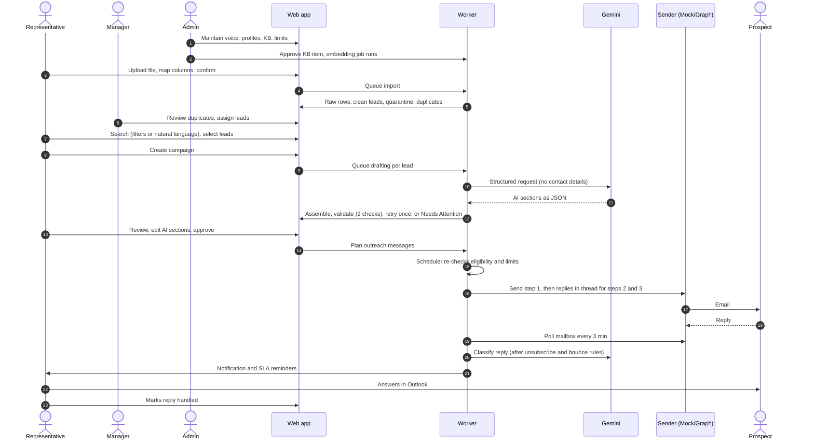

### 20.2 Stage-by-stage workflow

| # | Stage | Actor | System actions | Result / new state | Main failure path | Milestone |
|---|---|---|---|---|---|---|
| 1 | Prepare content | Admin | Create or edit voice, size and industry profiles, email structures, KB items; approve KB items | Config versions saved; embeddings queued and stored | Embedding fails: item stays non-retrievable and an alert is shown | M4 |
| 2 | Upload file | Rep | Store file, compute SHA-256, detect duplicate file | `ImportFile` = uploaded | Same hash seen: warn with the earlier date and user; cancel or import anyway (D-109) | M2 |
| 3 | Map and preview | Rep | Pick worksheet, source profile, default country; map columns; fix missing headers; show preview and estimate | `ImportFile` = ready | Unmapped required columns: block confirm | M2 |
| 4 | Import | Worker | Save every row raw, normalize, validate | Raw rows kept; valid rows continue; invalid rows to quarantine | Row errors never fail the file; worker crash resumes from last chunk | M2 |
| 5 | Quarantine handling | Rep / Manager | List by issue; edit, fix and release, or discard; download | Released rows re-enter step 4 logic; discarded rows audited | Fixed record still invalid: stays quarantined | M2 |
| 6 | Match and merge | Worker | Person and company matching; field-level latest-wins merge; per-import change summary; uncertain matches imported as "Possible duplicate" and kept out of campaigns | New or updated People and Companies | Ambiguous match becomes a *possible duplicate*, never an auto-merge | M2 |
| 7 | Duplicate review | Manager | Compare side by side; merge or mark not-a-duplicate | Merged record (all emails kept, timelines combined), or a remembered "not a duplicate" | Merged record had an opt-out: the opt-out survives the merge | M2 |
| 8 | Assign | Manager | Assign owners, singly or in bulk; unassigned view on dashboard | `owner` set; audit entry | None significant | M3 |
| 9 | Search | Rep | Structured filters, or natural-language text translated to filters; user sees and edits interpreted filters; run; paginate | Result list with eligibility shown | AI unavailable: structured filters still work; invented fields are dropped and reported | M3 |
| 10 | Select | Rep | Select individual leads or "all matching" (stores the filter) | Selection | None significant | M3 |
| 11 | Create campaign | Rep | Run eligibility on selection; show eligible and excluded counts with reasons; choose mailbox, sequence config, target date; show completion estimate | `Campaign` = draft | Estimate shows target unreachable: warn, let the rep adjust | M4 |
| 12 | Draft | Worker | Per lead: resolve profiles, retrieve ≤5 approved items, build allow-listed payload, call AI, assemble from structure, run nine checks | Sequence = Ready, or retry once, then Needs Attention | AI timeout or 429: backoff and retry; outage: sequences wait in a retryable state | M4 |
| 13 | Review and approve | Rep (owner only) | Preview, edit AI sections only, revalidate, regenerate, approve or reject; bulk-approve clean sequences | Sequence = Approved; messages planned | Edit introduces a Fail: approval blocked until fixed | M4 |
| 14 | Plan and schedule | App + Worker | Create three messages per lead (Planned/Scheduled) with dates in the prospect's zone | `OutreachMessage` rows | Unreachable target date: warn the owner | M5 |
| 15 | Send | Worker | Claim due message; recheck eligibility, opt-out and all limits; render final HTML and text; send; store thread IDs | Message = Sent; thread created | Limit hit: deferred with reason. Ineligible: cancelled. Technical error: retry at 30 min, 4 h, 20 h, then Failed + notification | M5 / M7 |
| 16 | Follow-ups | Worker | Steps 2 and 3 as replies in the original thread; follow-ups take priority over new first emails | Messages sent in thread | Reply or opt-out received first: remaining steps cancelled | M5 |
| 17 | Monitor replies | Worker | Poll every 3 min (delta query); drop unrelated mail without storing; match threads; store matched messages | `InboundMessage` | Delta token invalid: safe resync limited to app threads | M6 / M7 |
| 18 | Triage reply | Worker | Unsubscribe check, then bounce check, then AI classification with confidence | Category set; or Unclear if confidence < 0.7 | AI unavailable: message waits as Unclassified and the rep is told to read it manually | M6 |
| 19 | Act on reply | Worker | Out of office: record and continue. Other categories: stop sequence. Unsubscribe: create opt-out. Notify sending rep and lead owner; start SLA clock | Notification, sequence state | Notification email fails: in-app notice still shown | M6 |
| 20 | Handle reply | Rep | Reply in Outlook; mark handled in app; SLA reminders stop | Reply = handled | Not handled by end of business day: hourly reminders | M6 |
| 21 | Track and report | All | Lead timeline, campaign progress, per-lead status, results CSV, dashboards, audit | Visible history | None significant | M3 to M6 |
| 22 | Administer | Admin | Users, mailboxes, limits, mappings, compliance, opt-out removal (with reason), erasure; activate real sending after the gate | Audited changes | Gate not passed: real sending cannot be activated | M5 to M8 |

### 20.3 State machines

**Import file**
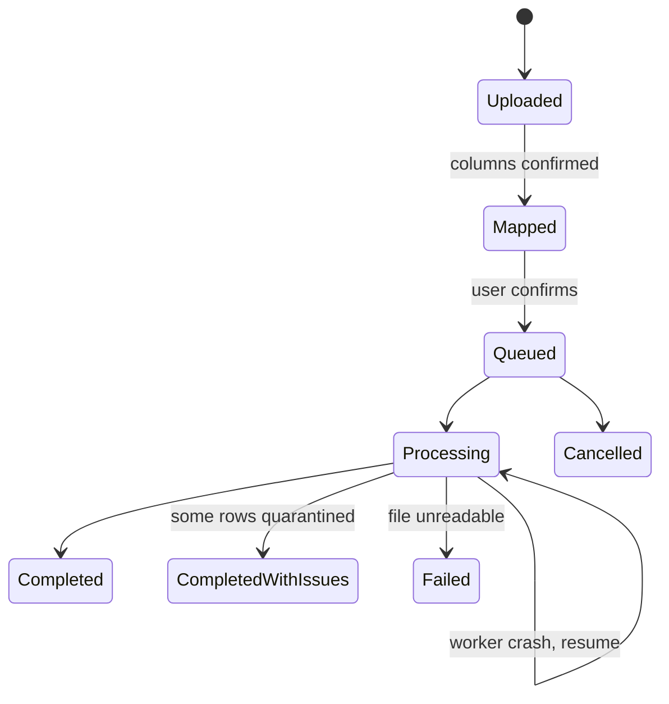

**Lead journey (workflow state, derived from data; the `lead_status` values themselves are UNRESOLVED)**
```mermaid
stateDiagram-v2
  [*] --> Quarantined
  [*] --> Imported
  Quarantined --> Imported: fix and release
  Quarantined --> [*]: discard
  Imported --> Eligible
  Imported --> Ineligible: opt-out, invalid email, other rule
  Eligible --> InCampaign
  InCampaign --> Contacted: first email sent
  Contacted --> Replied
  Contacted --> OptedOut
  Contacted --> Bounced
  Contacted --> CoolingOff: sequence finished (90 days)
  Replied --> CoolingOff
  CoolingOff --> Eligible: cooling-off over
  Ineligible --> Eligible: restriction cleared
```

**Email sequence (review)**
```mermaid
stateDiagram-v2
  [*] --> Generating
  Generating --> Ready: all checks pass or warn
  Generating --> Retrying: a check fails
  Retrying --> Ready
  Retrying --> NeedsAttention: second failure
  NeedsAttention --> Ready: rep edits and revalidates
  Ready --> Approved
  Approved --> Ready: undo (while still possible)
  Ready --> Rejected
  Approved --> Running: first message sent
  Running --> Completed
  Running --> Stopped: reply, opt-out, bounce, pause
```

**Outreach message (queue)**
```mermaid
stateDiagram-v2
  [*] --> Planned
  Planned --> Scheduled: date and time slot assigned
  Scheduled --> Sending: claimed by worker
  Sending --> Sent
  Sending --> RetryWait: technical failure
  RetryWait --> Sending: 30 min, 4 h, 20 h
  RetryWait --> Failed: retries exhausted
  Scheduled --> Deferred: limit or time window
  Deferred --> Scheduled
  Scheduled --> Cancelled: opt-out, reply, pause, campaign stopped
  Sending --> Sending: stuck, recovered after timeout
```
`Planned` means a future step whose date depends on an earlier step actually being sent. `Scheduled` means the date is fixed. This is my reading of the brief's two statuses. `[ASSUMPTION]`

### 20.4 Worked example: one lead through a default sequence

Assumes the prospect is in a Monday–Friday office zone, no holidays, all limits satisfied. `[ASSUMPTION]`

| When (prospect's local time) | Event |
|---|---|
| Monday 10:12 | Step 1 sent from the rep's mailbox (day 0) |
| Monday to Wednesday | App watches for replies every 3 min. Min gap between emails is 2 business days. |
| Thursday 09:40 | Step 2 sent in the same thread (business day 3). Eligibility and limits re-checked first. |
| Next Wednesday 11:05 | Step 3 sent in the same thread (business day 7). |
| Any time | A reply, bounce or unsubscribe cancels the remaining steps. An out-of-office reply does not. |
| After step 3 | Cooling-off: no new campaign for 90 days. |

Alternative branch: the prospect replies "Interested" on Tuesday. The sequence stops, the rep and lead owner are notified, the SLA clock starts, the rep replies in Outlook the same business day and marks it handled.

### 20.5 Exception and edge paths

| Situation | Behaviour |
|---|---|
| Lead opts out between approval and send | Send-time check cancels the message. Audit entry. No bypass. |
| Rep leaves the company | Admin deactivates the user, reassigns leads and campaigns, resolves mailbox access. Pending messages are paused until reassigned. `[SUGGESTION]` |
| Mailbox hits 30/day or 8/hour | Remaining messages deferred with a reason and rescheduled. |
| Two people at one company already contacted today | Third is deferred to the next eligible day. |
| Worker crash while sending | Stuck-message recovery (11.3) prevents duplicates. |
| Gemini outage | Imports, search by filters, sending and reply monitoring continue. Only drafting, NL search and classification wait. |
| Graph outage or throttling | Sends retry on the technical schedule. Polling resumes from the saved delta cursor. |
| Draft fails twice | Needs Attention. Rep edits or regenerates. Notification sent. |
| Duplicate file uploaded | Warned with the earlier date and user; the user cancels or imports anyway. |
| Unrelated mail in a rep's inbox | Ignored and never stored. |
| Manager opens another rep's draft | Read-only. Edit and approve actions are refused server-side. |

### 20.6 Daily and weekly operating rhythm

| Role | Typical use |
|---|---|
| Representative | Morning: dashboard (replies to handle, drafts to review, failed sends). Review and approve sequences. Handle replies in Outlook and mark handled. Weekly: build next campaign. |
| Manager | Weekly: duplicate review, assign new leads, check team statistics, spot-check drafts, review unhandled replies. |
| Admin | As needed: maintain content and limits, user changes. Weekly: check failed jobs and audit highlights. |

---

## 21. Implementation plan (how the work will be run)

### 21.1 Working agreements `[SUGGESTION]`
- **Vertical slices:** each milestone ends with a working, demonstrable feature, not only models.
- **Branching:** short-lived branches, pull requests into `main`, CI must pass before merge.
- **Migrations:** every model change has a reviewed migration. No edits to applied migrations. Destructive changes use expand-then-contract.
- **Feature flags** for risky features, especially real sending (a setting guarded by the compliance gate).
- **Decision log:** each significant technical decision is recorded in `docs/decisions/` with date and reason.
- **Keep real personal data out of the free-tier AI path:** development and AI testing use a hand-selected test dataset with the free-tier Gemini key (D-062); a wrong filter could send real data to the free tier, which Q-A accepts as an MVP risk, so take care when selecting test records. Automated tests use synthetic leads. Real imports only in staging or production, with access controls and a paid Gemini key.
- **Secrets:** `.env` only, never committed. `.env.example` documents each variable without values.
- **Documentation produced alongside code:** README (setup on Mac), architecture overview, runbooks, admin guide, rep guide.

### 21.2 Environments

| Environment | Purpose | Sender | AI | Data |
|---|---|---|---|---|
| Local (Mac) | Development and MVP running (Q-DESIGN-01; sized for about 5 reps and a few thousand emails per month) | MockSender | Free-tier Gemini key on hand-selected test data (D-062), or fake provider | Synthetic or hand-selected test records |
| CI | Automated checks | Mock, network blocked | Fake provider | Synthetic, throwaway DB |
| Staging (post-M8) `[SUGGESTION]` | Rehearse deploys, UAT, Graph test mailboxes | Mock, then Graph to test mailboxes only | Real Gemini | Synthetic or small approved sample |
| Production | Real use | Graph, after gate | Real Gemini | Real |

Whether you want a separate staging server is a decision (section 25).

### 21.3 Effort estimate

No team size, start date or deadline was given, so these are **relative ranges for one experienced full-stack developer**, to be recalculated once team size and start date are known. `[ASSUMPTION]` The v0.3 stack change (separate Next.js frontend and FastAPI API) has not been re-estimated. I expect it to add effort in M1 and in every screen-heavy milestone, so treat the ranges below as the pre-change figures.

| Milestone | Indicative effort | Main uncertainty |
|---|---|---|
| M1 Setup and data model | 1–2 weeks | Content of `app.design` |
| M2 Import, validation, dedupe | 2–3 weeks | Three source layouts, matching edge cases |
| M3 Search, eligibility, opt-outs | 2–3 weeks | Eligibility parity, NL search quality |
| M4 KB, AI drafting, review | 3–4 weeks | Prompt quality, validator thresholds |
| M5 Scheduler, mock sender, dashboard | 3–4 weeks | Limits and time-zone correctness |
| M6 Replies and notifications | 2–3 weeks | Classification quality |
| M7 Graph | 2–3 weeks | Tenant access, throttling |
| M8 Gate and controlled sending | 1–2 weeks | Gate definition |
| Hardening, docs, UAT, deployment (section 23) | 2–3 weeks | Hosting choice |
| **Total** | **about 18–27 weeks** | |

A larger team can parallelise some work (for example Graph spikes during M4–M5, content admin screens beside drafting), but the data model, eligibility service and scheduler should have a single owner.

### 21.4 Definitions

**Definition of Ready (a task can start):** acceptance criteria written; any `[UNRESOLVED]` rule it depends on is answered; test data identified.

**Definition of Done (a task is finished):**
1. Code merged through review, ruff clean.
2. Automated tests for each business rule touched, all passing.
3. Permission checks present and tested.
4. Audit events added where required.
5. No secrets or personal data in code, logs or fixtures.
6. Migrations applied cleanly on an empty DB and on a copy of realistic data.
7. Docs and admin help updated.
8. Demonstrated against the milestone checklist.

### 21.5 Review gates with you

| Gate | When | You decide |
|---|---|---|
| G0 | Before M1 | Approve this plan and section 18/25 answers |
| G1 | End of M1 | Schema and permissions |
| G2 | End of M2 | Import behaviour with your real sample files |
| G3 | End of M4 | Email quality: AI output, validators, review UX |
| G4 | End of M5 | Scheduling behaviour and limits |
| G5 | End of M6 | Reply handling and SLA |
| G6 | End of M7 | Graph in test tenant |
| G7 | M8 | Go-live readiness (section 23.5) |

### 21.6 Initial data to prepare
Source profiles (three layouts), industry and state mappings, personal-domain and generic-prefix lists, default voice and profiles, email structures, banned phrases, initial KB items, user list with roles and mailboxes, default limits. Most of these come from the missing documents (section 17). Seed scripts will load them idempotently so staging and production can be rebuilt.

---

## 22. Testing plan

### 22.1 Principles
- Every important business rule has an automated test (security rule 15, `[AGREED]`).
- Tests run without network access to Gemini or Microsoft. Fakes and recorded responses are used. A network guard fails any test that tries a real external call.
- AI output is not deterministic, so the application is tested around the AI (schemas, validators, fallbacks), and AI quality is checked separately (22.4).
- Time is never read directly: all code uses `core.clock.now()`, so tests control time.

### 22.2 Test layers

| Layer | What | Tools | Examples |
|---|---|---|---|
| Unit | Pure functions and rules | pytest | Normalizers, validators, matching, limit calculations, business-day arithmetic |
| Service / database | Services against real PostgreSQL (not SQLite), including pgvector | pytest | Merge precedence, eligibility, scheduler claims, retrieval |
| Concurrency | Row locking and idempotency | pytest with threads or processes | Two workers claim one message; two imports of one file |
| Property-based | Rules with many inputs | Hypothesis `[SUGGESTION]` | Limits never exceeded for any generated schedule |
| Integration | Jobs + services + fakes | pytest | Import end to end; approve to Outbox; reply to notification |
| Contract | Sender and AI adapters | Recorded responses | Graph send, delta, errors; Gemini structured output |
| API / permission | Role × endpoint matrix | httpx / FastAPI TestClient | Rep cannot edit manager view; every route has a declared permission |
| Frontend component | Forms, filter chips, review editor, protected-section display | Vitest + React Testing Library `[SUGGESTION]` | Fixed sections are read-only in the UI (the server test is the real check) |
| UI end-to-end | Key journeys in a browser | Playwright `[SUGGESTION]` | Import wizard, review queue, Outbox view |
| Security | Authorization, input, secrets | pytest, manual review, dependency audit | See 22.5 |
| Performance | Realistic volumes | scripts, timing | Large import, search on large dataset, scheduler tick |
| UAT | Real users, real workflow | Manual checklists | See 22.6 |

### 22.3 Scenario suites tied to the end-to-end workflow
Each stage in 20.2 has at least one happy-path and one failure-path test. Three full-journey tests run in CI:
1. **Golden path:** import, dedupe, search, campaign, draft, approve, send via MockSender, advance test clock through all three steps.
2. **Reply path:** simulated replies for every category, including out-of-office (sequence continues) and unsubscribe (opt-out created, sequence stopped, no AI call).
3. **Failure path:** AI outage during drafting, worker crash mid-send, opt-out arriving between steps, mailbox limit exhausted.

### 22.4 AI quality evaluation (separate from pass/fail tests)
- **Golden sets** of anonymised or synthetic inputs with expected properties: NL queries and expected filters; replies and expected categories; leads and checks for draft quality.
- Report accuracy per category and the share of drafts passing validators first time.
- **Run on every change** to prompts, models or profiles, and before any Gemini model change. `[SUGGESTION]`
- **Human sampling** at G3: you review a batch of drafts for tone and accuracy. Pass bar to be agreed. `[UNRESOLVED]`
- **Adversarial cases:** prompt injection in lead fields, KB items, NL queries and reply bodies; the app must still return only schema-valid output and never execute free text.

### 22.5 Security rules traceability

| # | Rule from brief | How it is tested |
|---|---|---|
| 1 | No credentials in source | Secret scanner in CI (e.g. gitleaks); fails on findings |
| 2 | Secrets in git-ignored `.env` | Check `.gitignore`; settings fail fast if variables missing |
| 3 | No contact details to AI | Payload tests across all AI tasks assert absence of email, phone, LinkedIn |
| 4 | No send after opt-out | Opt-out at each lifecycle point; send is cancelled |
| 5 | No real sending without gate | Activation attempts with each gate item failing |
| 6 | Server-side permissions | Permission matrix; forged requests |
| 7 | Fixed sections protected | Tampered POST bodies rejected |
| 8 | Recheck before every email | Change state after scheduling; assert cancel or defer |
| 9 | No duplicate jobs or sends | Concurrency and crash tests |
| 10 | Original data preserved | Raw row equality after merges and edits |
| 11 | Audit history | One test per audited action |
| 12 | AI failure handling | Fake provider: timeout, 429, 5xx, malformed JSON |
| 13 | Unrelated mail not stored | Inbound fixtures with unrelated mail; DB must contain none |
| 14 | No data or credentials in logs | Log capture tests with sentinel values |
| 15 | Tests for business rules | Coverage review per milestone |

Additional: OWASP-style review (CSRF, XSS in the React frontend, IDOR, injection, upload handling including file type and size limits and formula injection in CSV exports). Email previews and the Outbox render HTML from generated content, so they must be shown in a sandboxed iframe or sanitised, never injected raw into the page, dependency vulnerability audit, and an authorization review before go-live. `[SUGGESTION]`

### 22.6 User acceptance testing
- Run with the five representatives, a manager and an admin on staging or a controlled production setup with test recipients.
- Scripted scenarios from section 20, plus free exploration.
- Defects triaged as Blocker / Major / Minor. No Blockers and no open Majors affecting compliance or sending to proceed.
- Sign-off recorded (who, date, version).

### 22.7 Automation and quality gates
- CI on every pull request: ruff, pytest (with real PostgreSQL + pgvector), migration check, OpenAPI client up-to-date check, tsc, ESLint, frontend tests and build, secret scan, dependency audit (pip and npm).
- Coverage targets: high on `compliance`, `outreach`, `ai/validators` (suggest 90%+), reasonable elsewhere (suggest 80%+). `[SUGGESTION]`
- Nightly: concurrency and property-based suites with more iterations, plus AI golden-set evaluation if keys are available.
- Release candidates: full suite, migration rehearsal on a copy of production data, smoke tests after deploy.

### 22.8 Test data
Synthetic generators (factories) for leads, companies, files with every defect type (bad headers, merged cells, personal emails, duplicates, huge files), KB items, replies per category and in several languages. `[SUGGESTION]` Test with international names, non-Latin scripts and many time zones.

---

## 23. Deployment plan

The brief says the MVP runs natively on the Mac, with Docker deferred until server deployment. This section covers that later step. Hosting details are not specified, so most choices below are suggestions. `[UNRESOLVED]`

### 23.1 Deployment stages

| Stage | Description | Exit condition |
|---|---|---|
| 0. Local MVP | Mac-native: Homebrew PostgreSQL 17, Python virtualenv, Node.js; API, frontend and worker as three terminals or a process manager | M1–M6 complete, MockSender only |
| 1. Staging server | Production-like setup, MockSender, then Graph to test mailboxes | M7 acceptance met |
| 2. Production, locked | Production deployed with real sending **disabled** | Gate not yet passed |
| 3. Production, controlled real sending | See rollout phases (23.6) | G7 approved |

### 23.2 Target architecture `[SUGGESTION]`

```mermaid
flowchart LR
  U[Users] -->|HTTPS| RP[Reverse proxy + TLS]
  RP --> FE[Next.js frontend]
  RP -->|/api| API[FastAPI API: uvicorn]
  FE -->|server-side calls| API
  API --> PG[(PostgreSQL 17 + pgvector)]
  WRK[Procrastinate workers] --> PG
  API --> SEC[Secrets via env or secret manager]
  WRK --> SEC
  WRK --> GEM[Gemini API]
  WRK --> GR[Microsoft Graph]
  PG --> BK[(Encrypted backups, off-host)]
  API --> LOG[Central logs and metrics]
  FE --> LOG
  WRK --> LOG
```

- **Containers:** api, frontend (Next.js), worker, and one-off migration job. PostgreSQL either managed (must support pgvector and PostgreSQL 17) or self-hosted with tested backups. A single small server with Docker Compose is enough for about five users.
- **Process roles:** the API handles requests only. Next.js serves the UI and calls the API; both sit behind one reverse proxy on one domain so the session cookie is first-party. Worker runs imports, drafting, scheduler tick, mailbox polling, SLA and embedding jobs. Periodic jobs are deduplicated with queueing locks so extra workers are safe.
- **Static files:** Next.js serves its own assets. Uploaded import files stored on a persistent volume, outside any web root, with limits and cleanup policy.
- **Network:** outbound access only to Gemini, Microsoft login and Graph endpoints. The database is not publicly reachable.
- **Security settings:** debug off, API docs endpoints (`/docs`, `/openapi.json`) disabled or protected in production, strict CORS and trusted hosts, secure HttpOnly cookies, HSTS, security headers (including a Content-Security-Policy set from Next.js), rate limits on login.
- **Access:** the app is internal. Consider restricting to company network or VPN. `[UNRESOLVED]`

### 23.3 Configuration and secrets

| Item | Notes |
|---|---|
| Variables | `DATABASE_URL`, session secret, allowed hosts and CORS origins, API base URL for the frontend (no secrets in `NEXT_PUBLIC_*` variables), Gemini key and model names per task, Graph tenant/client credentials, sender mode (mock or graph), log level |
| Storage | Environment or secret manager. Never in git, images or logs |
| Microsoft credentials | Prefer a certificate over a client secret. Record expiry date and owner `[SUGGESTION]` |
| Rotation | Documented procedure and calendar reminders (see 24.5) |
| Per-environment | Separate Gemini keys, Graph app registrations and databases for staging and production |

### 23.4 Release procedure `[SUGGESTION]`
1. Tag a release after CI passes. Build the image or package.
2. Take a database backup (automatic) and note the current version.
3. Deploy to staging, run migrations, run smoke tests.
4. Deploy to production in a short, announced window: stop worker (finish in-flight jobs), run migrations, start API, frontend and worker.
5. Smoke tests: login, health endpoint, create test import, open Outbox or sent items, worker heartbeat, a no-op job.
6. Watch logs and failed-job counts for one hour.
7. **Rollback:** redeploy the previous version. If a migration is not backward compatible, restore from backup. This is why destructive migrations use expand-then-contract.
8. Record release notes and audit the deploy.

For a five-user internal tool, a brief maintenance window is acceptable. `[ASSUMPTION]` Real sending can be paused by the kill switch during any release.

### 23.5 Go-live readiness checklist (gate G7)

**Technical**
- All milestone acceptance criteria met; full suite green; migration rehearsal done
- Backups running and a **restore test passed**
- Monitoring and alerts live (24.2); failed-send and worker-down alerts tested
- Kill switch tested
- Security review complete; secrets rotated from any development values
- Time zone and DST tests passed; test clock disabled in production `[SUGGESTION]`

**Microsoft 365 and email**
- App registration with admin consent for `Mail.Send` and `Mail.ReadWrite`
- Access restricted to the approved mail-enabled security group
- Only BD mailboxes in the group
- Sending domain has SPF, DKIM and DMARC configured, and sender reputation checked `[SUGGESTION]`
- Footer and unsubscribe `mailto` verified, and the mailbox that receives unsubscribes is monitored

**Compliance and content**
- Compliance gate items all passed `[definition UNRESOLVED]`
- Legal or compliance sign-off on email wording, opt-out handling, retention and erasure `[UNRESOLVED]`
- Initial KB items approved by the content owner; voice and profiles approved
- Sending limits confirmed (defaults 30 per day and 8 per hour; BD's 800–1,000 per day target validated or dropped)
- Paid Gemini tier key in place and the provider's data-use terms reviewed (D-062)
- Footer wording and postal address saved (Q-COMP-05 / 06); retention period agreed (D-100); Apollo data terms checked (Q-COMP-03)

**People**
- Users created and trained; rep and admin guides delivered
- Support contact and escalation path named
- UAT signed off

### 23.6 Rollout phases for real sending `[SUGGESTION]`

| Phase | Scope | Exit criteria |
|---|---|---|
| A. Mock only | MockSender in production | Team comfortable with all flows |
| B. Graph, test recipients only | Real Graph delivery to internal or approved test addresses | Threading, replies, bounces and unsubscribe behave correctly |
| C. Pilot | One rep, small campaigns | Several days with no incorrect sends; SLA and notifications work; bounce and complaint rates acceptable |
| D. Full team | All five reps | Continued monitoring; review at 2 and 4 weeks |

Move back a phase, or press the kill switch, if any unexpected send, compliance concern or abnormal bounce rate occurs. Thresholds for "acceptable" rates `[UNRESOLVED]`.

---

## 24. Post-deployment operations and maintenance

### 24.1 Ownership and support model `[UNRESOLVED: who]`
Name an **operations owner** (application health), a **content owner** (KB, voice, profiles), a **compliance owner** (opt-outs, gate, retention) and a **technical contact** for Microsoft 365. Define support hours and a way for reps to report problems (for example a shared mailbox or channel). Initial hypercare: daily check-ins for the first two weeks after Phase C, then weekly for four weeks. `[SUGGESTION]`

### 24.2 Monitoring and alerting `[SUGGESTION]`

| Signal | Alert when |
|---|---|
| Web health endpoint | Down or slow |
| Worker heartbeat | No heartbeat, or queue not draining |
| Job failures and retry counts | Failures above threshold; any job stuck beyond timeout |
| Scheduler | No tick for several minutes |
| Failed sends | Any Failed message (also notifies rep, per brief) |
| Messages stuck in Sending | Beyond timeout |
| Graph | Repeated 401 or 403 (expired secret, permission change); throttling |
| Mailbox polling | A mailbox has not been polled successfully for 15 minutes |
| Reply SLA | Unhandled replies past SLA (rep reminders per brief; also summarised for managers) |
| Gemini | Error or latency spike; quota nearing |
| Database | Disk, connections, long locks, backup failure, replication if used |
| Bounce and unsubscribe rates | Sudden increase |
| Security | Repeated login failures, unexpected admin actions |

Logs are structured and scrubbed of personal data and credentials (rule 14).

### 24.3 Routine tasks

| Cadence | Task | Owner |
|---|---|---|
| Daily | Check dashboard of failed jobs, failed sends, Needs Attention, unhandled replies | Ops / manager |
| Weekly | Review audit highlights (exports, opt-out removals, merges, settings); duplicate queue; quarantine backlog | Manager / admin |
| Weekly | Review bounce, unsubscribe and reply stats; any limit adjustments | Manager |
| Monthly | Apply security and dependency updates; review AI quality sample; review storage growth | Ops |
| Monthly | Backup restore check on a copy | Ops |
| Quarterly | Access review (users, roles, mailboxes, security group); content review (retire stale KB items); disaster recovery drill; review retention rules | Admin / compliance |
| Annually | Credential and certificate renewal check; architecture and cost review | Ops |

### 24.4 Backup and recovery
- **Backups:** nightly full database backup plus continuous WAL archiving if point-in-time recovery is required `[SUGGESTION]`. Encrypted, stored off the server, including uploaded import files and configuration (not secrets in plain text).
- **Targets:** RPO and RTO are business decisions. `[UNRESOLVED]` A reasonable starting point is RPO ≤ 24 hours and RTO ≤ 1 working day.
- **Restore drill:** at least quarterly. A backup that has not been restored is not a backup.
- **Key point for this app:** after a restore, the scheduler and sent-message state could be older than what Microsoft 365 actually sent. Recovery runbook: keep real sending paused, reconcile `OutreachMessage` against Sent Items, only then resume.
- **Retention of backups** must be consistent with erasure obligations (erased people may remain in old backups; document and handle on restore). `[UNRESOLVED]`

### 24.5 Security, patching and credentials
- **FastAPI, Next.js and React** release major versions often. Confirm the support window of the Node.js LTS and Next.js major in use, and plan major upgrades ahead of end of support. Run `pip audit` and `npm audit` in CI. Apply security releases promptly (suggested within days).
- Update Python, Node.js, PostgreSQL minor versions, pgvector and dependencies monthly; major versions on a planned schedule, tested in staging.
- **Credential rotation:** Graph secret/certificate before expiry (calendar reminder, documented steps, overlap window), Gemini API key at least annually or on staff change, session secret on suspected exposure.
- **Joiners/movers/leavers:** access reviewed quarterly and immediately on departure. Leaver steps: deactivate account, reassign leads and campaigns, handle pending messages, remove mailbox from the security group if appropriate.
- **Incident response:** severity levels (for example: S1 wrong or unauthorized send, compliance breach or data exposure; S2 sending stopped; S3 degraded). S1 steps: press the kill switch, contain, preserve logs, notify the compliance owner, review audit, fix, write a post-incident note. `[SUGGESTION]`

### 24.6 AI and content maintenance
- **Model lifecycle:** Gemini models are retired or replaced from time to time. Models are configured per task, so a change is a settings change, but it must be run through the golden-set evaluation (22.4) first. Subscribe to provider deprecation notices. Embeddings are tied to a specific model: changing the embedding model requires re-embedding all approved items (the stored model name and dimension make this detectable).
- **Prompt and profile changes** are versioned (the config version history) and evaluated before use.
- **KB governance:** content owner reviews approved items on a schedule; retire outdated case studies; approval is audited.
- **Quality feedback loop:** track which drafts reps edit heavily, which are rejected, and which checks fail most. Use this to tune profiles and prompts. `[SUGGESTION]`
- **Cost control:** monitor token usage per task; set budgets and alerts.

### 24.7 Data lifecycle and housekeeping
Retention periods are business and legal decisions `[UNRESOLVED]`. Suggested handling:

| Data | Suggested approach |
|---|---|
| Raw import rows | Keep (required to preserve original data), review size growth; consider archiving old files; removed only by erase-person (D-099) |
| Uploaded files | Keep per policy; archive or delete after set period |
| Inbound messages (matched only) | Retain per policy; delete or anonymise old ones |
| Outbox (mock) | Purge in production, where it should be unused |
| Audit log | Long retention, append-only |
| Notifications | Purge read items after a set period |
| Suppression records | Retain indefinitely (minimal) so opt-outs and erasures are never undone |
| Job queue history | Prune old completed jobs |

Housekeeping jobs are scheduled and logged. Database maintenance (vacuum/analyze, index review) is monitored. Add pgvector indexes only when retrieval slows (10.6).

### 24.8 Change management
- Small fixes: normal pull request flow and release procedure (23.4).
- Configuration changes by admins (limits, profiles, structures) are audited and versioned, and never need a deploy.
- **Sending limit changes** are reviewed by the manager and compliance owner, because they affect deliverability and compliance.
- **Backlog for deferred features** (A/B testing, Apollo API sync, public unsubscribe pages, auto-send, AI reply suggestions, analytics, WhatsApp, LinkedIn) is kept separately. Each needs its own design and a decision before work starts.
- Post-go-live reviews at 2, 4 and 12 weeks: usage, defects, performance, reply handling quality, rep feedback, whether the limits and templates need tuning.

### 24.9 Documentation to hand over
Setup and deployment guide, architecture and data model, configuration reference (all environment variables), runbooks (worker down, Graph auth failure, stuck messages, restore, kill switch, leaver process, incident), admin guide, rep guide, manager guide, testing guide, decision log, and an up-to-date list of unresolved items.

---

## 25. Additional decisions needed (deployment and operations)

1. Where will production run (existing server, cloud VM, managed platform)? Is a separate staging environment wanted?
2. Is access limited to the company network or VPN?
3. Who is the operations owner, content owner, compliance owner and Microsoft 365 contact?
4. Backup targets: acceptable data loss (RPO) and downtime (RTO).
5. Retention periods for raw data, replies, audit and backups; legal position on erasure.
6. Team size and timeline, so section 21.3 can be turned into dates.
7. Acceptable bounce, unsubscribe and complaint thresholds for moving between rollout phases.
8. Whether Docker Compose on a single server is acceptable for the first deployment (the brief defers Docker until server deployment, so I have placed it in stage 1 of 23.1).
9. Monitoring tooling preferences (self-hosted, existing company tools, or a hosted service).
10. UAT participants and sign-off authority.

---

## 26. Next steps

1. You review this draft and answer sections 18 and 25.
2. You supply the missing documents.
3. I revise this plan, including dates in 21.3.
4. You approve the plan (gate G0).
5. Implementation starts at M1. No code is written before step 4.


## 18. Decisions I need from you

**A. Settled by Q-A (no decision needed):** rep permissions to import, fix quarantine, export and view all leads (D-104, D-107, D-087, D-001); manager assignment (D-075); admin-only erase (D-099); latest source wins per field (D-046); uncertain matches become possible duplicates, never auto-merged (D-092); confidence threshold admin-adjustable, default 0.7 (D-094).

**A. Please confirm or correct my assumptions**
1. "Latest" means latest import time; blank incoming values do not overwrite existing data.
2. Business days 3 and 7 are counted from the actual send of step 1.
3. Simulate Reply is available only under MockSender.
4. Undo approval is allowed until the first message in that sequence is sent.
5. Password login for the MVP.
6. Qualified, Handed Off and replied leads are excluded from new campaigns (Q-A working assumption, 2 Nov).
7. A person counts as opted out in search if any of their addresses is opted out (Q-A working assumption, 2 Nov).

**B. Approve or reject my suggestions**
1. Define each eligibility rule once, as SQL expression + record check, with a parity test.
2. Re-embed or return to Draft when an approved KB item is edited.
3. Graph draft-then-send pattern to avoid duplicates on crash.
4. (Settled: erasure keeps the plain address on the opt-out list, D-099.)
5. Redact reply text before sending to AI.
6. Disable the test clock when real sending is active.
7. Pull the minimal AI adapter into M3; spike Graph issues in M5.
8. Admin-editable lists for personal domains and generic prefixes.

**C. Please provide**
`app.design` (if one applies to this fresh start), the sample file `Agentic Databse.xlsx` and a real Apollo CSV, footer wording and postal address (Q-COMP-05 / 06), approved case studies (Q-CONTENT-04), brand tone examples (Q-CONTENT-06), a decision on first-email length (Q-CONTENT-14), and the retention period.

---

## 19. Risks

| Risk | Mitigation |
|---|---|
| Missing spec documents lead to rework | Resolve section 17 before M2/M4/M8 start |
| Duplicate or unauthorized send | Single queue, row locking, idempotency keys, send-time recheck, kill switch, gate |
| Eligibility logic drift between search and send | Shared rule definitions + parity tests |
| AI outage or rate limits | Adapter, backoff, circuit breaker, retryable draft state |
| Personal data leaks to AI or logs | Allow-list payloads, redaction, log scrubbing tests |
| Graph tenant setup delays | Interface contract + recorded fixtures; start IT request early |
| Time-zone and DST bugs | Store UTC, convert per prospect zone, dedicated test cases |
| Import volume | Chunking, indexes, progress and resumability |
| API and frontend drift (two codebases) | Single OpenAPI schema, generated TypeScript client, CI fails if the client is out of date |
| Scope creep from deferred features | Keep the exclusion list (3.2) visible |

---

---

## 20. End-to-end workflow

This section follows one batch of leads from a spreadsheet to a handled reply, naming who does what, what the system does, and where it can fail. It expands the workflow summary in section 1.4.

### 20.1 Who does what (overview)

```mermaid
sequenceDiagram
  autonumber
  actor Rep as Representative
  actor Mgr as Manager
  actor Adm as Admin
  participant App as Web app
  participant W as Worker
  participant AI as Gemini
  participant MS as Sender (Mock/Graph)
  actor Pros as Prospect

  Adm->>App: Maintain voice, profiles, KB, limits
  Adm->>W: Approve KB item, embedding job runs
  Rep->>App: Upload file, map columns, confirm
  App->>W: Queue import
  W->>App: Raw rows, clean leads, quarantine, duplicates
  Mgr->>App: Review duplicates, assign leads
  Rep->>App: Search (filters or natural language), select leads
  Rep->>App: Create campaign
  App->>W: Queue drafting per lead
  W->>AI: Structured request (no contact details)
  AI-->>W: AI sections as JSON
  W->>App: Assemble, validate (9 checks), retry once, or Needs Attention
  Rep->>App: Review, edit AI sections, approve
  App->>W: Plan outreach messages
  W->>W: Scheduler re-checks eligibility and limits
  W->>MS: Send step 1, then replies in thread for steps 2 and 3
  MS->>Pros: Email
  Pros-->>MS: Reply
  W->>MS: Poll mailbox every 3 min
  W->>AI: Classify reply (after unsubscribe and bounce rules)
  W->>Rep: Notification and SLA reminders
  Rep->>Pros: Answers in Outlook
  Rep->>App: Marks reply handled
```

### 20.2 Stage-by-stage workflow

| # | Stage | Actor | System actions | Result / new state | Main failure path | Milestone |
|---|---|---|---|---|---|---|
| 1 | Prepare content | Admin | Create or edit voice, size and industry profiles, email structures, KB items; approve KB items | Config versions saved; embeddings queued and stored | Embedding fails: item stays non-retrievable and an alert is shown | M4 |
| 2 | Upload file | Rep | Store file, compute SHA-256, detect duplicate file | `ImportFile` = uploaded | Same hash seen: warn with the earlier date and user; cancel or import anyway (D-109) | M2 |
| 3 | Map and preview | Rep | Pick worksheet, source profile, default country; map columns; fix missing headers; show preview and estimate | `ImportFile` = ready | Unmapped required columns: block confirm | M2 |
| 4 | Import | Worker | Save every row raw, normalize, validate | Raw rows kept; valid rows continue; invalid rows to quarantine | Row errors never fail the file; worker crash resumes from last chunk | M2 |
| 5 | Quarantine handling | Rep / Manager | List by issue; edit, fix and release, or discard; download | Released rows re-enter step 4 logic; discarded rows audited | Fixed record still invalid: stays quarantined | M2 |
| 6 | Match and merge | Worker | Person and company matching; field-level latest-wins merge; per-import change summary; uncertain matches imported as "Possible duplicate" and kept out of campaigns | New or updated People and Companies | Ambiguous match becomes a *possible duplicate*, never an auto-merge | M2 |
| 7 | Duplicate review | Manager | Compare side by side; merge or mark not-a-duplicate | Merged record (all emails kept, timelines combined), or a remembered "not a duplicate" | Merged record had an opt-out: the opt-out survives the merge | M2 |
| 8 | Assign | Manager | Assign owners, singly or in bulk; unassigned view on dashboard | `owner` set; audit entry | None significant | M3 |
| 9 | Search | Rep | Structured filters, or natural-language text translated to filters; user sees and edits interpreted filters; run; paginate | Result list with eligibility shown | AI unavailable: structured filters still work; invented fields are dropped and reported | M3 |
| 10 | Select | Rep | Select individual leads or "all matching" (stores the filter) | Selection | None significant | M3 |
| 11 | Create campaign | Rep | Run eligibility on selection; show eligible and excluded counts with reasons; choose mailbox, sequence config, target date; show completion estimate | `Campaign` = draft | Estimate shows target unreachable: warn, let the rep adjust | M4 |
| 12 | Draft | Worker | Per lead: resolve profiles, retrieve ≤5 approved items, build allow-listed payload, call AI, assemble from structure, run nine checks | Sequence = Ready, or retry once, then Needs Attention | AI timeout or 429: backoff and retry; outage: sequences wait in a retryable state | M4 |
| 13 | Review and approve | Rep (owner only) | Preview, edit AI sections only, revalidate, regenerate, approve or reject; bulk-approve clean sequences | Sequence = Approved; messages planned | Edit introduces a Fail: approval blocked until fixed | M4 |
| 14 | Plan and schedule | App + Worker | Create three messages per lead (Planned/Scheduled) with dates in the prospect's zone | `OutreachMessage` rows | Unreachable target date: warn the owner | M5 |
| 15 | Send | Worker | Claim due message; recheck eligibility, opt-out and all limits; render final HTML and text; send; store thread IDs | Message = Sent; thread created | Limit hit: deferred with reason. Ineligible: cancelled. Technical error: retry at 30 min, 4 h, 20 h, then Failed + notification | M5 / M7 |
| 16 | Follow-ups | Worker | Steps 2 and 3 as replies in the original thread; follow-ups take priority over new first emails | Messages sent in thread | Reply or opt-out received first: remaining steps cancelled | M5 |
| 17 | Monitor replies | Worker | Poll every 3 min (delta query); drop unrelated mail without storing; match threads; store matched messages | `InboundMessage` | Delta token invalid: safe resync limited to app threads | M6 / M7 |
| 18 | Triage reply | Worker | Unsubscribe check, then bounce check, then AI classification with confidence | Category set; or Unclear if confidence < 0.7 | AI unavailable: message waits as Unclassified and the rep is told to read it manually | M6 |
| 19 | Act on reply | Worker | Out of office: record and continue. Other categories: stop sequence. Unsubscribe: create opt-out. Notify sending rep and lead owner; start SLA clock | Notification, sequence state | Notification email fails: in-app notice still shown | M6 |
| 20 | Handle reply | Rep | Reply in Outlook; mark handled in app; SLA reminders stop | Reply = handled | Not handled by end of business day: hourly reminders | M6 |
| 21 | Track and report | All | Lead timeline, campaign progress, per-lead status, results CSV, dashboards, audit | Visible history | None significant | M3 to M6 |
| 22 | Administer | Admin | Users, mailboxes, limits, mappings, compliance, opt-out removal (with reason), erasure; activate real sending after the gate | Audited changes | Gate not passed: real sending cannot be activated | M5 to M8 |

### 20.3 State machines

**Import file**
```mermaid
stateDiagram-v2
  [*] --> Uploaded
  Uploaded --> Mapped: columns confirmed
  Mapped --> Queued: user confirms
  Queued --> Processing
  Processing --> Completed
  Processing --> CompletedWithIssues: some rows quarantined
  Processing --> Failed: file unreadable
  Processing --> Processing: worker crash, resume
  Queued --> Cancelled
```

**Lead journey (workflow state, derived from data; the `lead_status` values themselves are UNRESOLVED)**
```mermaid
stateDiagram-v2
  [*] --> Quarantined
  [*] --> Imported
  Quarantined --> Imported: fix and release
  Quarantined --> [*]: discard
  Imported --> Eligible
  Imported --> Ineligible: opt-out, invalid email, other rule
  Eligible --> InCampaign
  InCampaign --> Contacted: first email sent
  Contacted --> Replied
  Contacted --> OptedOut
  Contacted --> Bounced
  Contacted --> CoolingOff: sequence finished (90 days)
  Replied --> CoolingOff
  CoolingOff --> Eligible: cooling-off over
  Ineligible --> Eligible: restriction cleared
```

**Email sequence (review)**
```mermaid
stateDiagram-v2
  [*] --> Generating
  Generating --> Ready: all checks pass or warn
  Generating --> Retrying: a check fails
  Retrying --> Ready
  Retrying --> NeedsAttention: second failure
  NeedsAttention --> Ready: rep edits and revalidates
  Ready --> Approved
  Approved --> Ready: undo (while still possible)
  Ready --> Rejected
  Approved --> Running: first message sent
  Running --> Completed
  Running --> Stopped: reply, opt-out, bounce, pause
```

**Outreach message (queue)**
```mermaid
stateDiagram-v2
  [*] --> Planned
  Planned --> Scheduled: date and time slot assigned
  Scheduled --> Sending: claimed by worker
  Sending --> Sent
  Sending --> RetryWait: technical failure
  RetryWait --> Sending: 30 min, 4 h, 20 h
  RetryWait --> Failed: retries exhausted
  Scheduled --> Deferred: limit or time window
  Deferred --> Scheduled
  Scheduled --> Cancelled: opt-out, reply, pause, campaign stopped
  Sending --> Sending: stuck, recovered after timeout
```
`Planned` means a future step whose date depends on an earlier step actually being sent. `Scheduled` means the date is fixed. This is my reading of the brief's two statuses. `[ASSUMPTION]`

### 20.4 Worked example: one lead through a default sequence

Assumes the prospect is in a Monday–Friday office zone, no holidays, all limits satisfied. `[ASSUMPTION]`

| When (prospect's local time) | Event |
|---|---|
| Monday 10:12 | Step 1 sent from the rep's mailbox (day 0) |
| Monday to Wednesday | App watches for replies every 3 min. Min gap between emails is 2 business days. |
| Thursday 09:40 | Step 2 sent in the same thread (business day 3). Eligibility and limits re-checked first. |
| Next Wednesday 11:05 | Step 3 sent in the same thread (business day 7). |
| Any time | A reply, bounce or unsubscribe cancels the remaining steps. An out-of-office reply does not. |
| After step 3 | Cooling-off: no new campaign for 90 days. |

Alternative branch: the prospect replies "Interested" on Tuesday. The sequence stops, the rep and lead owner are notified, the SLA clock starts, the rep replies in Outlook the same business day and marks it handled.

### 20.5 Exception and edge paths

| Situation | Behaviour |
|---|---|
| Lead opts out between approval and send | Send-time check cancels the message. Audit entry. No bypass. |
| Rep leaves the company | Admin deactivates the user, reassigns leads and campaigns, resolves mailbox access. Pending messages are paused until reassigned. `[SUGGESTION]` |
| Mailbox hits 30/day or 8/hour | Remaining messages deferred with a reason and rescheduled. |
| Two people at one company already contacted today | Third is deferred to the next eligible day. |
| Worker crash while sending | Stuck-message recovery (11.3) prevents duplicates. |
| Gemini outage | Imports, search by filters, sending and reply monitoring continue. Only drafting, NL search and classification wait. |
| Graph outage or throttling | Sends retry on the technical schedule. Polling resumes from the saved delta cursor. |
| Draft fails twice | Needs Attention. Rep edits or regenerates. Notification sent. |
| Duplicate file uploaded | Warned with the earlier date and user; the user cancels or imports anyway. |
| Unrelated mail in a rep's inbox | Ignored and never stored. |
| Manager opens another rep's draft | Read-only. Edit and approve actions are refused server-side. |

### 20.6 Daily and weekly operating rhythm

| Role | Typical use |
|---|---|
| Representative | Morning: dashboard (replies to handle, drafts to review, failed sends). Review and approve sequences. Handle replies in Outlook and mark handled. Weekly: build next campaign. |
| Manager | Weekly: duplicate review, assign new leads, check team statistics, spot-check drafts, review unhandled replies. |
| Admin | As needed: maintain content and limits, user changes. Weekly: check failed jobs and audit highlights. |

---

## 21. Implementation plan (how the work will be run)

### 21.1 Working agreements `[SUGGESTION]`
- **Vertical slices:** each milestone ends with a working, demonstrable feature, not only models.
- **Branching:** short-lived branches, pull requests into `main`, CI must pass before merge.
- **Migrations:** every model change has a reviewed migration. No edits to applied migrations. Destructive changes use expand-then-contract.
- **Feature flags** for risky features, especially real sending (a setting guarded by the compliance gate).
- **Decision log:** each significant technical decision is recorded in `docs/decisions/` with date and reason.
- **Keep real personal data out of the free-tier AI path:** development and AI testing use a hand-selected test dataset with the free-tier Gemini key (D-062); a wrong filter could send real data to the free tier, which Q-A accepts as an MVP risk, so take care when selecting test records. Automated tests use synthetic leads. Real imports only in staging or production, with access controls and a paid Gemini key.
- **Secrets:** `.env` only, never committed. `.env.example` documents each variable without values.
- **Documentation produced alongside code:** README (setup on Mac), architecture overview, runbooks, admin guide, rep guide.

### 21.2 Environments

| Environment | Purpose | Sender | AI | Data |
|---|---|---|---|---|
| Local (Mac) | Development and MVP running (Q-DESIGN-01; sized for about 5 reps and a few thousand emails per month) | MockSender | Free-tier Gemini key on hand-selected test data (D-062), or fake provider | Synthetic or hand-selected test records |
| CI | Automated checks | Mock, network blocked | Fake provider | Synthetic, throwaway DB |
| Staging (post-M8) `[SUGGESTION]` | Rehearse deploys, UAT, Graph test mailboxes | Mock, then Graph to test mailboxes only | Real Gemini | Synthetic or small approved sample |
| Production | Real use | Graph, after gate | Real Gemini | Real |

Whether you want a separate staging server is a decision (section 25).

### 21.3 Effort estimate

No team size, start date or deadline was given, so these are **relative ranges for one experienced full-stack developer**, to be recalculated once team size and start date are known. `[ASSUMPTION]` The v0.3 stack change (separate Next.js frontend and FastAPI API) has not been re-estimated. I expect it to add effort in M1 and in every screen-heavy milestone, so treat the ranges below as the pre-change figures.

| Milestone | Indicative effort | Main uncertainty |
|---|---|---|
| M1 Setup and data model | 1–2 weeks | Content of `app.design` |
| M2 Import, validation, dedupe | 2–3 weeks | Three source layouts, matching edge cases |
| M3 Search, eligibility, opt-outs | 2–3 weeks | Eligibility parity, NL search quality |
| M4 KB, AI drafting, review | 3–4 weeks | Prompt quality, validator thresholds |
| M5 Scheduler, mock sender, dashboard | 3–4 weeks | Limits and time-zone correctness |
| M6 Replies and notifications | 2–3 weeks | Classification quality |
| M7 Graph | 2–3 weeks | Tenant access, throttling |
| M8 Gate and controlled sending | 1–2 weeks | Gate definition |
| Hardening, docs, UAT, deployment (section 23) | 2–3 weeks | Hosting choice |
| **Total** | **about 18–27 weeks** | |

A larger team can parallelise some work (for example Graph spikes during M4–M5, content admin screens beside drafting), but the data model, eligibility service and scheduler should have a single owner.

### 21.4 Definitions

**Definition of Ready (a task can start):** acceptance criteria written; any `[UNRESOLVED]` rule it depends on is answered; test data identified.

**Definition of Done (a task is finished):**
1. Code merged through review, ruff clean.
2. Automated tests for each business rule touched, all passing.
3. Permission checks present and tested.
4. Audit events added where required.
5. No secrets or personal data in code, logs or fixtures.
6. Migrations applied cleanly on an empty DB and on a copy of realistic data.
7. Docs and admin help updated.
8. Demonstrated against the milestone checklist.

### 21.5 Review gates with you

| Gate | When | You decide |
|---|---|---|
| G0 | Before M1 | Approve this plan and section 18/25 answers |
| G1 | End of M1 | Schema and permissions |
| G2 | End of M2 | Import behaviour with your real sample files |
| G3 | End of M4 | Email quality: AI output, validators, review UX |
| G4 | End of M5 | Scheduling behaviour and limits |
| G5 | End of M6 | Reply handling and SLA |
| G6 | End of M7 | Graph in test tenant |
| G7 | M8 | Go-live readiness (section 23.5) |

### 21.6 Initial data to prepare
Source profiles (three layouts), industry and state mappings, personal-domain and generic-prefix lists, default voice and profiles, email structures, banned phrases, initial KB items, user list with roles and mailboxes, default limits. Most of these come from the missing documents (section 17). Seed scripts will load them idempotently so staging and production can be rebuilt.

---

## 22. Testing plan

### 22.1 Principles
- Every important business rule has an automated test (security rule 15, `[AGREED]`).
- Tests run without network access to Gemini or Microsoft. Fakes and recorded responses are used. A network guard fails any test that tries a real external call.
- AI output is not deterministic, so the application is tested around the AI (schemas, validators, fallbacks), and AI quality is checked separately (22.4).
- Time is never read directly: all code uses `core.clock.now()`, so tests control time.

### 22.2 Test layers

| Layer | What | Tools | Examples |
|---|---|---|---|
| Unit | Pure functions and rules | pytest | Normalizers, validators, matching, limit calculations, business-day arithmetic |
| Service / database | Services against real PostgreSQL (not SQLite), including pgvector | pytest | Merge precedence, eligibility, scheduler claims, retrieval |
| Concurrency | Row locking and idempotency | pytest with threads or processes | Two workers claim one message; two imports of one file |
| Property-based | Rules with many inputs | Hypothesis `[SUGGESTION]` | Limits never exceeded for any generated schedule |
| Integration | Jobs + services + fakes | pytest | Import end to end; approve to Outbox; reply to notification |
| Contract | Sender and AI adapters | Recorded responses | Graph send, delta, errors; Gemini structured output |
| API / permission | Role × endpoint matrix | httpx / FastAPI TestClient | Rep cannot edit manager view; every route has a declared permission |
| Frontend component | Forms, filter chips, review editor, protected-section display | Vitest + React Testing Library `[SUGGESTION]` | Fixed sections are read-only in the UI (the server test is the real check) |
| UI end-to-end | Key journeys in a browser | Playwright `[SUGGESTION]` | Import wizard, review queue, Outbox view |
| Security | Authorization, input, secrets | pytest, manual review, dependency audit | See 22.5 |
| Performance | Realistic volumes | scripts, timing | Large import, search on large dataset, scheduler tick |
| UAT | Real users, real workflow | Manual checklists | See 22.6 |

### 22.3 Scenario suites tied to the end-to-end workflow
Each stage in 20.2 has at least one happy-path and one failure-path test. Three full-journey tests run in CI:
1. **Golden path:** import, dedupe, search, campaign, draft, approve, send via MockSender, advance test clock through all three steps.
2. **Reply path:** simulated replies for every category, including out-of-office (sequence continues) and unsubscribe (opt-out created, sequence stopped, no AI call).
3. **Failure path:** AI outage during drafting, worker crash mid-send, opt-out arriving between steps, mailbox limit exhausted.

### 22.4 AI quality evaluation (separate from pass/fail tests)
- **Golden sets** of anonymised or synthetic inputs with expected properties: NL queries and expected filters; replies and expected categories; leads and checks for draft quality.
- Report accuracy per category and the share of drafts passing validators first time.
- **Run on every change** to prompts, models or profiles, and before any Gemini model change. `[SUGGESTION]`
- **Human sampling** at G3: you review a batch of drafts for tone and accuracy. Pass bar to be agreed. `[UNRESOLVED]`
- **Adversarial cases:** prompt injection in lead fields, KB items, NL queries and reply bodies; the app must still return only schema-valid output and never execute free text.

### 22.5 Security rules traceability

| # | Rule from brief | How it is tested |
|---|---|---|
| 1 | No credentials in source | Secret scanner in CI (e.g. gitleaks); fails on findings |
| 2 | Secrets in git-ignored `.env` | Check `.gitignore`; settings fail fast if variables missing |
| 3 | No contact details to AI | Payload tests across all AI tasks assert absence of email, phone, LinkedIn |
| 4 | No send after opt-out | Opt-out at each lifecycle point; send is cancelled |
| 5 | No real sending without gate | Activation attempts with each gate item failing |
| 6 | Server-side permissions | Permission matrix; forged requests |
| 7 | Fixed sections protected | Tampered POST bodies rejected |
| 8 | Recheck before every email | Change state after scheduling; assert cancel or defer |
| 9 | No duplicate jobs or sends | Concurrency and crash tests |
| 10 | Original data preserved | Raw row equality after merges and edits |
| 11 | Audit history | One test per audited action |
| 12 | AI failure handling | Fake provider: timeout, 429, 5xx, malformed JSON |
| 13 | Unrelated mail not stored | Inbound fixtures with unrelated mail; DB must contain none |
| 14 | No data or credentials in logs | Log capture tests with sentinel values |
| 15 | Tests for business rules | Coverage review per milestone |

Additional: OWASP-style review (CSRF, XSS in the React frontend, IDOR, injection, upload handling including file type and size limits and formula injection in CSV exports). Email previews and the Outbox render HTML from generated content, so they must be shown in a sandboxed iframe or sanitised, never injected raw into the page, dependency vulnerability audit, and an authorization review before go-live. `[SUGGESTION]`

### 22.6 User acceptance testing
- Run with the five representatives, a manager and an admin on staging or a controlled production setup with test recipients.
- Scripted scenarios from section 20, plus free exploration.
- Defects triaged as Blocker / Major / Minor. No Blockers and no open Majors affecting compliance or sending to proceed.
- Sign-off recorded (who, date, version).

### 22.7 Automation and quality gates
- CI on every pull request: ruff, pytest (with real PostgreSQL + pgvector), migration check, OpenAPI client up-to-date check, tsc, ESLint, frontend tests and build, secret scan, dependency audit (pip and npm).
- Coverage targets: high on `compliance`, `outreach`, `ai/validators` (suggest 90%+), reasonable elsewhere (suggest 80%+). `[SUGGESTION]`
- Nightly: concurrency and property-based suites with more iterations, plus AI golden-set evaluation if keys are available.
- Release candidates: full suite, migration rehearsal on a copy of production data, smoke tests after deploy.

### 22.8 Test data
Synthetic generators (factories) for leads, companies, files with every defect type (bad headers, merged cells, personal emails, duplicates, huge files), KB items, replies per category and in several languages. `[SUGGESTION]` Test with international names, non-Latin scripts and many time zones.

---

## 23. Deployment plan

The brief says the MVP runs natively on the Mac, with Docker deferred until server deployment. This section covers that later step. Hosting details are not specified, so most choices below are suggestions. `[UNRESOLVED]`

### 23.1 Deployment stages

| Stage | Description | Exit condition |
|---|---|---|
| 0. Local MVP | Mac-native: Homebrew PostgreSQL 17, Python virtualenv, Node.js; API, frontend and worker as three terminals or a process manager | M1–M6 complete, MockSender only |
| 1. Staging server | Production-like setup, MockSender, then Graph to test mailboxes | M7 acceptance met |
| 2. Production, locked | Production deployed with real sending **disabled** | Gate not yet passed |
| 3. Production, controlled real sending | See rollout phases (23.6) | G7 approved |

### 23.2 Target architecture `[SUGGESTION]`

```mermaid
flowchart LR
  U[Users] -->|HTTPS| RP[Reverse proxy + TLS]
  RP --> FE[Next.js frontend]
  RP -->|/api| API[FastAPI API: uvicorn]
  FE -->|server-side calls| API
  API --> PG[(PostgreSQL 17 + pgvector)]
  WRK[Procrastinate workers] --> PG
  API --> SEC[Secrets via env or secret manager]
  WRK --> SEC
  WRK --> GEM[Gemini API]
  WRK --> GR[Microsoft Graph]
  PG --> BK[(Encrypted backups, off-host)]
  API --> LOG[Central logs and metrics]
  FE --> LOG
  WRK --> LOG
```

- **Containers:** api, frontend (Next.js), worker, and one-off migration job. PostgreSQL either managed (must support pgvector and PostgreSQL 17) or self-hosted with tested backups. A single small server with Docker Compose is enough for about five users.
- **Process roles:** the API handles requests only. Next.js serves the UI and calls the API; both sit behind one reverse proxy on one domain so the session cookie is first-party. Worker runs imports, drafting, scheduler tick, mailbox polling, SLA and embedding jobs. Periodic jobs are deduplicated with queueing locks so extra workers are safe.
- **Static files:** Next.js serves its own assets. Uploaded import files stored on a persistent volume, outside any web root, with limits and cleanup policy.
- **Network:** outbound access only to Gemini, Microsoft login and Graph endpoints. The database is not publicly reachable.
- **Security settings:** debug off, API docs endpoints (`/docs`, `/openapi.json`) disabled or protected in production, strict CORS and trusted hosts, secure HttpOnly cookies, HSTS, security headers (including a Content-Security-Policy set from Next.js), rate limits on login.
- **Access:** the app is internal. Consider restricting to company network or VPN. `[UNRESOLVED]`

### 23.3 Configuration and secrets

| Item | Notes |
|---|---|
| Variables | `DATABASE_URL`, session secret, allowed hosts and CORS origins, API base URL for the frontend (no secrets in `NEXT_PUBLIC_*` variables), Gemini key and model names per task, Graph tenant/client credentials, sender mode (mock or graph), log level |
| Storage | Environment or secret manager. Never in git, images or logs |
| Microsoft credentials | Prefer a certificate over a client secret. Record expiry date and owner `[SUGGESTION]` |
| Rotation | Documented procedure and calendar reminders (see 24.5) |
| Per-environment | Separate Gemini keys, Graph app registrations and databases for staging and production |

### 23.4 Release procedure `[SUGGESTION]`
1. Tag a release after CI passes. Build the image or package.
2. Take a database backup (automatic) and note the current version.
3. Deploy to staging, run migrations, run smoke tests.
4. Deploy to production in a short, announced window: stop worker (finish in-flight jobs), run migrations, start API, frontend and worker.
5. Smoke tests: login, health endpoint, create test import, open Outbox or sent items, worker heartbeat, a no-op job.
6. Watch logs and failed-job counts for one hour.
7. **Rollback:** redeploy the previous version. If a migration is not backward compatible, restore from backup. This is why destructive migrations use expand-then-contract.
8. Record release notes and audit the deploy.

For a five-user internal tool, a brief maintenance window is acceptable. `[ASSUMPTION]` Real sending can be paused by the kill switch during any release.

### 23.5 Go-live readiness checklist (gate G7)

**Technical**
- All milestone acceptance criteria met; full suite green; migration rehearsal done
- Backups running and a **restore test passed**
- Monitoring and alerts live (24.2); failed-send and worker-down alerts tested
- Kill switch tested
- Security review complete; secrets rotated from any development values
- Time zone and DST tests passed; test clock disabled in production `[SUGGESTION]`

**Microsoft 365 and email**
- App registration with admin consent for `Mail.Send` and `Mail.ReadWrite`
- Access restricted to the approved mail-enabled security group
- Only BD mailboxes in the group
- Sending domain has SPF, DKIM and DMARC configured, and sender reputation checked `[SUGGESTION]`
- Footer and unsubscribe `mailto` verified, and the mailbox that receives unsubscribes is monitored

**Compliance and content**
- Compliance gate items all passed `[definition UNRESOLVED]`
- Legal or compliance sign-off on email wording, opt-out handling, retention and erasure `[UNRESOLVED]`
- Initial KB items approved by the content owner; voice and profiles approved
- Sending limits confirmed (defaults 30 per day and 8 per hour; BD's 800–1,000 per day target validated or dropped)
- Paid Gemini tier key in place and the provider's data-use terms reviewed (D-062)
- Footer wording and postal address saved (Q-COMP-05 / 06); retention period agreed (D-100); Apollo data terms checked (Q-COMP-03)

**People**
- Users created and trained; rep and admin guides delivered
- Support contact and escalation path named
- UAT signed off

### 23.6 Rollout phases for real sending `[SUGGESTION]`

| Phase | Scope | Exit criteria |
|---|---|---|
| A. Mock only | MockSender in production | Team comfortable with all flows |
| B. Graph, test recipients only | Real Graph delivery to internal or approved test addresses | Threading, replies, bounces and unsubscribe behave correctly |
| C. Pilot | One rep, small campaigns | Several days with no incorrect sends; SLA and notifications work; bounce and complaint rates acceptable |
| D. Full team | All five reps | Continued monitoring; review at 2 and 4 weeks |

Move back a phase, or press the kill switch, if any unexpected send, compliance concern or abnormal bounce rate occurs. Thresholds for "acceptable" rates `[UNRESOLVED]`.

---

## 24. Post-deployment operations and maintenance

### 24.1 Ownership and support model `[UNRESOLVED: who]`
Name an **operations owner** (application health), a **content owner** (KB, voice, profiles), a **compliance owner** (opt-outs, gate, retention) and a **technical contact** for Microsoft 365. Define support hours and a way for reps to report problems (for example a shared mailbox or channel). Initial hypercare: daily check-ins for the first two weeks after Phase C, then weekly for four weeks. `[SUGGESTION]`

### 24.2 Monitoring and alerting `[SUGGESTION]`

| Signal | Alert when |
|---|---|
| Web health endpoint | Down or slow |
| Worker heartbeat | No heartbeat, or queue not draining |
| Job failures and retry counts | Failures above threshold; any job stuck beyond timeout |
| Scheduler | No tick for several minutes |
| Failed sends | Any Failed message (also notifies rep, per brief) |
| Messages stuck in Sending | Beyond timeout |
| Graph | Repeated 401 or 403 (expired secret, permission change); throttling |
| Mailbox polling | A mailbox has not been polled successfully for 15 minutes |
| Reply SLA | Unhandled replies past SLA (rep reminders per brief; also summarised for managers) |
| Gemini | Error or latency spike; quota nearing |
| Database | Disk, connections, long locks, backup failure, replication if used |
| Bounce and unsubscribe rates | Sudden increase |
| Security | Repeated login failures, unexpected admin actions |

Logs are structured and scrubbed of personal data and credentials (rule 14).

### 24.3 Routine tasks

| Cadence | Task | Owner |
|---|---|---|
| Daily | Check dashboard of failed jobs, failed sends, Needs Attention, unhandled replies | Ops / manager |
| Weekly | Review audit highlights (exports, opt-out removals, merges, settings); duplicate queue; quarantine backlog | Manager / admin |
| Weekly | Review bounce, unsubscribe and reply stats; any limit adjustments | Manager |
| Monthly | Apply security and dependency updates; review AI quality sample; review storage growth | Ops |
| Monthly | Backup restore check on a copy | Ops |
| Quarterly | Access review (users, roles, mailboxes, security group); content review (retire stale KB items); disaster recovery drill; review retention rules | Admin / compliance |
| Annually | Credential and certificate renewal check; architecture and cost review | Ops |

### 24.4 Backup and recovery
- **Backups:** nightly full database backup plus continuous WAL archiving if point-in-time recovery is required `[SUGGESTION]`. Encrypted, stored off the server, including uploaded import files and configuration (not secrets in plain text).
- **Targets:** RPO and RTO are business decisions. `[UNRESOLVED]` A reasonable starting point is RPO ≤ 24 hours and RTO ≤ 1 working day.
- **Restore drill:** at least quarterly. A backup that has not been restored is not a backup.
- **Key point for this app:** after a restore, the scheduler and sent-message state could be older than what Microsoft 365 actually sent. Recovery runbook: keep real sending paused, reconcile `OutreachMessage` against Sent Items, only then resume.
- **Retention of backups** must be consistent with erasure obligations (erased people may remain in old backups; document and handle on restore). `[UNRESOLVED]`

### 24.5 Security, patching and credentials
- **FastAPI, Next.js and React** release major versions often. Confirm the support window of the Node.js LTS and Next.js major in use, and plan major upgrades ahead of end of support. Run `pip audit` and `npm audit` in CI. Apply security releases promptly (suggested within days).
- Update Python, Node.js, PostgreSQL minor versions, pgvector and dependencies monthly; major versions on a planned schedule, tested in staging.
- **Credential rotation:** Graph secret/certificate before expiry (calendar reminder, documented steps, overlap window), Gemini API key at least annually or on staff change, session secret on suspected exposure.
- **Joiners/movers/leavers:** access reviewed quarterly and immediately on departure. Leaver steps: deactivate account, reassign leads and campaigns, handle pending messages, remove mailbox from the security group if appropriate.
- **Incident response:** severity levels (for example: S1 wrong or unauthorized send, compliance breach or data exposure; S2 sending stopped; S3 degraded). S1 steps: press the kill switch, contain, preserve logs, notify the compliance owner, review audit, fix, write a post-incident note. `[SUGGESTION]`

### 24.6 AI and content maintenance
- **Model lifecycle:** Gemini models are retired or replaced from time to time. Models are configured per task, so a change is a settings change, but it must be run through the golden-set evaluation (22.4) first. Subscribe to provider deprecation notices. Embeddings are tied to a specific model: changing the embedding model requires re-embedding all approved items (the stored model name and dimension make this detectable).
- **Prompt and profile changes** are versioned (the config version history) and evaluated before use.
- **KB governance:** content owner reviews approved items on a schedule; retire outdated case studies; approval is audited.
- **Quality feedback loop:** track which drafts reps edit heavily, which are rejected, and which checks fail most. Use this to tune profiles and prompts. `[SUGGESTION]`
- **Cost control:** monitor token usage per task; set budgets and alerts.

### 24.7 Data lifecycle and housekeeping
Retention periods are business and legal decisions `[UNRESOLVED]`. Suggested handling:

| Data | Suggested approach |
|---|---|
| Raw import rows | Keep (required to preserve original data), review size growth; consider archiving old files; removed only by erase-person (D-099) |
| Uploaded files | Keep per policy; archive or delete after set period |
| Inbound messages (matched only) | Retain per policy; delete or anonymise old ones |
| Outbox (mock) | Purge in production, where it should be unused |
| Audit log | Long retention, append-only |
| Notifications | Purge read items after a set period |
| Suppression records | Retain indefinitely (minimal) so opt-outs and erasures are never undone |
| Job queue history | Prune old completed jobs |

Housekeeping jobs are scheduled and logged. Database maintenance (vacuum/analyze, index review) is monitored. Add pgvector indexes only when retrieval slows (10.6).

### 24.8 Change management
- Small fixes: normal pull request flow and release procedure (23.4).
- Configuration changes by admins (limits, profiles, structures) are audited and versioned, and never need a deploy.
- **Sending limit changes** are reviewed by the manager and compliance owner, because they affect deliverability and compliance.
- **Backlog for deferred features** (A/B testing, Apollo API sync, public unsubscribe pages, auto-send, AI reply suggestions, analytics, WhatsApp, LinkedIn) is kept separately. Each needs its own design and a decision before work starts.
- Post-go-live reviews at 2, 4 and 12 weeks: usage, defects, performance, reply handling quality, rep feedback, whether the limits and templates need tuning.

### 24.9 Documentation to hand over
Setup and deployment guide, architecture and data model, configuration reference (all environment variables), runbooks (worker down, Graph auth failure, stuck messages, restore, kill switch, leaver process, incident), admin guide, rep guide, manager guide, testing guide, decision log, and an up-to-date list of unresolved items.

---

## 25. Additional decisions needed (deployment and operations)

1. Where will production run (existing server, cloud VM, managed platform)? Is a separate staging environment wanted?
2. Is access limited to the company network or VPN?
3. Who is the operations owner, content owner, compliance owner and Microsoft 365 contact?
4. Backup targets: acceptable data loss (RPO) and downtime (RTO).
5. Retention periods for raw data, replies, audit and backups; legal position on erasure.
6. Team size and timeline, so section 21.3 can be turned into dates.
7. Acceptable bounce, unsubscribe and complaint thresholds for moving between rollout phases.
8. Whether Docker Compose on a single server is acceptable for the first deployment (the brief defers Docker until server deployment, so I have placed it in stage 1 of 23.1).
9. Monitoring tooling preferences (self-hosted, existing company tools, or a hosted service).
10. UAT participants and sign-off authority.

---

## 26. Next steps

1. You review this draft and answer sections 18 and 25.
2. You supply the missing documents.
3. I revise this plan, including dates in 21.3.
4. You approve the plan (gate G0).
5. Implementation starts at M1. No code is written before step 4.
